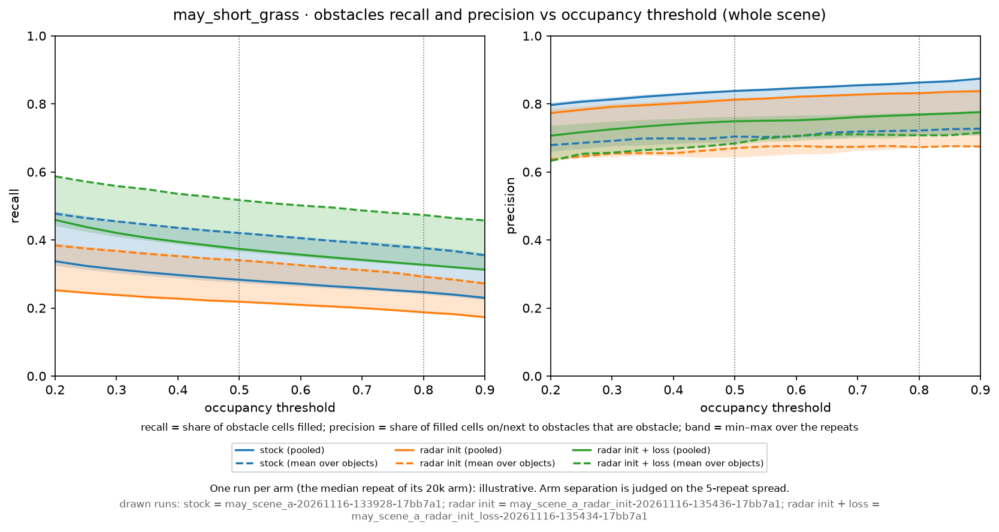

# Radar arms across sessions: june_tall_grass vs may_short_grass

Descriptive only: repeats share one seed and are not paired. Gap = radar variant - baseline (gain positive for higher-is-better metrics). `sep` = the two arms' [min, max] do not overlap; `n/a` = an arm has fewer than 2 repeats (no spread). Δ = gap in may_short_grass - gap in june_tall_grass. P1cuboid = scripts/13 ungated cuboid detection rate (T45) and point precision (T46); P1/P2 = scripts/19 voxel metrics on the rendered lidar (P1) and the Gaussians (P2); `_Hnear` = restricted to the hidden cells within the near band of the path (headline), `_H` = to all hidden cells, pooled over cells or mean over objects; P2@t = Gaussians occupied at probability >= t.

*The definitions below are rendered once, with the values of session june_tall_grass; the per-session values table and sections give the other sessions' values.*

## Definitions

Plain words first, the formula last. Every number is read from the run reports, never typed in.

1. **Cells.** The scene is cut into small cubes ("cells") of edge 0.521933 m. Everything below is about cells.
2. **Ground truth, "on an obstacle" and "next to an obstacle".** People drew a box around every tree trunk, rock and bush ("obstacles"). The boxes are used only for scoring, never for training.
   - **On an obstacle (G):** a cell whose **centre** lies inside an obstacle box.
   - **The scored area around a class (N_c):** for each class (trunk, rock, bush) separately:
     1. **Margin:** m_c = half of the class's typical footprint width, i.e. the median over all of the session's boxes of that class of (length + width) / 4. Values for session june_tall_grass: trunk 0.522 m, rock 0.665 m, bush 0.953 m.
     2. **Grow:** widen every box of the class by m_c on each of its four sides, along the box's own axes, leaving its height unchanged. A typical object's grown box is therefore about twice its own width.
     3. **Collect:** N_c = the cells whose centre lies inside a grown box.
   - **Only space the lidar could have covered is scored:** a box counts only when its centre is within the lidar's range (200.985 m) and vertical field of view (±44.8°) of at least one recorded sweep. The same range and field-of-view test is applied to every cell of N_c.
   - **Obstacles as one group:** N = N_trunk ∪ N_rock ∪ N_bush, minus any cell whose centre lies in a box of a different, non-obstacle annotated class. Those cells count neither for nor against.
   - **Next to an obstacle:** N ∖ G, the cells in the grown area that are not inside any obstacle box.
   - **Scored:** only cells in N; everything else in the scene is ignored.
   - **Caveat:** the boxes are rectangular and a cell counts by its centre only. So for a trunk thinner than one cell (0.521933 m), whether the trunk gets 0, 1 or 2 cells across depends on where the grid lines fall.
3. **What the model contains.** A trained SplatAD model is millions of small fuzzy blobs (3D Gaussians). Each blob has an opacity from 0 (see-through) to 1 (solid).
4. **Occupancy of a cell** is how solid the model says the cell is, from 0 (empty) to 1 (solid).
   - Each blob adds its opacity to the cell its centre lies in, and a fading share to nearby cells.
   - Blobs combine like stacked tinted glass: light passes through a blob of opacity α with probability (1 − α). So occupancy = 1 − ∏_k(1 − α_k), which grows with every blob but never passes 1.
   - **Why opacities are combined this way (the source of the definition).** The rule is not new. It reads, at a cell, the same accumulation SplatAD uses to render a lidar ray. The design choice is recorded in PLAN §5 (P2) and `docs/research/evaluation_caveats.md`, "Blocking probability". Quotes are verbatim from the sources below.
     1. **How SplatAD blends Gaussians along a ray.** SplatAD (Hess et al., *SplatAD: Real-Time Lidar and Camera Rendering with 3D Gaussian Splatting for Autonomous Driving*, arXiv:2411.16816, https://arxiv.org/abs/2411.16816, Eqs. 4-5 (section 3.2), median-range rule (section 3.3); passages checked 2026-11-25) models the scene as "translucent 3D Gaussians with learnable occupancy o∈(0,1)" (§3.1).
        - **Eq. 4 (§3.2):** [F_p^rgb, F_p] = Σ_i [f_i^rgb, f_i] α_i ∏_{j=1}^{i−1}(1 − α_j). Each Gaussian's own opacity α_i is multiplied by ∏_{j<i}(1 − α_j), the light still left in front of it (the transmittance).
        - **Eq. 5 (§3.2):** α_i = sqrt(|Σ_i^I| / |Σ_i^I + s·I|) · o_i · exp(−½ Δ_iᵀ (Σ_i^I + s·I)⁻¹ Δ_i). The Gaussian's α_i is its learned opacity o_i times its falloff at the ray, projected onto the sensor plane.
        - **§3.3:** "For each lidar point, we α-blend the Gaussians' features 𝐟_i using Eqs. 4, 5 and 6." So the lidar uses exactly these weights.
     2. **SplatAD's own 0.5 rule, which is our definition.** SplatAD places a rendered lidar point at the median range, "the rolling shutter corrected range of the first Gaussian that satisfies ∏_{j=1}^{i}(1−α_j) < 0.5 during the α-blending in Eq. 4" (§3.3). It is used at inference: "While we use the expected range for training, the median range is used during inference as it, in contrast to the expected range, does not yield depths between Gaussians." (§3.3). In words: SplatAD says a ray has hit something once **1 − ∏(1 − α) passes 0.5**. Our occupancy is that same quantity. Our binding cut-off is that same 0.5. So "the cell is filled" means "SplatAD's own renderer would consider a ray through these Gaussians stopped".
     3. **The lineage.** 3D Gaussian Splatting (Kerbl et al., *3D Gaussian Splatting for Real-Time Radiance Field Rendering*, arXiv:2308.04079, https://arxiv.org/abs/2308.04079, section 2.3, Eqs. 1-3 (ACM TOG 42(4), 2023); passages checked 2026-11-25) gives the same blending, Eq. 3: C = Σ_{i∈N} c_i α_i ∏_{j=1}^{i−1}(1 − α_j). It states: "Point-based α-blending and NeRF-style volumetric rendering share essentially the same image formation model." (§2.3). So ∏(1 − α_j) is the transmittance T_i of volume rendering (its Eqs. 1–2).
     4. **Why 1 − ∏(1 − α), as one number per cell.** The blending weights along a ray always add up to Σ_i α_i ∏_{j<i}(1 − α_j) = 1 − ∏_i(1 − α_i). Proof by telescoping: with T_k = ∏_{i≤k}(1 − α_i) and T_0 = 1, each weight equals T_{k−1} − T_k, so the sum is T_0 − T_n = 1 − T_n. A unit test checks this identity. The product does not depend on the order of the Gaussians, so no particular ray direction is needed. The result is the total opacity a ray collects from these Gaussians, between 0 and 1.
   - **How ours differs from SplatAD's α (stated here, not hidden):**
     - SplatAD evaluates each Gaussian **projected** onto the image or lidar plane, with a small blur term s·I that matches the pixel size or beam divergence (Eq. 5). We evaluate the **3D** Gaussian at a point: α_k(x) = σ(o_k) · exp(−½ (x − μ_k)ᵀ Σ_k⁻¹ (x − μ_k)), at the cell centre, or at its own peak for the cell holding its mean (T81).
     - We combine every Gaussian touching the cell, rather than those along one beam.
     - So occupancy is a blocking probability at one point of the cell, in the spirit of SplatAD's accumulation. It is not the fraction of the cell that is filled. Like the renderer, it assumes each Gaussian blocks light independently.
   - **General reference, not the source of our rule.** Using 3D Gaussians to predict 3D occupancy has been done before (Huang et al., *GaussianFormer: Scene as Gaussians for Vision-Based 3D Semantic Occupancy Prediction*, arXiv:2405.17429, https://arxiv.org/abs/2405.17429, section 3.3, Gaussian-to-Voxel Splatting (general reference only); passages checked 2026-11-25). It adds up the Gaussians' contributions at voxel positions. Ours combines opacities with the renderer's rule above instead, so that the result stays in [0, 1] and matches SplatAD's stop rule.
   - It is read from the blobs directly, not from a rendered image, so something hidden behind grass still counts.
5. **Filled, recall and precision.** Pick a cut-off t; a cell with occupancy ≥ t counts as *filled*. Let O_t be the set of filled cells.
   - **(a) What is scored and what is not.** Only the cells in N are scored: the cells **on** an obstacle (G) and the cells **next to** an obstacle (N ∖ G, the ring, 11751 cells). "Not ground truth" here means only that ring, not the whole scene. Every other cell is ignored, even if the model fills it, so the ring is what makes false alarms countable: a filled cell far from every obstacle is never counted. Cells on another labelled class are excluded from both metrics.
   - **(b) The 2 × 2 table.** Each scored cell is either filled or empty, and either on an obstacle or next to one:

     | | on an obstacle (G) | next to an obstacle (N ∖ G) |
     |---|---|---|
     | **model filled** | hit | false alarm |
     | **model left empty** | missed | correct empty |

     "Correct empty" enters neither metric.
   - **(c) Recall** = hit / (hit + missed) = |O_t ∩ G| / |G|. *Did it rebuild the obstacles?* The denominator is every obstacle cell (12687); it depends only on the ground truth. So recall cannot be gamed by leaving things out, but it ignores false alarms.
   - **(d) Precision** = hit / (hit + false alarm) = |O_t ∩ G| / |O_t ∩ N|. *When it fills something, is it real?* The denominator is every filled scored cell; it depends on the model. Filling everything near obstacles raises recall and lowers precision. This is why both are read together, and why the reading rule asks for higher recall *without lower precision*.
   - **IoU** (intersection over union) = hit / (hit + missed + false alarm) = |O_t ∩ G| / |(O_t ∪ G) ∩ N|. In words: the overlap between what the model filled and the obstacles, divided by everything either of them covers in the scored area. It puts both kinds of error in one number: a miss and a false alarm each lower it. Correct-empty cells do not enter it. It is always ≤ min(recall, precision). It is a summary only: the reading rule uses recall and precision.
   - **(e) Worked example.** The stock arm's drawn run in june_tall_grass at t = 0.5, with its real counts: 4457 hits, 8230 missed, 1238 false alarms → recall 0.351, precision 0.783, IoU 0.320. These are one run; the tables give mean ± std over the repeats.
   - **(f) Pooled vs mean over objects.** *Pooled* counts all cells together, so big objects weigh most. *Mean over objects* scores each object k alone, with its own cells G_k and its own ring N_k, and then averages, so every object weighs the same. An occupied cell inside several rings counts against each of them.
   - **(g) Why precision stays below 1.** "Next to an obstacle" is not "empty space". The ring also holds things nobody labelled: grass (tall in June), ground and small plants, which really are solid. It also catches the edges of a trunk's own Gaussians, because a trunk is thinner than one cell. So precision stays below 1 even for a correct model. This is a likely cause, not a tested finding.
   - **(h) How the threshold changes both.** Raising t moves cells from filled to empty, so recall can only fall; precision usually rises.
6. **Hidden cells (reference for the later round).** We replay every recorded lidar beam.
   - A cell is *hidden* if no beam reached it, none passed through it, and at least one was stopped before it (by grass, for example).
   - *H_near* keeps the hidden cells within 20 m of the driven path.
   - Hidden-cell metrics are the formulas of point 5, restricted to H_near. The figures will take the same form as the whole-scene ones.
   - Stock SplatAD is expected to leave hidden cells mostly empty, since no lidar or camera signal reached them. That gap is what radar is meant to close.
7. **Statistics.** Each arm is trained 5 times. A table cell shows mean ± std over the repeats. Gap = difference of means. "sep" means the two arms' [min, max] ranges do not overlap. A gap is read only when it is larger than the spread within the arms.

## Whole scene: june_tall_grass

### obstacles, P2 occupied at >= 0.5

| metric | stock (`june_scene_a_cam`) | radar init (`june_scene_a_radar_init_cam`) | radar init + loss (`june_scene_a_radar_init_loss_cam`) |
|---|---|---|---|
| recall | 0.342 ± 0.006 [0.336, 0.351] (n=5) | 0.312 ± 0.002 [0.310, 0.314] (n=5) | 0.380 ± 0.003 [0.376, 0.383] (n=5) |
| precision | 0.789 ± 0.005 [0.783, 0.796] (n=5) | 0.784 ± 0.004 [0.778, 0.788] (n=5) | 0.796 ± 0.004 [0.790, 0.801] (n=5) |
| IoU | 0.313 ± 0.005 [0.309, 0.320] (n=5) | 0.287 ± 0.002 [0.285, 0.290] (n=5) | 0.346 ± 0.003 [0.342, 0.349] (n=5) |

### obstacles, P2 occupied at >= 0.8

| metric | stock (`june_scene_a_cam`) | radar init (`june_scene_a_radar_init_cam`) | radar init + loss (`june_scene_a_radar_init_loss_cam`) |
|---|---|---|---|
| recall | 0.304 ± 0.002 [0.302, 0.307] (n=5) | 0.276 ± 0.002 [0.274, 0.279] (n=5) | 0.338 ± 0.002 [0.335, 0.341] (n=5) |
| precision | 0.813 ± 0.005 [0.806, 0.821] (n=5) | 0.803 ± 0.005 [0.798, 0.807] (n=5) | 0.823 ± 0.003 [0.820, 0.826] (n=5) |
| IoU | 0.284 ± 0.002 [0.282, 0.286] (n=5) | 0.259 ± 0.002 [0.256, 0.261] (n=5) | 0.315 ± 0.002 [0.312, 0.318] (n=5) |

### tree_trunk, P2 occupied at >= 0.5

| metric | stock (`june_scene_a_cam`) | radar init (`june_scene_a_radar_init_cam`) | radar init + loss (`june_scene_a_radar_init_loss_cam`) |
|---|---|---|---|
| recall | 0.435 ± 0.004 [0.431, 0.440] (n=5) | 0.417 ± 0.002 [0.415, 0.419] (n=5) | 0.467 ± 0.004 [0.461, 0.471] (n=5) |
| precision | 0.828 ± 0.003 [0.825, 0.833] (n=5) | 0.823 ± 0.004 [0.817, 0.828] (n=5) | 0.834 ± 0.004 [0.829, 0.839] (n=5) |
| IoU | 0.399 ± 0.003 [0.397, 0.403] (n=5) | 0.382 ± 0.002 [0.380, 0.384] (n=5) | 0.427 ± 0.004 [0.421, 0.430] (n=5) |

### tree_trunk, P2 occupied at >= 0.8

| metric | stock (`june_scene_a_cam`) | radar init (`june_scene_a_radar_init_cam`) | radar init + loss (`june_scene_a_radar_init_loss_cam`) |
|---|---|---|---|
| recall | 0.397 ± 0.003 [0.394, 0.401] (n=5) | 0.376 ± 0.002 [0.373, 0.379] (n=5) | 0.429 ± 0.002 [0.426, 0.431] (n=5) |
| precision | 0.845 ± 0.003 [0.843, 0.850] (n=5) | 0.838 ± 0.004 [0.832, 0.842] (n=5) | 0.847 ± 0.002 [0.845, 0.851] (n=5) |
| IoU | 0.370 ± 0.002 [0.367, 0.374] (n=5) | 0.350 ± 0.003 [0.347, 0.353] (n=5) | 0.398 ± 0.002 [0.395, 0.401] (n=5) |

### rock, P2 occupied at >= 0.5

| metric | stock (`june_scene_a_cam`) | radar init (`june_scene_a_radar_init_cam`) | radar init + loss (`june_scene_a_radar_init_loss_cam`) |
|---|---|---|---|
| recall | 0.198 ± 0.015 [0.176, 0.212] (n=5) | 0.167 ± 0.017 [0.141, 0.188] (n=5) | 0.266 ± 0.006 [0.259, 0.271] (n=5) |
| precision | 0.210 ± 0.024 [0.179, 0.234] (n=5) | 0.209 ± 0.017 [0.185, 0.232] (n=5) | 0.219 ± 0.005 [0.214, 0.228] (n=5) |
| IoU | 0.113 ± 0.012 [0.097, 0.125] (n=5) | 0.102 ± 0.011 [0.087, 0.116] (n=5) | 0.136 ± 0.003 [0.133, 0.141] (n=5) |

### rock, P2 occupied at >= 0.8

| metric | stock (`june_scene_a_cam`) | radar init (`june_scene_a_radar_init_cam`) | radar init + loss (`june_scene_a_radar_init_loss_cam`) |
|---|---|---|---|
| recall | 0.186 ± 0.013 [0.176, 0.200] (n=5) | 0.153 ± 0.019 [0.129, 0.176] (n=5) | 0.240 ± 0.011 [0.224, 0.247] (n=5) |
| precision | 0.224 ± 0.017 [0.203, 0.239] (n=5) | 0.227 ± 0.023 [0.200, 0.263] (n=5) | 0.216 ± 0.006 [0.207, 0.221] (n=5) |
| IoU | 0.113 ± 0.009 [0.104, 0.122] (n=5) | 0.101 ± 0.012 [0.085, 0.118] (n=5) | 0.128 ± 0.005 [0.120, 0.132] (n=5) |

### bush_or_small_tree, P2 occupied at >= 0.5

| metric | stock (`june_scene_a_cam`) | radar init (`june_scene_a_radar_init_cam`) | radar init + loss (`june_scene_a_radar_init_loss_cam`) |
|---|---|---|---|
| recall | 0.144 ± 0.020 [0.132, 0.180] (n=5) | 0.090 ± 0.007 [0.084, 0.099] (n=5) | 0.196 ± 0.008 [0.187, 0.207] (n=5) |
| precision | 0.640 ± 0.015 [0.624, 0.657] (n=5) | 0.575 ± 0.020 [0.550, 0.596] (n=5) | 0.688 ± 0.022 [0.661, 0.719] (n=5) |
| IoU | 0.133 ± 0.017 [0.122, 0.163] (n=5) | 0.084 ± 0.006 [0.078, 0.092] (n=5) | 0.180 ± 0.008 [0.170, 0.192] (n=5) |

### bush_or_small_tree, P2 occupied at >= 0.8

| metric | stock (`june_scene_a_cam`) | radar init (`june_scene_a_radar_init_cam`) | radar init + loss (`june_scene_a_radar_init_loss_cam`) |
|---|---|---|---|
| recall | 0.106 ± 0.008 [0.101, 0.121] (n=5) | 0.065 ± 0.003 [0.062, 0.071] (n=5) | 0.145 ± 0.005 [0.140, 0.152] (n=5) |
| precision | 0.671 ± 0.016 [0.652, 0.694] (n=5) | 0.579 ± 0.011 [0.567, 0.597] (n=5) | 0.760 ± 0.015 [0.740, 0.782] (n=5) |
| IoU | 0.101 ± 0.007 [0.096, 0.113] (n=5) | 0.062 ± 0.003 [0.060, 0.067] (n=5) | 0.139 ± 0.005 [0.134, 0.146] (n=5) |

### Gap radar init (`june_scene_a_radar_init_cam`) - stock (`june_scene_a_cam`) (sep = the arms' [min, max] do not overlap, ovl = they overlap)

| metric | gap | sep / ovl |
|---|---|---|
| obstacles/P2@0.5/recall/pooled | -0.030 | sep |
| obstacles/P2@0.5/precision/pooled | -0.005 | ovl |
| obstacles/P2@0.5/iou/pooled | -0.026 | sep |
| obstacles/P2@0.8/recall/pooled | -0.028 | sep |
| obstacles/P2@0.8/precision/pooled | -0.010 | ovl |
| obstacles/P2@0.8/iou/pooled | -0.025 | sep |
| tree_trunk/P2@0.5/recall/pooled | -0.019 | sep |
| tree_trunk/P2@0.5/precision/pooled | -0.006 | ovl |
| tree_trunk/P2@0.5/iou/pooled | -0.017 | sep |
| tree_trunk/P2@0.8/recall/pooled | -0.022 | sep |
| tree_trunk/P2@0.8/precision/pooled | -0.008 | sep |
| tree_trunk/P2@0.8/iou/pooled | -0.020 | sep |
| rock/P2@0.5/recall/pooled | -0.031 | ovl |
| rock/P2@0.5/precision/pooled | -0.001 | ovl |
| rock/P2@0.5/iou/pooled | -0.011 | ovl |
| rock/P2@0.8/recall/pooled | -0.033 | ovl |
| rock/P2@0.8/precision/pooled | 0.003 | ovl |
| rock/P2@0.8/iou/pooled | -0.012 | ovl |
| bush_or_small_tree/P2@0.5/recall/pooled | -0.054 | sep |
| bush_or_small_tree/P2@0.5/precision/pooled | -0.064 | sep |
| bush_or_small_tree/P2@0.5/iou/pooled | -0.048 | sep |
| bush_or_small_tree/P2@0.8/recall/pooled | -0.041 | sep |
| bush_or_small_tree/P2@0.8/precision/pooled | -0.092 | sep |
| bush_or_small_tree/P2@0.8/iou/pooled | -0.039 | sep |

### Gap radar init + loss (`june_scene_a_radar_init_loss_cam`) - stock (`june_scene_a_cam`) (sep = the arms' [min, max] do not overlap, ovl = they overlap)

| metric | gap | sep / ovl |
|---|---|---|
| obstacles/P2@0.5/recall/pooled | 0.038 | sep |
| obstacles/P2@0.5/precision/pooled | 0.007 | ovl |
| obstacles/P2@0.5/iou/pooled | 0.033 | sep |
| obstacles/P2@0.8/recall/pooled | 0.034 | sep |
| obstacles/P2@0.8/precision/pooled | 0.010 | ovl |
| obstacles/P2@0.8/iou/pooled | 0.031 | sep |
| tree_trunk/P2@0.5/recall/pooled | 0.031 | sep |
| tree_trunk/P2@0.5/precision/pooled | 0.005 | ovl |
| tree_trunk/P2@0.5/iou/pooled | 0.028 | sep |
| tree_trunk/P2@0.8/recall/pooled | 0.032 | sep |
| tree_trunk/P2@0.8/precision/pooled | 0.002 | ovl |
| tree_trunk/P2@0.8/iou/pooled | 0.028 | sep |
| rock/P2@0.5/recall/pooled | 0.068 | sep |
| rock/P2@0.5/precision/pooled | 0.009 | ovl |
| rock/P2@0.5/iou/pooled | 0.023 | sep |
| rock/P2@0.8/recall/pooled | 0.054 | sep |
| rock/P2@0.8/precision/pooled | -0.008 | ovl |
| rock/P2@0.8/iou/pooled | 0.015 | ovl |
| bush_or_small_tree/P2@0.5/recall/pooled | 0.052 | sep |
| bush_or_small_tree/P2@0.5/precision/pooled | 0.048 | sep |
| bush_or_small_tree/P2@0.5/iou/pooled | 0.047 | sep |
| bush_or_small_tree/P2@0.8/recall/pooled | 0.039 | sep |
| bush_or_small_tree/P2@0.8/precision/pooled | 0.088 | sep |
| bush_or_small_tree/P2@0.8/iou/pooled | 0.038 | sep |

### Gap radar init + loss (`june_scene_a_radar_init_loss_cam`) - radar init (`june_scene_a_radar_init_cam`) (sep = the arms' [min, max] do not overlap, ovl = they overlap)

| metric | gap | sep / ovl |
|---|---|---|
| obstacles/P2@0.5/recall/pooled | 0.068 | sep |
| obstacles/P2@0.5/precision/pooled | 0.012 | sep |
| obstacles/P2@0.5/iou/pooled | 0.059 | sep |
| obstacles/P2@0.8/recall/pooled | 0.062 | sep |
| obstacles/P2@0.8/precision/pooled | 0.020 | sep |
| obstacles/P2@0.8/iou/pooled | 0.057 | sep |
| tree_trunk/P2@0.5/recall/pooled | 0.050 | sep |
| tree_trunk/P2@0.5/precision/pooled | 0.011 | sep |
| tree_trunk/P2@0.5/iou/pooled | 0.045 | sep |
| tree_trunk/P2@0.8/recall/pooled | 0.053 | sep |
| tree_trunk/P2@0.8/precision/pooled | 0.010 | sep |
| tree_trunk/P2@0.8/iou/pooled | 0.048 | sep |
| rock/P2@0.5/recall/pooled | 0.099 | sep |
| rock/P2@0.5/precision/pooled | 0.010 | ovl |
| rock/P2@0.5/iou/pooled | 0.034 | sep |
| rock/P2@0.8/recall/pooled | 0.087 | sep |
| rock/P2@0.8/precision/pooled | -0.011 | ovl |
| rock/P2@0.8/iou/pooled | 0.028 | sep |
| bush_or_small_tree/P2@0.5/recall/pooled | 0.106 | sep |
| bush_or_small_tree/P2@0.5/precision/pooled | 0.113 | sep |
| bush_or_small_tree/P2@0.5/iou/pooled | 0.095 | sep |
| bush_or_small_tree/P2@0.8/recall/pooled | 0.080 | sep |
| bush_or_small_tree/P2@0.8/precision/pooled | 0.181 | sep |
| bush_or_small_tree/P2@0.8/iou/pooled | 0.077 | sep |

**How to read this figure**
- **GT panel:** the obstacle boxes, coloured by class, for orientation.
- **Arm panels:** green = hit (filled, on an obstacle); red = false alarm (filled, next to an obstacle); grey = missed (empty, on an obstacle); faint grey = the scored area, the ring included. Correct-empty cells are not drawn. Cut-off t = 0.5. The terms are defined in point 5.
- **Difference panel:** hits only radar init + loss has, hits only stock has, and hits both have.
- One run per arm (the median repeat), so it illustrates and does not decide anything.

**How to read this figure**
- **What is plotted:** recall (left) and precision (right) recomputed at each cut-off t from 0.2 to 0.9 (15 evenly spaced values). Solid lines are pooled and dashed lines are the mean over objects. The line is the median repeat. The band spans, at each t, the lowest and highest value of both the pooled and the mean-over-objects curve over the 5 repeats of the arm; it is therefore wider than either line's own spread, so "bands do not overlap" is a conservative reading. Dotted lines mark the table cut-offs 0.5, 0.8.
- **Definitions:** see point 5. Only recall and precision are plotted; IoU is in the tables. Recall = hit / (hit + missed) has all 12687 obstacle cells as its denominator; precision = hit / (hit + false alarm) has every filled scored cell as its denominator.
- **How the curves move:** raising t fills fewer cells, so recall can only fall and precision usually rises.
- **When one arm beats another:** its curve is higher and the bands do not overlap.
- **Why t runs from 0.2 to 0.9:** the extremes are left out because they say nothing about the model. At t = 0 every cell counts as filled (recall 1, precision = the share of obstacle cells). At t ≈ 1 precision rests on a handful of cells and jumps.

## Whole scene: may_short_grass

### obstacles, P2 occupied at >= 0.5

| metric | stock (`may_scene_a`) | radar init (`may_scene_a_radar_init`) | radar init + loss (`may_scene_a_radar_init_loss`) |
|---|---|---|---|
| recall | 0.278 ± 0.003 [0.275, 0.283] (n=5) | 0.221 ± 0.003 [0.218, 0.225] (n=5) | 0.370 ± 0.003 [0.366, 0.374] (n=5) |
| precision | 0.838 ± 0.004 [0.834, 0.843] (n=5) | 0.810 ± 0.005 [0.805, 0.817] (n=5) | 0.758 ± 0.006 [0.749, 0.762] (n=5) |
| IoU | 0.264 ± 0.003 [0.261, 0.268] (n=5) | 0.210 ± 0.003 [0.208, 0.215] (n=5) | 0.331 ± 0.002 [0.328, 0.333] (n=5) |

### obstacles, P2 occupied at >= 0.8

| metric | stock (`may_scene_a`) | radar init (`may_scene_a_radar_init`) | radar init + loss (`may_scene_a_radar_init_loss`) |
|---|---|---|---|
| recall | 0.244 ± 0.002 [0.241, 0.247] (n=5) | 0.190 ± 0.002 [0.187, 0.193] (n=5) | 0.326 ± 0.001 [0.324, 0.327] (n=5) |
| precision | 0.863 ± 0.003 [0.859, 0.866] (n=5) | 0.831 ± 0.002 [0.827, 0.834] (n=5) | 0.772 ± 0.003 [0.768, 0.774] (n=5) |
| IoU | 0.234 ± 0.002 [0.232, 0.237] (n=5) | 0.183 ± 0.002 [0.180, 0.186] (n=5) | 0.297 ± 0.001 [0.296, 0.298] (n=5) |

### tree_trunk, P2 occupied at >= 0.5

| metric | stock (`may_scene_a`) | radar init (`may_scene_a_radar_init`) | radar init + loss (`may_scene_a_radar_init_loss`) |
|---|---|---|---|
| recall | 0.375 ± 0.002 [0.372, 0.376] (n=5) | 0.302 ± 0.001 [0.300, 0.303] (n=5) | 0.433 ± 0.004 [0.426, 0.438] (n=5) |
| precision | 0.849 ± 0.005 [0.845, 0.856] (n=5) | 0.828 ± 0.002 [0.826, 0.830] (n=5) | 0.811 ± 0.009 [0.795, 0.817] (n=5) |
| IoU | 0.351 ± 0.001 [0.349, 0.352] (n=5) | 0.284 ± 0.001 [0.283, 0.286] (n=5) | 0.393 ± 0.004 [0.389, 0.398] (n=5) |

### tree_trunk, P2 occupied at >= 0.8

| metric | stock (`may_scene_a`) | radar init (`may_scene_a_radar_init`) | radar init + loss (`may_scene_a_radar_init_loss`) |
|---|---|---|---|
| recall | 0.331 ± 0.001 [0.329, 0.332] (n=5) | 0.263 ± 0.003 [0.258, 0.266] (n=5) | 0.379 ± 0.002 [0.377, 0.383] (n=5) |
| precision | 0.872 ± 0.005 [0.868, 0.878] (n=5) | 0.848 ± 0.003 [0.846, 0.852] (n=5) | 0.825 ± 0.003 [0.821, 0.828] (n=5) |
| IoU | 0.316 ± 0.001 [0.314, 0.317] (n=5) | 0.251 ± 0.003 [0.247, 0.253] (n=5) | 0.351 ± 0.002 [0.349, 0.354] (n=5) |

### rock, P2 occupied at >= 0.5

| metric | stock (`may_scene_a`) | radar init (`may_scene_a_radar_init`) | radar init + loss (`may_scene_a_radar_init_loss`) |
|---|---|---|---|
| recall | 0.253 ± 0.018 [0.230, 0.281] (n=5) | 0.206 ± 0.021 [0.180, 0.225] (n=5) | 0.284 ± 0.010 [0.270, 0.298] (n=5) |
| precision | 0.456 ± 0.011 [0.441, 0.472] (n=5) | 0.406 ± 0.034 [0.367, 0.455] (n=5) | 0.429 ± 0.020 [0.395, 0.445] (n=5) |
| IoU | 0.194 ± 0.012 [0.180, 0.214] (n=5) | 0.158 ± 0.017 [0.140, 0.177] (n=5) | 0.206 ± 0.008 [0.198, 0.217] (n=5) |

### rock, P2 occupied at >= 0.8

| metric | stock (`may_scene_a`) | radar init (`may_scene_a_radar_init`) | radar init + loss (`may_scene_a_radar_init_loss`) |
|---|---|---|---|
| recall | 0.228 ± 0.015 [0.202, 0.236] (n=5) | 0.165 ± 0.011 [0.157, 0.180] (n=5) | 0.267 ± 0.010 [0.258, 0.281] (n=5) |
| precision | 0.478 ± 0.022 [0.444, 0.500] (n=5) | 0.408 ± 0.025 [0.373, 0.438] (n=5) | 0.458 ± 0.011 [0.447, 0.475] (n=5) |
| IoU | 0.183 ± 0.012 [0.161, 0.191] (n=5) | 0.133 ± 0.010 [0.124, 0.146] (n=5) | 0.203 ± 0.007 [0.196, 0.212] (n=5) |

### bush_or_small_tree, P2 occupied at >= 0.5

| metric | stock (`may_scene_a`) | radar init (`may_scene_a_radar_init`) | radar init + loss (`may_scene_a_radar_init_loss`) |
|---|---|---|---|
| recall | 0.127 ± 0.007 [0.122, 0.138] (n=5) | 0.093 ± 0.006 [0.088, 0.104] (n=5) | 0.274 ± 0.005 [0.269, 0.280] (n=5) |
| precision | 0.819 ± 0.012 [0.807, 0.835] (n=5) | 0.763 ± 0.020 [0.739, 0.791] (n=5) | 0.663 ± 0.007 [0.655, 0.672] (n=5) |
| IoU | 0.124 ± 0.007 [0.119, 0.134] (n=5) | 0.091 ± 0.006 [0.086, 0.101] (n=5) | 0.241 ± 0.004 [0.236, 0.246] (n=5) |

### bush_or_small_tree, P2 occupied at >= 0.8

| metric | stock (`may_scene_a`) | radar init (`may_scene_a_radar_init`) | radar init + loss (`may_scene_a_radar_init_loss`) |
|---|---|---|---|
| recall | 0.106 ± 0.005 [0.102, 0.113] (n=5) | 0.076 ± 0.003 [0.073, 0.081] (n=5) | 0.244 ± 0.003 [0.241, 0.247] (n=5) |
| precision | 0.853 ± 0.011 [0.839, 0.864] (n=5) | 0.779 ± 0.020 [0.758, 0.803] (n=5) | 0.677 ± 0.004 [0.673, 0.684] (n=5) |
| IoU | 0.104 ± 0.005 [0.100, 0.111] (n=5) | 0.075 ± 0.003 [0.071, 0.079] (n=5) | 0.218 ± 0.002 [0.216, 0.222] (n=5) |

### Gap radar init (`may_scene_a_radar_init`) - stock (`may_scene_a`) (sep = the arms' [min, max] do not overlap, ovl = they overlap)

| metric | gap | sep / ovl |
|---|---|---|
| obstacles/P2@0.5/recall/pooled | -0.058 | sep |
| obstacles/P2@0.5/precision/pooled | -0.027 | sep |
| obstacles/P2@0.5/iou/pooled | -0.054 | sep |
| obstacles/P2@0.8/recall/pooled | -0.053 | sep |
| obstacles/P2@0.8/precision/pooled | -0.032 | sep |
| obstacles/P2@0.8/iou/pooled | -0.051 | sep |
| tree_trunk/P2@0.5/recall/pooled | -0.073 | sep |
| tree_trunk/P2@0.5/precision/pooled | -0.021 | sep |
| tree_trunk/P2@0.5/iou/pooled | -0.067 | sep |
| tree_trunk/P2@0.8/recall/pooled | -0.068 | sep |
| tree_trunk/P2@0.8/precision/pooled | -0.024 | sep |
| tree_trunk/P2@0.8/iou/pooled | -0.064 | sep |
| rock/P2@0.5/recall/pooled | -0.047 | sep |
| rock/P2@0.5/precision/pooled | -0.050 | ovl |
| rock/P2@0.5/iou/pooled | -0.036 | sep |
| rock/P2@0.8/recall/pooled | -0.063 | sep |
| rock/P2@0.8/precision/pooled | -0.070 | sep |
| rock/P2@0.8/iou/pooled | -0.049 | sep |
| bush_or_small_tree/P2@0.5/recall/pooled | -0.034 | sep |
| bush_or_small_tree/P2@0.5/precision/pooled | -0.056 | sep |
| bush_or_small_tree/P2@0.5/iou/pooled | -0.033 | sep |
| bush_or_small_tree/P2@0.8/recall/pooled | -0.030 | sep |
| bush_or_small_tree/P2@0.8/precision/pooled | -0.074 | sep |
| bush_or_small_tree/P2@0.8/iou/pooled | -0.030 | sep |

### Gap radar init + loss (`may_scene_a_radar_init_loss`) - stock (`may_scene_a`) (sep = the arms' [min, max] do not overlap, ovl = they overlap)

| metric | gap | sep / ovl |
|---|---|---|
| obstacles/P2@0.5/recall/pooled | 0.092 | sep |
| obstacles/P2@0.5/precision/pooled | -0.079 | sep |
| obstacles/P2@0.5/iou/pooled | 0.067 | sep |
| obstacles/P2@0.8/recall/pooled | 0.082 | sep |
| obstacles/P2@0.8/precision/pooled | -0.091 | sep |
| obstacles/P2@0.8/iou/pooled | 0.063 | sep |
| tree_trunk/P2@0.5/recall/pooled | 0.058 | sep |
| tree_trunk/P2@0.5/precision/pooled | -0.038 | sep |
| tree_trunk/P2@0.5/iou/pooled | 0.042 | sep |
| tree_trunk/P2@0.8/recall/pooled | 0.048 | sep |
| tree_trunk/P2@0.8/precision/pooled | -0.047 | sep |
| tree_trunk/P2@0.8/iou/pooled | 0.035 | sep |
| rock/P2@0.5/recall/pooled | 0.031 | ovl |
| rock/P2@0.5/precision/pooled | -0.027 | ovl |
| rock/P2@0.5/iou/pooled | 0.012 | ovl |
| rock/P2@0.8/recall/pooled | 0.039 | sep |
| rock/P2@0.8/precision/pooled | -0.021 | ovl |
| rock/P2@0.8/iou/pooled | 0.020 | sep |
| bush_or_small_tree/P2@0.5/recall/pooled | 0.147 | sep |
| bush_or_small_tree/P2@0.5/precision/pooled | -0.156 | sep |
| bush_or_small_tree/P2@0.5/iou/pooled | 0.117 | sep |
| bush_or_small_tree/P2@0.8/recall/pooled | 0.138 | sep |
| bush_or_small_tree/P2@0.8/precision/pooled | -0.176 | sep |
| bush_or_small_tree/P2@0.8/iou/pooled | 0.114 | sep |

### Gap radar init + loss (`may_scene_a_radar_init_loss`) - radar init (`may_scene_a_radar_init`) (sep = the arms' [min, max] do not overlap, ovl = they overlap)

| metric | gap | sep / ovl |
|---|---|---|
| obstacles/P2@0.5/recall/pooled | 0.150 | sep |
| obstacles/P2@0.5/precision/pooled | -0.052 | sep |
| obstacles/P2@0.5/iou/pooled | 0.121 | sep |
| obstacles/P2@0.8/recall/pooled | 0.136 | sep |
| obstacles/P2@0.8/precision/pooled | -0.058 | sep |
| obstacles/P2@0.8/iou/pooled | 0.114 | sep |
| tree_trunk/P2@0.5/recall/pooled | 0.131 | sep |
| tree_trunk/P2@0.5/precision/pooled | -0.017 | sep |
| tree_trunk/P2@0.5/iou/pooled | 0.109 | sep |
| tree_trunk/P2@0.8/recall/pooled | 0.116 | sep |
| tree_trunk/P2@0.8/precision/pooled | -0.023 | sep |
| tree_trunk/P2@0.8/iou/pooled | 0.100 | sep |
| rock/P2@0.5/recall/pooled | 0.079 | sep |
| rock/P2@0.5/precision/pooled | 0.023 | ovl |
| rock/P2@0.5/iou/pooled | 0.048 | sep |
| rock/P2@0.8/recall/pooled | 0.102 | sep |
| rock/P2@0.8/precision/pooled | 0.049 | sep |
| rock/P2@0.8/iou/pooled | 0.070 | sep |
| bush_or_small_tree/P2@0.5/recall/pooled | 0.181 | sep |
| bush_or_small_tree/P2@0.5/precision/pooled | -0.100 | sep |
| bush_or_small_tree/P2@0.5/iou/pooled | 0.150 | sep |
| bush_or_small_tree/P2@0.8/recall/pooled | 0.167 | sep |
| bush_or_small_tree/P2@0.8/precision/pooled | -0.102 | sep |
| bush_or_small_tree/P2@0.8/iou/pooled | 0.144 | sep |

**How to read this figure**
- **GT panel:** the obstacle boxes, coloured by class, for orientation.
- **Arm panels:** green = hit (filled, on an obstacle); red = false alarm (filled, next to an obstacle); grey = missed (empty, on an obstacle); faint grey = the scored area, the ring included. Correct-empty cells are not drawn. Cut-off t = 0.5. The terms are defined in point 5.
- **Difference panel:** hits only radar init + loss has, hits only stock has, and hits both have.
- One run per arm (the median repeat), so it illustrates and does not decide anything.

**How to read this figure**
- **What is plotted:** recall (left) and precision (right) recomputed at each cut-off t from 0.2 to 0.9 (15 evenly spaced values). Solid lines are pooled and dashed lines are the mean over objects. The line is the median repeat. The band spans, at each t, the lowest and highest value of both the pooled and the mean-over-objects curve over the 5 repeats of the arm; it is therefore wider than either line's own spread, so "bands do not overlap" is a conservative reading. Dotted lines mark the table cut-offs 0.5, 0.8.
- **Definitions:** see point 5. Only recall and precision are plotted; IoU is in the tables. Recall = hit / (hit + missed) has all 19600 obstacle cells as its denominator; precision = hit / (hit + false alarm) has every filled scored cell as its denominator.
- **How the curves move:** raising t fills fewer cells, so recall can only fall and precision usually rises.
- **When one arm beats another:** its curve is higher and the bands do not overlap.
- **Why t runs from 0.2 to 0.9:** the extremes are left out because they say nothing about the model. At t = 0 every cell counts as filled (recall 1, precision = the share of obstacle cells). At t ≈ 1 precision rests on a handful of cells and jumps.

## june_tall_grass: arms

- **stock** (`june_scene_a_cam`, n=5): june_tall_grass-june_scene_a_cam-20261116-134222-17bb7a1, june_tall_grass-june_scene_a_cam-20261116-135429-17bb7a1, june_tall_grass-june_scene_a_cam-20261116-135432-17bb7a1, june_tall_grass-june_scene_a_cam-20261116-135435-17bb7a1, june_tall_grass-june_scene_a_cam-20261118-032048-c28a956
- **radar init** (`june_scene_a_radar_init_cam`, n=5): june_tall_grass-june_scene_a_radar_init_cam-20261116-134824-17bb7a1, june_tall_grass-june_scene_a_radar_init_cam-20261116-135427-17bb7a1, june_tall_grass-june_scene_a_radar_init_cam-20261116-135430-17bb7a1, june_tall_grass-june_scene_a_radar_init_cam-20261116-135433-17bb7a1, june_tall_grass-june_scene_a_radar_init_cam-20261116-135436-17bb7a1
- **radar init + loss** (`june_scene_a_radar_init_loss_cam`, n=5): june_tall_grass-june_scene_a_radar_init_loss_cam-20261116-135425-17bb7a1, june_tall_grass-june_scene_a_radar_init_loss_cam-20261116-135428-17bb7a1, june_tall_grass-june_scene_a_radar_init_loss_cam-20261116-135431-17bb7a1, june_tall_grass-june_scene_a_radar_init_loss_cam-20261116-135437-17bb7a1, june_tall_grass-june_scene_a_radar_init_loss_cam-20261118-211540-c28a956

## may_short_grass: arms

- **stock** (`may_scene_a`, n=5): may_short_grass-may_scene_a-20261116-133928-17bb7a1, may_short_grass-may_scene_a-20261116-135425-17bb7a1, may_short_grass-may_scene_a-20261116-135428-17bb7a1, may_short_grass-may_scene_a-20261116-135432-17bb7a1, may_short_grass-may_scene_a-20261116-135435-17bb7a1
- **radar init** (`may_scene_a_radar_init`, n=5): may_short_grass-may_scene_a_radar_init-20261116-134527-17bb7a1, may_short_grass-may_scene_a_radar_init-20261116-135426-17bb7a1, may_short_grass-may_scene_a_radar_init-20261116-135429-17bb7a1, may_short_grass-may_scene_a_radar_init-20261116-135433-17bb7a1, may_short_grass-may_scene_a_radar_init-20261116-135436-17bb7a1
- **radar init + loss** (`may_scene_a_radar_init_loss`, n=5): may_short_grass-may_scene_a_radar_init_loss-20261116-135125-17bb7a1, may_short_grass-may_scene_a_radar_init_loss-20261116-135427-17bb7a1, may_short_grass-may_scene_a_radar_init_loss-20261116-135431-17bb7a1, may_short_grass-may_scene_a_radar_init_loss-20261116-135434-17bb7a1, may_short_grass-may_scene_a_radar_init_loss-20261116-135437-17bb7a1

## obstacles: arm values

| metric | session | stock | radar init | radar init + loss |
|---|---|---|---|---|
| P2@0.5/recall_Hnear/pooled | june_tall_grass | 0.116 ± 0.036 [0.066, 0.166] (n=5) | 0.060 ± 0.015 [0.042, 0.078] (n=5) | 0.145 ± 0.029 [0.111, 0.190] (n=5) |
| P2@0.5/recall_Hnear/pooled | may_short_grass | 0.140 ± 0.105 [0.078, 0.326] (n=5) | 0.080 ± 0.012 [0.067, 0.098] (n=5) | 0.215 ± 0.077 [0.145, 0.342] (n=5) |
| P2@0.5/recall_Hnear/mean | june_tall_grass | 0.124 ± 0.038 [0.082, 0.175] (n=5) | 0.085 ± 0.029 [0.052, 0.131] (n=5) | 0.228 ± 0.034 [0.201, 0.275] (n=5) |
| P2@0.5/recall_Hnear/mean | may_short_grass | 0.194 ± 0.059 [0.120, 0.281] (n=5) | 0.190 ± 0.049 [0.131, 0.239] (n=5) | 0.388 ± 0.038 [0.356, 0.446] (n=5) |
| P2@0.5/precision_Hnear/pooled | june_tall_grass | 0.387 ± 0.093 [0.259, 0.519] (n=5) | 0.500 ± 0.145 [0.359, 0.700] (n=5) | 0.495 ± 0.041 [0.431, 0.538] (n=5) |
| P2@0.5/precision_Hnear/pooled | may_short_grass | 0.610 ± 0.152 [0.488, 0.875] (n=5) | 0.630 ± 0.088 [0.520, 0.727] (n=5) | 0.536 ± 0.095 [0.424, 0.667] (n=5) |
| P2@0.5/precision_Hnear/mean | june_tall_grass | 0.483 ± 0.037 [0.439, 0.519] (n=5) | 0.502 ± 0.123 [0.361, 0.667] (n=5) | 0.458 ± 0.036 [0.415, 0.497] (n=5) |
| P2@0.5/precision_Hnear/mean | may_short_grass | 0.466 ± 0.041 [0.417, 0.512] (n=5) | 0.570 ± 0.084 [0.455, 0.683] (n=5) | 0.457 ± 0.038 [0.408, 0.510] (n=5) |
| P2@0.5/iou_Hnear/pooled | june_tall_grass | 0.097 ± 0.028 [0.056, 0.129] (n=5) | 0.057 ± 0.014 [0.039, 0.072] (n=5) | 0.126 ± 0.023 [0.099, 0.161] (n=5) |
| P2@0.5/iou_Hnear/pooled | may_short_grass | 0.131 ± 0.101 [0.074, 0.312] (n=5) | 0.076 ± 0.012 [0.063, 0.094] (n=5) | 0.183 ± 0.066 [0.121, 0.292] (n=5) |
| P2@0.5/iou_Hnear/mean | june_tall_grass | 0.101 ± 0.029 [0.071, 0.137] (n=5) | 0.070 ± 0.026 [0.040, 0.110] (n=5) | 0.134 ± 0.024 [0.108, 0.171] (n=5) |
| P2@0.5/iou_Hnear/mean | may_short_grass | 0.156 ± 0.042 [0.097, 0.214] (n=5) | 0.160 ± 0.033 [0.122, 0.202] (n=5) | 0.204 ± 0.030 [0.175, 0.245] (n=5) |
| P2@0.5/recall_H/pooled | june_tall_grass | 0.042 ± 0.007 [0.034, 0.050] (n=5) | 0.031 ± 0.004 [0.027, 0.036] (n=5) | 0.056 ± 0.004 [0.053, 0.061] (n=5) |
| P2@0.5/recall_H/pooled | may_short_grass | 0.019 ± 0.005 [0.013, 0.024] (n=5) | 0.006 ± 0.002 [0.004, 0.009] (n=5) | 0.097 ± 0.002 [0.095, 0.099] (n=5) |
| P2@0.5/recall_H/mean | june_tall_grass | 0.075 ± 0.014 [0.062, 0.091] (n=5) | 0.061 ± 0.011 [0.048, 0.071] (n=5) | 0.097 ± 0.012 [0.080, 0.113] (n=5) |
| P2@0.5/recall_H/mean | may_short_grass | 0.067 ± 0.005 [0.062, 0.074] (n=5) | 0.036 ± 0.009 [0.024, 0.045] (n=5) | 0.166 ± 0.009 [0.152, 0.174] (n=5) |
| P2@0.5/precision_H/pooled | june_tall_grass | 0.466 ± 0.061 [0.414, 0.570] (n=5) | 0.532 ± 0.033 [0.497, 0.588] (n=5) | 0.502 ± 0.048 [0.436, 0.552] (n=5) |
| P2@0.5/precision_H/pooled | may_short_grass | 0.561 ± 0.062 [0.474, 0.640] (n=5) | 0.580 ± 0.093 [0.453, 0.710] (n=5) | 0.590 ± 0.017 [0.562, 0.607] (n=5) |
| P2@0.5/precision_H/mean | june_tall_grass | 0.458 ± 0.035 [0.406, 0.503] (n=5) | 0.477 ± 0.028 [0.443, 0.509] (n=5) | 0.487 ± 0.033 [0.448, 0.536] (n=5) |
| P2@0.5/precision_H/mean | may_short_grass | 0.513 ± 0.035 [0.455, 0.548] (n=5) | 0.548 ± 0.077 [0.423, 0.628] (n=5) | 0.579 ± 0.031 [0.548, 0.617] (n=5) |
| P2@0.5/iou_H/pooled | june_tall_grass | 0.040 ± 0.007 [0.033, 0.047] (n=5) | 0.030 ± 0.004 [0.026, 0.035] (n=5) | 0.053 ± 0.004 [0.050, 0.058] (n=5) |
| P2@0.5/iou_H/pooled | may_short_grass | 0.019 ± 0.005 [0.013, 0.024] (n=5) | 0.006 ± 0.002 [0.004, 0.009] (n=5) | 0.091 ± 0.001 [0.089, 0.092] (n=5) |
| P2@0.5/iou_H/mean | june_tall_grass | 0.056 ± 0.008 [0.044, 0.065] (n=5) | 0.046 ± 0.006 [0.041, 0.057] (n=5) | 0.064 ± 0.009 [0.052, 0.077] (n=5) |
| P2@0.5/iou_H/mean | may_short_grass | 0.060 ± 0.004 [0.056, 0.067] (n=5) | 0.033 ± 0.008 [0.022, 0.044] (n=5) | 0.116 ± 0.008 [0.104, 0.125] (n=5) |
| P2@0.5/recall/pooled | june_tall_grass | 0.342 ± 0.006 [0.336, 0.351] (n=5) | 0.312 ± 0.002 [0.310, 0.314] (n=5) | 0.380 ± 0.003 [0.376, 0.383] (n=5) |
| P2@0.5/recall/pooled | may_short_grass | 0.278 ± 0.003 [0.275, 0.283] (n=5) | 0.221 ± 0.003 [0.218, 0.225] (n=5) | 0.370 ± 0.003 [0.366, 0.374] (n=5) |
| P2@0.5/precision/pooled | june_tall_grass | 0.789 ± 0.005 [0.783, 0.796] (n=5) | 0.784 ± 0.004 [0.778, 0.788] (n=5) | 0.796 ± 0.004 [0.790, 0.801] (n=5) |
| P2@0.5/precision/pooled | may_short_grass | 0.838 ± 0.004 [0.834, 0.843] (n=5) | 0.810 ± 0.005 [0.805, 0.817] (n=5) | 0.758 ± 0.006 [0.749, 0.762] (n=5) |
| P2@0.5/iou/pooled | june_tall_grass | 0.313 ± 0.005 [0.309, 0.320] (n=5) | 0.287 ± 0.002 [0.285, 0.290] (n=5) | 0.346 ± 0.003 [0.342, 0.349] (n=5) |
| P2@0.5/iou/pooled | may_short_grass | 0.264 ± 0.003 [0.261, 0.268] (n=5) | 0.210 ± 0.003 [0.208, 0.215] (n=5) | 0.331 ± 0.002 [0.328, 0.333] (n=5) |
| P2@0.8/recall_Hnear/pooled | june_tall_grass | 0.073 ± 0.013 [0.054, 0.090] (n=5) | 0.039 ± 0.009 [0.027, 0.051] (n=5) | 0.046 ± 0.012 [0.036, 0.066] (n=5) |
| P2@0.8/recall_Hnear/pooled | may_short_grass | 0.095 ± 0.070 [0.036, 0.218] (n=5) | 0.062 ± 0.013 [0.047, 0.078] (n=5) | 0.128 ± 0.041 [0.104, 0.202] (n=5) |
| P2@0.8/recall_Hnear/mean | june_tall_grass | 0.080 ± 0.025 [0.050, 0.106] (n=5) | 0.063 ± 0.035 [0.037, 0.118] (n=5) | 0.148 ± 0.022 [0.120, 0.182] (n=5) |
| P2@0.8/recall_Hnear/mean | may_short_grass | 0.168 ± 0.062 [0.090, 0.257] (n=5) | 0.144 ± 0.021 [0.125, 0.179] (n=5) | 0.337 ± 0.021 [0.308, 0.359] (n=5) |
| P2@0.8/precision_Hnear/pooled | june_tall_grass | 0.419 ± 0.132 [0.304, 0.612] (n=5) | 0.492 ± 0.146 [0.321, 0.700] (n=5) | 0.443 ± 0.065 [0.357, 0.519] (n=5) |
| P2@0.8/precision_Hnear/pooled | may_short_grass | 0.627 ± 0.164 [0.500, 0.913] (n=5) | 0.605 ± 0.105 [0.450, 0.684] (n=5) | 0.514 ± 0.082 [0.431, 0.650] (n=5) |
| P2@0.8/precision_Hnear/mean | june_tall_grass | 0.484 ± 0.050 [0.423, 0.547] (n=5) | 0.467 ± 0.105 [0.390, 0.640] (n=5) | 0.424 ± 0.033 [0.384, 0.470] (n=5) |
| P2@0.8/precision_Hnear/mean | may_short_grass | 0.536 ± 0.127 [0.425, 0.745] (n=5) | 0.556 ± 0.101 [0.393, 0.667] (n=5) | 0.479 ± 0.043 [0.414, 0.533] (n=5) |
| P2@0.8/iou_Hnear/pooled | june_tall_grass | 0.066 ± 0.014 [0.048, 0.085] (n=5) | 0.038 ± 0.009 [0.026, 0.049] (n=5) | 0.044 ± 0.011 [0.034, 0.062] (n=5) |
| P2@0.8/iou_Hnear/pooled | may_short_grass | 0.092 ± 0.070 [0.035, 0.213] (n=5) | 0.060 ± 0.012 [0.044, 0.075] (n=5) | 0.115 ± 0.038 [0.094, 0.182] (n=5) |
| P2@0.8/iou_Hnear/mean | june_tall_grass | 0.067 ± 0.018 [0.049, 0.089] (n=5) | 0.053 ± 0.030 [0.032, 0.098] (n=5) | 0.101 ± 0.018 [0.089, 0.132] (n=5) |
| P2@0.8/iou_Hnear/mean | may_short_grass | 0.145 ± 0.050 [0.073, 0.209] (n=5) | 0.119 ± 0.030 [0.085, 0.166] (n=5) | 0.174 ± 0.018 [0.147, 0.194] (n=5) |
| P2@0.8/recall_H/pooled | june_tall_grass | 0.027 ± 0.004 [0.023, 0.031] (n=5) | 0.023 ± 0.003 [0.019, 0.026] (n=5) | 0.024 ± 0.001 [0.022, 0.026] (n=5) |
| P2@0.8/recall_H/pooled | may_short_grass | 0.011 ± 0.004 [0.009, 0.017] (n=5) | 0.005 ± 0.002 [0.002, 0.007] (n=5) | 0.068 ± 0.001 [0.067, 0.070] (n=5) |
| P2@0.8/recall_H/mean | june_tall_grass | 0.047 ± 0.010 [0.034, 0.058] (n=5) | 0.046 ± 0.011 [0.037, 0.062] (n=5) | 0.052 ± 0.010 [0.039, 0.065] (n=5) |
| P2@0.8/recall_H/mean | may_short_grass | 0.047 ± 0.004 [0.041, 0.051] (n=5) | 0.027 ± 0.007 [0.019, 0.038] (n=5) | 0.114 ± 0.009 [0.106, 0.129] (n=5) |
| P2@0.8/precision_H/pooled | june_tall_grass | 0.473 ± 0.058 [0.428, 0.571] (n=5) | 0.550 ± 0.037 [0.512, 0.598] (n=5) | 0.510 ± 0.041 [0.449, 0.550] (n=5) |
| P2@0.8/precision_H/pooled | may_short_grass | 0.582 ± 0.083 [0.509, 0.719] (n=5) | 0.589 ± 0.087 [0.469, 0.712] (n=5) | 0.564 ± 0.007 [0.553, 0.570] (n=5) |
| P2@0.8/precision_H/mean | june_tall_grass | 0.459 ± 0.037 [0.411, 0.495] (n=5) | 0.484 ± 0.024 [0.452, 0.517] (n=5) | 0.476 ± 0.041 [0.422, 0.529] (n=5) |
| P2@0.8/precision_H/mean | may_short_grass | 0.537 ± 0.055 [0.487, 0.625] (n=5) | 0.520 ± 0.086 [0.389, 0.615] (n=5) | 0.562 ± 0.025 [0.519, 0.581] (n=5) |
| P2@0.8/iou_H/pooled | june_tall_grass | 0.026 ± 0.004 [0.022, 0.030] (n=5) | 0.022 ± 0.003 [0.019, 0.026] (n=5) | 0.024 ± 0.001 [0.022, 0.026] (n=5) |
| P2@0.8/iou_H/pooled | may_short_grass | 0.010 ± 0.004 [0.008, 0.017] (n=5) | 0.005 ± 0.002 [0.002, 0.007] (n=5) | 0.065 ± 0.001 [0.064, 0.066] (n=5) |
| P2@0.8/iou_H/mean | june_tall_grass | 0.038 ± 0.006 [0.030, 0.043] (n=5) | 0.037 ± 0.007 [0.032, 0.049] (n=5) | 0.035 ± 0.006 [0.025, 0.042] (n=5) |
| P2@0.8/iou_H/mean | may_short_grass | 0.044 ± 0.004 [0.038, 0.048] (n=5) | 0.024 ± 0.008 [0.017, 0.038] (n=5) | 0.074 ± 0.008 [0.069, 0.087] (n=5) |
| P2@0.8/recall/pooled | june_tall_grass | 0.304 ± 0.002 [0.302, 0.307] (n=5) | 0.276 ± 0.002 [0.274, 0.279] (n=5) | 0.338 ± 0.002 [0.335, 0.341] (n=5) |
| P2@0.8/recall/pooled | may_short_grass | 0.244 ± 0.002 [0.241, 0.247] (n=5) | 0.190 ± 0.002 [0.187, 0.193] (n=5) | 0.326 ± 0.001 [0.324, 0.327] (n=5) |
| P2@0.8/precision/pooled | june_tall_grass | 0.813 ± 0.005 [0.806, 0.821] (n=5) | 0.803 ± 0.005 [0.798, 0.807] (n=5) | 0.823 ± 0.003 [0.820, 0.826] (n=5) |
| P2@0.8/precision/pooled | may_short_grass | 0.863 ± 0.003 [0.859, 0.866] (n=5) | 0.831 ± 0.002 [0.827, 0.834] (n=5) | 0.772 ± 0.003 [0.768, 0.774] (n=5) |
| P2@0.8/iou/pooled | june_tall_grass | 0.284 ± 0.002 [0.282, 0.286] (n=5) | 0.259 ± 0.002 [0.256, 0.261] (n=5) | 0.315 ± 0.002 [0.312, 0.318] (n=5) |
| P2@0.8/iou/pooled | may_short_grass | 0.234 ± 0.002 [0.232, 0.237] (n=5) | 0.183 ± 0.002 [0.180, 0.186] (n=5) | 0.297 ± 0.001 [0.296, 0.298] (n=5) |
| P1/recall/pooled | june_tall_grass | 0.322 ± 0.003 [0.319, 0.327] (n=5) | 0.311 ± 0.003 [0.308, 0.314] (n=5) | 0.329 ± 0.003 [0.326, 0.333] (n=5) |
| P1/recall/pooled | may_short_grass | 0.299 ± 0.001 [0.298, 0.301] (n=5) | 0.273 ± 0.002 [0.270, 0.275] (n=5) | 0.298 ± 0.002 [0.295, 0.300] (n=5) |
| P1/precision/pooled | june_tall_grass | 0.644 ± 0.003 [0.639, 0.647] (n=5) | 0.640 ± 0.003 [0.638, 0.646] (n=5) | 0.644 ± 0.002 [0.641, 0.646] (n=5) |
| P1/precision/pooled | may_short_grass | 0.680 ± 0.004 [0.677, 0.685] (n=5) | 0.660 ± 0.004 [0.654, 0.663] (n=5) | 0.673 ± 0.003 [0.670, 0.677] (n=5) |
| P1/recall_Hnear/pooled | june_tall_grass | 0.043 ± 0.004 [0.039, 0.048] (n=5) | 0.020 ± 0.003 [0.015, 0.024] (n=5) | 0.029 ± 0.007 [0.021, 0.039] (n=5) |
| P1/recall_Hnear/pooled | may_short_grass | 0.033 ± 0.012 [0.021, 0.047] (n=5) | 0.031 ± 0.008 [0.021, 0.041] (n=5) | 0.046 ± 0.015 [0.026, 0.062] (n=5) |
| P1/recall_H/pooled | june_tall_grass | 0.011 ± 0.002 [0.009, 0.013] (n=5) | 0.005 ± 0.001 [0.003, 0.006] (n=5) | 0.012 ± 0.001 [0.010, 0.013] (n=5) |
| P1/recall_H/pooled | may_short_grass | 0.010 ± 0.001 [0.008, 0.011] (n=5) | 0.005 ± 0.002 [0.003, 0.008] (n=5) | 0.008 ± 0.002 [0.005, 0.010] (n=5) |
| P1cuboid/detection_rate | june_tall_grass | n/a | n/a | n/a |
| P1cuboid/detection_rate | may_short_grass | n/a | n/a | n/a |
| P1cuboid/point_precision | june_tall_grass | n/a | n/a | n/a |
| P1cuboid/point_precision | may_short_grass | n/a | n/a | n/a |

## tree_trunk: arm values

| metric | session | stock | radar init | radar init + loss |
|---|---|---|---|---|
| P2@0.5/recall_Hnear/pooled | june_tall_grass | 0.065 ± 0.014 [0.057, 0.089] (n=5) | 0.058 ± 0.019 [0.044, 0.089] (n=5) | 0.053 ± 0.018 [0.038, 0.082] (n=5) |
| P2@0.5/recall_Hnear/pooled | may_short_grass | 0.320 ± 0.065 [0.233, 0.400] (n=5) | 0.253 ± 0.030 [0.233, 0.300] (n=5) | 0.333 ± 0.100 [0.200, 0.433] (n=5) |
| P2@0.5/recall_Hnear/mean | june_tall_grass | 0.097 ± 0.044 [0.066, 0.174] (n=5) | 0.074 ± 0.017 [0.049, 0.095] (n=5) | 0.069 ± 0.047 [0.034, 0.149] (n=5) |
| P2@0.5/recall_Hnear/mean | may_short_grass | 0.315 ± 0.099 [0.193, 0.438] (n=5) | 0.311 ± 0.101 [0.171, 0.424] (n=5) | 0.288 ± 0.059 [0.240, 0.386] (n=5) |
| P2@0.5/precision_Hnear/pooled | june_tall_grass | 0.793 ± 0.091 [0.692, 0.933] (n=5) | 0.707 ± 0.082 [0.583, 0.778] (n=5) | 0.551 ± 0.104 [0.462, 0.722] (n=5) |
| P2@0.5/precision_Hnear/pooled | may_short_grass | 0.785 ± 0.128 [0.583, 0.917] (n=5) | 0.672 ± 0.102 [0.538, 0.818] (n=5) | 0.760 ± 0.074 [0.667, 0.818] (n=5) |
| P2@0.5/precision_Hnear/mean | june_tall_grass | 0.642 ± 0.113 [0.500, 0.810] (n=5) | 0.586 ± 0.102 [0.444, 0.700] (n=5) | 0.407 ± 0.062 [0.343, 0.484] (n=5) |
| P2@0.5/precision_Hnear/mean | may_short_grass | 0.638 ± 0.109 [0.500, 0.800] (n=5) | 0.652 ± 0.047 [0.600, 0.714] (n=5) | 0.607 ± 0.048 [0.550, 0.667] (n=5) |
| P2@0.5/iou_Hnear/pooled | june_tall_grass | 0.064 ± 0.014 [0.056, 0.088] (n=5) | 0.057 ± 0.018 [0.043, 0.086] (n=5) | 0.051 ± 0.018 [0.036, 0.080] (n=5) |
| P2@0.5/iou_Hnear/pooled | may_short_grass | 0.297 ± 0.070 [0.200, 0.375] (n=5) | 0.226 ± 0.034 [0.194, 0.281] (n=5) | 0.303 ± 0.091 [0.182, 0.394] (n=5) |
| P2@0.5/iou_Hnear/mean | june_tall_grass | 0.094 ± 0.046 [0.061, 0.174] (n=5) | 0.064 ± 0.012 [0.045, 0.076] (n=5) | 0.057 ± 0.037 [0.027, 0.118] (n=5) |
| P2@0.5/iou_Hnear/mean | may_short_grass | 0.253 ± 0.084 [0.150, 0.341] (n=5) | 0.255 ± 0.071 [0.150, 0.335] (n=5) | 0.231 ± 0.045 [0.188, 0.298] (n=5) |
| P2@0.5/recall_H/pooled | june_tall_grass | 0.046 ± 0.005 [0.040, 0.054] (n=5) | 0.052 ± 0.007 [0.044, 0.058] (n=5) | 0.066 ± 0.007 [0.057, 0.072] (n=5) |
| P2@0.5/recall_H/pooled | may_short_grass | 0.028 ± 0.003 [0.024, 0.031] (n=5) | 0.009 ± 0.004 [0.005, 0.016] (n=5) | 0.094 ± 0.003 [0.091, 0.099] (n=5) |
| P2@0.5/recall_H/mean | june_tall_grass | 0.067 ± 0.015 [0.052, 0.090] (n=5) | 0.054 ± 0.005 [0.049, 0.064] (n=5) | 0.070 ± 0.016 [0.048, 0.084] (n=5) |
| P2@0.5/recall_H/mean | may_short_grass | 0.087 ± 0.012 [0.075, 0.107] (n=5) | 0.047 ± 0.015 [0.026, 0.063] (n=5) | 0.161 ± 0.017 [0.145, 0.182] (n=5) |
| P2@0.5/precision_H/pooled | june_tall_grass | 0.589 ± 0.075 [0.481, 0.683] (n=5) | 0.687 ± 0.056 [0.596, 0.725] (n=5) | 0.645 ± 0.074 [0.557, 0.761] (n=5) |
| P2@0.5/precision_H/pooled | may_short_grass | 0.627 ± 0.033 [0.586, 0.672] (n=5) | 0.661 ± 0.085 [0.548, 0.769] (n=5) | 0.719 ± 0.051 [0.629, 0.749] (n=5) |
| P2@0.5/precision_H/mean | june_tall_grass | 0.583 ± 0.069 [0.471, 0.657] (n=5) | 0.624 ± 0.023 [0.596, 0.649] (n=5) | 0.602 ± 0.046 [0.552, 0.672] (n=5) |
| P2@0.5/precision_H/mean | may_short_grass | 0.581 ± 0.023 [0.543, 0.605] (n=5) | 0.625 ± 0.090 [0.486, 0.716] (n=5) | 0.666 ± 0.040 [0.637, 0.712] (n=5) |
| P2@0.5/iou_H/pooled | june_tall_grass | 0.045 ± 0.005 [0.039, 0.052] (n=5) | 0.051 ± 0.006 [0.044, 0.057] (n=5) | 0.063 ± 0.007 [0.054, 0.069] (n=5) |
| P2@0.5/iou_H/pooled | may_short_grass | 0.027 ± 0.003 [0.024, 0.031] (n=5) | 0.009 ± 0.004 [0.005, 0.016] (n=5) | 0.091 ± 0.003 [0.088, 0.096] (n=5) |
| P2@0.5/iou_H/mean | june_tall_grass | 0.056 ± 0.014 [0.037, 0.070] (n=5) | 0.049 ± 0.004 [0.044, 0.054] (n=5) | 0.062 ± 0.015 [0.040, 0.077] (n=5) |
| P2@0.5/iou_H/mean | may_short_grass | 0.078 ± 0.010 [0.069, 0.094] (n=5) | 0.043 ± 0.013 [0.024, 0.061] (n=5) | 0.132 ± 0.015 [0.117, 0.151] (n=5) |
| P2@0.5/recall/pooled | june_tall_grass | 0.435 ± 0.004 [0.431, 0.440] (n=5) | 0.417 ± 0.002 [0.415, 0.419] (n=5) | 0.467 ± 0.004 [0.461, 0.471] (n=5) |
| P2@0.5/recall/pooled | may_short_grass | 0.375 ± 0.002 [0.372, 0.376] (n=5) | 0.302 ± 0.001 [0.300, 0.303] (n=5) | 0.433 ± 0.004 [0.426, 0.438] (n=5) |
| P2@0.5/precision/pooled | june_tall_grass | 0.828 ± 0.003 [0.825, 0.833] (n=5) | 0.823 ± 0.004 [0.817, 0.828] (n=5) | 0.834 ± 0.004 [0.829, 0.839] (n=5) |
| P2@0.5/precision/pooled | may_short_grass | 0.849 ± 0.005 [0.845, 0.856] (n=5) | 0.828 ± 0.002 [0.826, 0.830] (n=5) | 0.811 ± 0.009 [0.795, 0.817] (n=5) |
| P2@0.5/iou/pooled | june_tall_grass | 0.399 ± 0.003 [0.397, 0.403] (n=5) | 0.382 ± 0.002 [0.380, 0.384] (n=5) | 0.427 ± 0.004 [0.421, 0.430] (n=5) |
| P2@0.5/iou/pooled | may_short_grass | 0.351 ± 0.001 [0.349, 0.352] (n=5) | 0.284 ± 0.001 [0.283, 0.286] (n=5) | 0.393 ± 0.004 [0.389, 0.398] (n=5) |
| P2@0.8/recall_Hnear/pooled | june_tall_grass | 0.048 ± 0.017 [0.025, 0.070] (n=5) | 0.043 ± 0.014 [0.025, 0.063] (n=5) | 0.022 ± 0.007 [0.013, 0.032] (n=5) |
| P2@0.8/recall_Hnear/pooled | may_short_grass | 0.240 ± 0.080 [0.133, 0.333] (n=5) | 0.193 ± 0.055 [0.133, 0.267] (n=5) | 0.220 ± 0.061 [0.167, 0.300] (n=5) |
| P2@0.8/recall_Hnear/mean | june_tall_grass | 0.065 ± 0.017 [0.048, 0.090] (n=5) | 0.056 ± 0.014 [0.043, 0.072] (n=5) | 0.032 ± 0.043 [0.004, 0.105] (n=5) |
| P2@0.8/recall_Hnear/mean | may_short_grass | 0.284 ± 0.104 [0.157, 0.412] (n=5) | 0.229 ± 0.063 [0.164, 0.312] (n=5) | 0.239 ± 0.039 [0.193, 0.288] (n=5) |
| P2@0.8/precision_Hnear/pooled | june_tall_grass | 0.796 ± 0.170 [0.500, 0.917] (n=5) | 0.700 ± 0.131 [0.500, 0.857] (n=5) | 0.394 ± 0.140 [0.250, 0.571] (n=5) |
| P2@0.8/precision_Hnear/pooled | may_short_grass | 0.817 ± 0.160 [0.571, 1.000] (n=5) | 0.645 ± 0.116 [0.500, 0.778] (n=5) | 0.707 ± 0.095 [0.600, 0.833] (n=5) |
| P2@0.8/precision_Hnear/mean | june_tall_grass | 0.662 ± 0.118 [0.500, 0.810] (n=5) | 0.571 ± 0.083 [0.467, 0.667] (n=5) | 0.340 ± 0.095 [0.250, 0.500] (n=5) |
| P2@0.8/precision_Hnear/mean | may_short_grass | 0.725 ± 0.225 [0.400, 1.000] (n=5) | 0.623 ± 0.040 [0.583, 0.667] (n=5) | 0.595 ± 0.088 [0.533, 0.750] (n=5) |
| P2@0.8/iou_Hnear/pooled | june_tall_grass | 0.048 ± 0.017 [0.025, 0.069] (n=5) | 0.042 ± 0.014 [0.025, 0.061] (n=5) | 0.021 ± 0.007 [0.012, 0.031] (n=5) |
| P2@0.8/iou_Hnear/pooled | may_short_grass | 0.229 ± 0.076 [0.121, 0.312] (n=5) | 0.175 ± 0.052 [0.125, 0.242] (n=5) | 0.201 ± 0.054 [0.152, 0.273] (n=5) |
| P2@0.8/iou_Hnear/mean | june_tall_grass | 0.063 ± 0.018 [0.046, 0.090] (n=5) | 0.049 ± 0.012 [0.036, 0.066] (n=5) | 0.028 ± 0.037 [0.003, 0.090] (n=5) |
| P2@0.8/iou_Hnear/mean | may_short_grass | 0.243 ± 0.081 [0.122, 0.320] (n=5) | 0.184 ± 0.055 [0.144, 0.273] (n=5) | 0.192 ± 0.027 [0.159, 0.223] (n=5) |
| P2@0.8/recall_H/pooled | june_tall_grass | 0.032 ± 0.004 [0.029, 0.040] (n=5) | 0.040 ± 0.004 [0.035, 0.044] (n=5) | 0.029 ± 0.004 [0.025, 0.033] (n=5) |
| P2@0.8/recall_H/pooled | may_short_grass | 0.017 ± 0.003 [0.015, 0.022] (n=5) | 0.007 ± 0.004 [0.003, 0.011] (n=5) | 0.048 ± 0.003 [0.046, 0.052] (n=5) |
| P2@0.8/recall_H/mean | june_tall_grass | 0.043 ± 0.009 [0.032, 0.055] (n=5) | 0.042 ± 0.004 [0.038, 0.048] (n=5) | 0.026 ± 0.011 [0.016, 0.045] (n=5) |
| P2@0.8/recall_H/mean | may_short_grass | 0.063 ± 0.006 [0.053, 0.069] (n=5) | 0.035 ± 0.013 [0.019, 0.054] (n=5) | 0.096 ± 0.014 [0.088, 0.121] (n=5) |
| P2@0.8/precision_H/pooled | june_tall_grass | 0.617 ± 0.055 [0.526, 0.662] (n=5) | 0.701 ± 0.041 [0.657, 0.740] (n=5) | 0.617 ± 0.062 [0.569, 0.722] (n=5) |
| P2@0.8/precision_H/pooled | may_short_grass | 0.633 ± 0.074 [0.544, 0.747] (n=5) | 0.647 ± 0.133 [0.450, 0.794] (n=5) | 0.642 ± 0.021 [0.608, 0.661] (n=5) |
| P2@0.8/precision_H/mean | june_tall_grass | 0.577 ± 0.073 [0.488, 0.683] (n=5) | 0.640 ± 0.010 [0.631, 0.655] (n=5) | 0.547 ± 0.054 [0.471, 0.611] (n=5) |
| P2@0.8/precision_H/mean | may_short_grass | 0.587 ± 0.071 [0.495, 0.687] (n=5) | 0.596 ± 0.114 [0.409, 0.678] (n=5) | 0.615 ± 0.026 [0.579, 0.653] (n=5) |
| P2@0.8/iou_H/pooled | june_tall_grass | 0.032 ± 0.004 [0.028, 0.039] (n=5) | 0.039 ± 0.004 [0.035, 0.044] (n=5) | 0.029 ± 0.004 [0.024, 0.032] (n=5) |
| P2@0.8/iou_H/pooled | may_short_grass | 0.017 ± 0.003 [0.015, 0.022] (n=5) | 0.007 ± 0.004 [0.003, 0.011] (n=5) | 0.047 ± 0.002 [0.045, 0.051] (n=5) |
| P2@0.8/iou_H/mean | june_tall_grass | 0.038 ± 0.008 [0.030, 0.049] (n=5) | 0.038 ± 0.005 [0.033, 0.043] (n=5) | 0.025 ± 0.010 [0.016, 0.042] (n=5) |
| P2@0.8/iou_H/mean | may_short_grass | 0.059 ± 0.005 [0.049, 0.063] (n=5) | 0.031 ± 0.013 [0.018, 0.052] (n=5) | 0.077 ± 0.012 [0.071, 0.098] (n=5) |
| P2@0.8/recall/pooled | june_tall_grass | 0.397 ± 0.003 [0.394, 0.401] (n=5) | 0.376 ± 0.002 [0.373, 0.379] (n=5) | 0.429 ± 0.002 [0.426, 0.431] (n=5) |
| P2@0.8/recall/pooled | may_short_grass | 0.331 ± 0.001 [0.329, 0.332] (n=5) | 0.263 ± 0.003 [0.258, 0.266] (n=5) | 0.379 ± 0.002 [0.377, 0.383] (n=5) |
| P2@0.8/precision/pooled | june_tall_grass | 0.845 ± 0.003 [0.843, 0.850] (n=5) | 0.838 ± 0.004 [0.832, 0.842] (n=5) | 0.847 ± 0.002 [0.845, 0.851] (n=5) |
| P2@0.8/precision/pooled | may_short_grass | 0.872 ± 0.005 [0.868, 0.878] (n=5) | 0.848 ± 0.003 [0.846, 0.852] (n=5) | 0.825 ± 0.003 [0.821, 0.828] (n=5) |
| P2@0.8/iou/pooled | june_tall_grass | 0.370 ± 0.002 [0.367, 0.374] (n=5) | 0.350 ± 0.003 [0.347, 0.353] (n=5) | 0.398 ± 0.002 [0.395, 0.401] (n=5) |
| P2@0.8/iou/pooled | may_short_grass | 0.316 ± 0.001 [0.314, 0.317] (n=5) | 0.251 ± 0.003 [0.247, 0.253] (n=5) | 0.351 ± 0.002 [0.349, 0.354] (n=5) |
| P1/recall/pooled | june_tall_grass | 0.408 ± 0.004 [0.403, 0.412] (n=5) | 0.399 ± 0.003 [0.396, 0.403] (n=5) | 0.416 ± 0.002 [0.413, 0.419] (n=5) |
| P1/recall/pooled | may_short_grass | 0.379 ± 0.002 [0.377, 0.382] (n=5) | 0.343 ± 0.002 [0.340, 0.345] (n=5) | 0.376 ± 0.003 [0.372, 0.380] (n=5) |
| P1/precision/pooled | june_tall_grass | 0.680 ± 0.003 [0.676, 0.684] (n=5) | 0.678 ± 0.004 [0.674, 0.685] (n=5) | 0.680 ± 0.002 [0.678, 0.682] (n=5) |
| P1/precision/pooled | may_short_grass | 0.711 ± 0.004 [0.706, 0.716] (n=5) | 0.687 ± 0.006 [0.679, 0.694] (n=5) | 0.712 ± 0.004 [0.708, 0.716] (n=5) |
| P1/recall_Hnear/pooled | june_tall_grass | 0.024 ± 0.005 [0.019, 0.032] (n=5) | 0.010 ± 0.003 [0.006, 0.013] (n=5) | 0.011 ± 0.005 [0.006, 0.019] (n=5) |
| P1/recall_Hnear/pooled | may_short_grass | 0.147 ± 0.038 [0.100, 0.200] (n=5) | 0.093 ± 0.049 [0.033, 0.167] (n=5) | 0.147 ± 0.061 [0.067, 0.233] (n=5) |
| P1/recall_H/pooled | june_tall_grass | 0.014 ± 0.004 [0.010, 0.019] (n=5) | 0.007 ± 0.001 [0.005, 0.009] (n=5) | 0.015 ± 0.002 [0.013, 0.019] (n=5) |
| P1/recall_H/pooled | may_short_grass | 0.012 ± 0.002 [0.010, 0.014] (n=5) | 0.005 ± 0.002 [0.002, 0.007] (n=5) | 0.010 ± 0.001 [0.008, 0.012] (n=5) |
| P1cuboid/detection_rate | june_tall_grass | 0.424 ± 0.007 [0.417, 0.434] (n=5) | 0.406 ± 0.004 [0.400, 0.411] (n=5) | 0.447 ± 0.007 [0.434, 0.451] (n=5) |
| P1cuboid/detection_rate | may_short_grass | 0.556 ± 0.007 [0.545, 0.561] (n=5) | 0.491 ± 0.004 [0.487, 0.497] (n=5) | 0.544 ± 0.011 [0.534, 0.561] (n=5) |
| P1cuboid/point_precision | june_tall_grass | 0.564 ± 0.002 [0.561, 0.567] (n=5) | 0.560 ± 0.005 [0.552, 0.565] (n=5) | 0.562 ± 0.001 [0.560, 0.564] (n=5) |
| P1cuboid/point_precision | may_short_grass | 0.606 ± 0.001 [0.604, 0.608] (n=5) | 0.587 ± 0.002 [0.584, 0.588] (n=5) | 0.595 ± 0.001 [0.595, 0.596] (n=5) |

## rock: arm values

| metric | session | stock | radar init | radar init + loss |
|---|---|---|---|---|
| P2@0.5/recall_Hnear/pooled | june_tall_grass | 0.050 ± 0.112 [0.000, 0.250] (n=5) | 0.050 ± 0.112 [0.000, 0.250] (n=5) | 0.300 ± 0.112 [0.250, 0.500] (n=5) |
| P2@0.5/recall_Hnear/pooled | may_short_grass | n/a ± n/a [n/a, n/a] (n=0) | n/a ± n/a [n/a, n/a] (n=0) | n/a ± n/a [n/a, n/a] (n=0) |
| P2@0.5/recall_Hnear/mean | june_tall_grass | 0.050 ± 0.112 [0.000, 0.250] (n=5) | 0.050 ± 0.112 [0.000, 0.250] (n=5) | 0.300 ± 0.112 [0.250, 0.500] (n=5) |
| P2@0.5/recall_Hnear/mean | may_short_grass | n/a ± n/a [n/a, n/a] (n=0) | n/a ± n/a [n/a, n/a] (n=0) | n/a ± n/a [n/a, n/a] (n=0) |
| P2@0.5/precision_Hnear/pooled | june_tall_grass | 0.200 ± 0.447 [0.000, 1.000] (n=5) | 0.333 ± 0.577 [0.000, 1.000] (n=3) | 0.833 ± 0.236 [0.500, 1.000] (n=5) |
| P2@0.5/precision_Hnear/pooled | may_short_grass | n/a ± n/a [n/a, n/a] (n=0) | n/a ± n/a [n/a, n/a] (n=0) | n/a ± n/a [n/a, n/a] (n=0) |
| P2@0.5/precision_Hnear/mean | june_tall_grass | 0.200 ± 0.447 [0.000, 1.000] (n=5) | 0.333 ± 0.577 [0.000, 1.000] (n=3) | 0.833 ± 0.236 [0.500, 1.000] (n=5) |
| P2@0.5/precision_Hnear/mean | may_short_grass | n/a ± n/a [n/a, n/a] (n=0) | n/a ± n/a [n/a, n/a] (n=0) | n/a ± n/a [n/a, n/a] (n=0) |
| P2@0.5/iou_Hnear/pooled | june_tall_grass | 0.050 ± 0.112 [0.000, 0.250] (n=5) | 0.050 ± 0.112 [0.000, 0.250] (n=5) | 0.270 ± 0.076 [0.200, 0.400] (n=5) |
| P2@0.5/iou_Hnear/pooled | may_short_grass | n/a ± n/a [n/a, n/a] (n=0) | n/a ± n/a [n/a, n/a] (n=0) | n/a ± n/a [n/a, n/a] (n=0) |
| P2@0.5/iou_Hnear/mean | june_tall_grass | 0.050 ± 0.112 [0.000, 0.250] (n=5) | 0.050 ± 0.112 [0.000, 0.250] (n=5) | 0.270 ± 0.076 [0.200, 0.400] (n=5) |
| P2@0.5/iou_Hnear/mean | may_short_grass | n/a ± n/a [n/a, n/a] (n=0) | n/a ± n/a [n/a, n/a] (n=0) | n/a ± n/a [n/a, n/a] (n=0) |
| P2@0.5/recall_H/pooled | june_tall_grass | 0.004 ± 0.008 [0.000, 0.018] (n=5) | 0.004 ± 0.008 [0.000, 0.018] (n=5) | 0.022 ± 0.008 [0.018, 0.036] (n=5) |
| P2@0.5/recall_H/pooled | may_short_grass | 0.012 ± 0.022 [0.000, 0.051] (n=5) | 0.000 ± 0.000 [0.000, 0.000] (n=5) | 0.010 ± 0.017 [0.000, 0.040] (n=5) |
| P2@0.5/recall_H/mean | june_tall_grass | 0.007 ± 0.016 [0.000, 0.036] (n=5) | 0.007 ± 0.016 [0.000, 0.036] (n=5) | 0.043 ± 0.016 [0.036, 0.071] (n=5) |
| P2@0.5/recall_H/mean | may_short_grass | 0.011 ± 0.015 [0.000, 0.028] (n=5) | 0.000 ± 0.000 [0.000, 0.000] (n=5) | 0.019 ± 0.036 [0.000, 0.083] (n=5) |
| P2@0.5/precision_H/pooled | june_tall_grass | 0.200 ± 0.447 [0.000, 1.000] (n=5) | 0.167 ± 0.289 [0.000, 0.500] (n=3) | 0.433 ± 0.091 [0.333, 0.500] (n=5) |
| P2@0.5/precision_H/pooled | may_short_grass | 0.857 ± 0.202 [0.714, 1.000] (n=2) | n/a ± n/a [n/a, n/a] (n=0) | 0.167 ± 0.236 [0.000, 0.500] (n=5) |
| P2@0.5/precision_H/mean | june_tall_grass | 0.200 ± 0.447 [0.000, 1.000] (n=5) | 0.167 ± 0.289 [0.000, 0.500] (n=3) | 0.383 ± 0.112 [0.250, 0.500] (n=5) |
| P2@0.5/precision_H/mean | may_short_grass | 0.708 ± 0.412 [0.417, 1.000] (n=2) | n/a ± n/a [n/a, n/a] (n=0) | 0.133 ± 0.183 [0.000, 0.333] (n=5) |
| P2@0.5/iou_H/pooled | june_tall_grass | 0.004 ± 0.008 [0.000, 0.018] (n=5) | 0.004 ± 0.008 [0.000, 0.018] (n=5) | 0.021 ± 0.008 [0.018, 0.035] (n=5) |
| P2@0.5/iou_H/pooled | may_short_grass | 0.012 ± 0.021 [0.000, 0.050] (n=5) | 0.000 ± 0.000 [0.000, 0.000] (n=5) | 0.010 ± 0.017 [0.000, 0.039] (n=5) |
| P2@0.5/iou_H/mean | june_tall_grass | 0.007 ± 0.016 [0.000, 0.036] (n=5) | 0.007 ± 0.016 [0.000, 0.036] (n=5) | 0.039 ± 0.011 [0.029, 0.057] (n=5) |
| P2@0.5/iou_H/mean | may_short_grass | 0.010 ± 0.014 [0.000, 0.028] (n=5) | 0.000 ± 0.000 [0.000, 0.000] (n=5) | 0.013 ± 0.024 [0.000, 0.056] (n=5) |
| P2@0.5/recall/pooled | june_tall_grass | 0.198 ± 0.015 [0.176, 0.212] (n=5) | 0.167 ± 0.017 [0.141, 0.188] (n=5) | 0.266 ± 0.006 [0.259, 0.271] (n=5) |
| P2@0.5/recall/pooled | may_short_grass | 0.253 ± 0.018 [0.230, 0.281] (n=5) | 0.206 ± 0.021 [0.180, 0.225] (n=5) | 0.284 ± 0.010 [0.270, 0.298] (n=5) |
| P2@0.5/precision/pooled | june_tall_grass | 0.210 ± 0.024 [0.179, 0.234] (n=5) | 0.209 ± 0.017 [0.185, 0.232] (n=5) | 0.219 ± 0.005 [0.214, 0.228] (n=5) |
| P2@0.5/precision/pooled | may_short_grass | 0.456 ± 0.011 [0.441, 0.472] (n=5) | 0.406 ± 0.034 [0.367, 0.455] (n=5) | 0.429 ± 0.020 [0.395, 0.445] (n=5) |
| P2@0.5/iou/pooled | june_tall_grass | 0.113 ± 0.012 [0.097, 0.125] (n=5) | 0.102 ± 0.011 [0.087, 0.116] (n=5) | 0.136 ± 0.003 [0.133, 0.141] (n=5) |
| P2@0.5/iou/pooled | may_short_grass | 0.194 ± 0.012 [0.180, 0.214] (n=5) | 0.158 ± 0.017 [0.140, 0.177] (n=5) | 0.206 ± 0.008 [0.198, 0.217] (n=5) |
| P2@0.8/recall_Hnear/pooled | june_tall_grass | 0.050 ± 0.112 [0.000, 0.250] (n=5) | 0.000 ± 0.000 [0.000, 0.000] (n=5) | 0.300 ± 0.112 [0.250, 0.500] (n=5) |
| P2@0.8/recall_Hnear/pooled | may_short_grass | n/a ± n/a [n/a, n/a] (n=0) | n/a ± n/a [n/a, n/a] (n=0) | n/a ± n/a [n/a, n/a] (n=0) |
| P2@0.8/recall_Hnear/mean | june_tall_grass | 0.050 ± 0.112 [0.000, 0.250] (n=5) | 0.000 ± 0.000 [0.000, 0.000] (n=5) | 0.300 ± 0.112 [0.250, 0.500] (n=5) |
| P2@0.8/recall_Hnear/mean | may_short_grass | n/a ± n/a [n/a, n/a] (n=0) | n/a ± n/a [n/a, n/a] (n=0) | n/a ± n/a [n/a, n/a] (n=0) |
| P2@0.8/precision_Hnear/pooled | june_tall_grass | 0.333 ± 0.577 [0.000, 1.000] (n=3) | 0.000 ± n/a [0.000, 0.000] (n=1) | 0.900 ± 0.224 [0.500, 1.000] (n=5) |
| P2@0.8/precision_Hnear/pooled | may_short_grass | n/a ± n/a [n/a, n/a] (n=0) | n/a ± n/a [n/a, n/a] (n=0) | n/a ± n/a [n/a, n/a] (n=0) |
| P2@0.8/precision_Hnear/mean | june_tall_grass | 0.333 ± 0.577 [0.000, 1.000] (n=3) | 0.000 ± n/a [0.000, 0.000] (n=1) | 0.900 ± 0.224 [0.500, 1.000] (n=5) |
| P2@0.8/precision_Hnear/mean | may_short_grass | n/a ± n/a [n/a, n/a] (n=0) | n/a ± n/a [n/a, n/a] (n=0) | n/a ± n/a [n/a, n/a] (n=0) |
| P2@0.8/iou_Hnear/pooled | june_tall_grass | 0.050 ± 0.112 [0.000, 0.250] (n=5) | 0.000 ± 0.000 [0.000, 0.000] (n=5) | 0.290 ± 0.119 [0.200, 0.500] (n=5) |
| P2@0.8/iou_Hnear/pooled | may_short_grass | n/a ± n/a [n/a, n/a] (n=0) | n/a ± n/a [n/a, n/a] (n=0) | n/a ± n/a [n/a, n/a] (n=0) |
| P2@0.8/iou_Hnear/mean | june_tall_grass | 0.050 ± 0.112 [0.000, 0.250] (n=5) | 0.000 ± 0.000 [0.000, 0.000] (n=5) | 0.290 ± 0.119 [0.200, 0.500] (n=5) |
| P2@0.8/iou_Hnear/mean | may_short_grass | n/a ± n/a [n/a, n/a] (n=0) | n/a ± n/a [n/a, n/a] (n=0) | n/a ± n/a [n/a, n/a] (n=0) |
| P2@0.8/recall_H/pooled | june_tall_grass | 0.004 ± 0.008 [0.000, 0.018] (n=5) | 0.000 ± 0.000 [0.000, 0.000] (n=5) | 0.022 ± 0.008 [0.018, 0.036] (n=5) |
| P2@0.8/recall_H/pooled | may_short_grass | 0.004 ± 0.006 [0.000, 0.010] (n=5) | 0.000 ± 0.000 [0.000, 0.000] (n=5) | 0.004 ± 0.009 [0.000, 0.020] (n=5) |
| P2@0.8/recall_H/mean | june_tall_grass | 0.007 ± 0.016 [0.000, 0.036] (n=5) | 0.000 ± 0.000 [0.000, 0.000] (n=5) | 0.043 ± 0.016 [0.036, 0.071] (n=5) |
| P2@0.8/recall_H/mean | may_short_grass | 0.007 ± 0.012 [0.000, 0.028] (n=5) | 0.000 ± 0.000 [0.000, 0.000] (n=5) | 0.008 ± 0.019 [0.000, 0.042] (n=5) |
| P2@0.8/precision_H/pooled | june_tall_grass | 0.333 ± 0.577 [0.000, 1.000] (n=3) | 0.000 ± n/a [0.000, 0.000] (n=1) | 0.733 ± 0.365 [0.333, 1.000] (n=5) |
| P2@0.8/precision_H/pooled | may_short_grass | 0.750 ± 0.354 [0.500, 1.000] (n=2) | n/a ± n/a [n/a, n/a] (n=0) | 0.333 ± 0.577 [0.000, 1.000] (n=3) |
| P2@0.8/precision_H/mean | june_tall_grass | 0.333 ± 0.577 [0.000, 1.000] (n=3) | 0.000 ± n/a [0.000, 0.000] (n=1) | 0.717 ± 0.389 [0.250, 1.000] (n=5) |
| P2@0.8/precision_H/mean | may_short_grass | 0.750 ± 0.354 [0.500, 1.000] (n=2) | n/a ± n/a [n/a, n/a] (n=0) | 0.333 ± 0.577 [0.000, 1.000] (n=3) |
| P2@0.8/iou_H/pooled | june_tall_grass | 0.004 ± 0.008 [0.000, 0.018] (n=5) | 0.000 ± 0.000 [0.000, 0.000] (n=5) | 0.022 ± 0.008 [0.018, 0.036] (n=5) |
| P2@0.8/iou_H/pooled | may_short_grass | 0.004 ± 0.006 [0.000, 0.010] (n=5) | 0.000 ± 0.000 [0.000, 0.000] (n=5) | 0.004 ± 0.009 [0.000, 0.020] (n=5) |
| P2@0.8/iou_H/mean | june_tall_grass | 0.007 ± 0.016 [0.000, 0.036] (n=5) | 0.000 ± 0.000 [0.000, 0.000] (n=5) | 0.041 ± 0.017 [0.029, 0.071] (n=5) |
| P2@0.8/iou_H/mean | may_short_grass | 0.007 ± 0.012 [0.000, 0.028] (n=5) | 0.000 ± 0.000 [0.000, 0.000] (n=5) | 0.008 ± 0.019 [0.000, 0.042] (n=5) |
| P2@0.8/recall/pooled | june_tall_grass | 0.186 ± 0.013 [0.176, 0.200] (n=5) | 0.153 ± 0.019 [0.129, 0.176] (n=5) | 0.240 ± 0.011 [0.224, 0.247] (n=5) |
| P2@0.8/recall/pooled | may_short_grass | 0.228 ± 0.015 [0.202, 0.236] (n=5) | 0.165 ± 0.011 [0.157, 0.180] (n=5) | 0.267 ± 0.010 [0.258, 0.281] (n=5) |
| P2@0.8/precision/pooled | june_tall_grass | 0.224 ± 0.017 [0.203, 0.239] (n=5) | 0.227 ± 0.023 [0.200, 0.263] (n=5) | 0.216 ± 0.006 [0.207, 0.221] (n=5) |
| P2@0.8/precision/pooled | may_short_grass | 0.478 ± 0.022 [0.444, 0.500] (n=5) | 0.408 ± 0.025 [0.373, 0.438] (n=5) | 0.458 ± 0.011 [0.447, 0.475] (n=5) |
| P2@0.8/iou/pooled | june_tall_grass | 0.113 ± 0.009 [0.104, 0.122] (n=5) | 0.101 ± 0.012 [0.085, 0.118] (n=5) | 0.128 ± 0.005 [0.120, 0.132] (n=5) |
| P2@0.8/iou/pooled | may_short_grass | 0.183 ± 0.012 [0.161, 0.191] (n=5) | 0.133 ± 0.010 [0.124, 0.146] (n=5) | 0.203 ± 0.007 [0.196, 0.212] (n=5) |
| P1/recall/pooled | june_tall_grass | 0.242 ± 0.018 [0.224, 0.271] (n=5) | 0.221 ± 0.017 [0.200, 0.247] (n=5) | 0.256 ± 0.019 [0.235, 0.282] (n=5) |
| P1/recall/pooled | may_short_grass | 0.263 ± 0.023 [0.236, 0.287] (n=5) | 0.262 ± 0.005 [0.258, 0.270] (n=5) | 0.270 ± 0.016 [0.253, 0.292] (n=5) |
| P1/precision/pooled | june_tall_grass | 0.206 ± 0.013 [0.192, 0.219] (n=5) | 0.186 ± 0.013 [0.176, 0.206] (n=5) | 0.201 ± 0.015 [0.186, 0.222] (n=5) |
| P1/precision/pooled | may_short_grass | 0.304 ± 0.013 [0.286, 0.320] (n=5) | 0.299 ± 0.014 [0.280, 0.311] (n=5) | 0.308 ± 0.016 [0.281, 0.321] (n=5) |
| P1/recall_Hnear/pooled | june_tall_grass | 0.000 ± 0.000 [0.000, 0.000] (n=5) | 0.000 ± 0.000 [0.000, 0.000] (n=5) | 0.000 ± 0.000 [0.000, 0.000] (n=5) |
| P1/recall_Hnear/pooled | may_short_grass | n/a ± n/a [n/a, n/a] (n=0) | n/a ± n/a [n/a, n/a] (n=0) | n/a ± n/a [n/a, n/a] (n=0) |
| P1/recall_H/pooled | june_tall_grass | 0.000 ± 0.000 [0.000, 0.000] (n=5) | 0.000 ± 0.000 [0.000, 0.000] (n=5) | 0.000 ± 0.000 [0.000, 0.000] (n=5) |
| P1/recall_H/pooled | may_short_grass | 0.000 ± 0.000 [0.000, 0.000] (n=5) | 0.004 ± 0.006 [0.000, 0.010] (n=5) | 0.000 ± 0.000 [0.000, 0.000] (n=5) |
| P1cuboid/detection_rate | june_tall_grass | 0.133 ± 0.021 [0.095, 0.143] (n=5) | 0.133 ± 0.021 [0.095, 0.143] (n=5) | 0.143 ± 0.000 [0.143, 0.143] (n=5) |
| P1cuboid/detection_rate | may_short_grass | 0.333 ± 0.000 [0.333, 0.333] (n=5) | 0.333 ± 0.000 [0.333, 0.333] (n=5) | 0.276 ± 0.021 [0.238, 0.286] (n=5) |
| P1cuboid/point_precision | june_tall_grass | 0.353 ± 0.010 [0.343, 0.370] (n=5) | 0.351 ± 0.005 [0.345, 0.356] (n=5) | 0.348 ± 0.006 [0.338, 0.354] (n=5) |
| P1cuboid/point_precision | may_short_grass | 0.323 ± 0.005 [0.318, 0.328] (n=5) | 0.321 ± 0.010 [0.305, 0.329] (n=5) | 0.320 ± 0.009 [0.311, 0.335] (n=5) |

## bush_or_small_tree: arm values

| metric | session | stock | radar init | radar init + loss |
|---|---|---|---|---|
| P2@0.5/recall_Hnear/pooled | june_tall_grass | 0.165 ± 0.067 [0.076, 0.265] (n=5) | 0.062 ± 0.018 [0.035, 0.076] (n=5) | 0.226 ± 0.042 [0.176, 0.288] (n=5) |
| P2@0.5/recall_Hnear/pooled | may_short_grass | 0.107 ± 0.126 [0.043, 0.331] (n=5) | 0.048 ± 0.012 [0.037, 0.067] (n=5) | 0.193 ± 0.078 [0.135, 0.325] (n=5) |
| P2@0.5/recall_Hnear/mean | june_tall_grass | 0.173 ± 0.092 [0.108, 0.318] (n=5) | 0.107 ± 0.071 [0.017, 0.205] (n=5) | 0.457 ± 0.038 [0.422, 0.517] (n=5) |
| P2@0.5/recall_Hnear/mean | may_short_grass | 0.052 ± 0.047 [0.009, 0.107] (n=5) | 0.050 ± 0.038 [0.018, 0.099] (n=5) | 0.505 ± 0.029 [0.457, 0.533] (n=5) |
| P2@0.5/precision_Hnear/pooled | june_tall_grass | 0.329 ± 0.097 [0.181, 0.452] (n=5) | 0.416 ± 0.201 [0.207, 0.722] (n=5) | 0.479 ± 0.046 [0.410, 0.527] (n=5) |
| P2@0.5/precision_Hnear/pooled | may_short_grass | 0.510 ± 0.234 [0.310, 0.885] (n=5) | 0.592 ± 0.100 [0.429, 0.688] (n=5) | 0.488 ± 0.100 [0.386, 0.639] (n=5) |
| P2@0.5/precision_Hnear/mean | june_tall_grass | 0.385 ± 0.089 [0.326, 0.532] (n=5) | 0.417 ± 0.114 [0.291, 0.584] (n=5) | 0.465 ± 0.008 [0.455, 0.473] (n=5) |
| P2@0.5/precision_Hnear/mean | may_short_grass | 0.264 ± 0.132 [0.097, 0.401] (n=5) | 0.469 ± 0.139 [0.278, 0.611] (n=5) | 0.344 ± 0.043 [0.295, 0.395] (n=5) |
| P2@0.5/iou_Hnear/pooled | june_tall_grass | 0.122 ± 0.042 [0.057, 0.172] (n=5) | 0.057 ± 0.018 [0.031, 0.074] (n=5) | 0.181 ± 0.029 [0.148, 0.218] (n=5) |
| P2@0.5/iou_Hnear/pooled | may_short_grass | 0.101 ± 0.121 [0.040, 0.318] (n=5) | 0.046 ± 0.012 [0.035, 0.065] (n=5) | 0.162 ± 0.067 [0.111, 0.275] (n=5) |
| P2@0.5/iou_Hnear/mean | june_tall_grass | 0.117 ± 0.064 [0.067, 0.215] (n=5) | 0.085 ± 0.062 [0.013, 0.163] (n=5) | 0.228 ± 0.021 [0.196, 0.243] (n=5) |
| P2@0.5/iou_Hnear/mean | may_short_grass | 0.041 ± 0.036 [0.006, 0.085] (n=5) | 0.041 ± 0.030 [0.017, 0.084] (n=5) | 0.172 ± 0.019 [0.141, 0.187] (n=5) |
| P2@0.5/recall_H/pooled | june_tall_grass | 0.040 ± 0.012 [0.027, 0.058] (n=5) | 0.017 ± 0.005 [0.013, 0.025] (n=5) | 0.051 ± 0.009 [0.042, 0.063] (n=5) |
| P2@0.5/recall_H/pooled | may_short_grass | 0.010 ± 0.008 [0.003, 0.019] (n=5) | 0.003 ± 0.001 [0.002, 0.004] (n=5) | 0.103 ± 0.002 [0.100, 0.106] (n=5) |
| P2@0.5/recall_H/mean | june_tall_grass | 0.110 ± 0.027 [0.079, 0.144] (n=5) | 0.089 ± 0.041 [0.041, 0.128] (n=5) | 0.167 ± 0.029 [0.144, 0.207] (n=5) |
| P2@0.5/recall_H/mean | may_short_grass | 0.030 ± 0.027 [0.003, 0.067] (n=5) | 0.020 ± 0.012 [0.009, 0.035] (n=5) | 0.289 ± 0.013 [0.267, 0.300] (n=5) |
| P2@0.5/precision_H/pooled | june_tall_grass | 0.399 ± 0.073 [0.321, 0.515] (n=5) | 0.364 ± 0.053 [0.282, 0.414] (n=5) | 0.421 ± 0.066 [0.320, 0.506] (n=5) |
| P2@0.5/precision_H/pooled | may_short_grass | 0.427 ± 0.162 [0.161, 0.596] (n=5) | 0.445 ± 0.118 [0.318, 0.609] (n=5) | 0.514 ± 0.011 [0.499, 0.527] (n=5) |
| P2@0.5/precision_H/mean | june_tall_grass | 0.273 ± 0.047 [0.212, 0.332] (n=5) | 0.289 ± 0.030 [0.246, 0.316] (n=5) | 0.330 ± 0.043 [0.289, 0.399] (n=5) |
| P2@0.5/precision_H/mean | may_short_grass | 0.273 ± 0.123 [0.082, 0.425] (n=5) | 0.369 ± 0.096 [0.278, 0.520] (n=5) | 0.402 ± 0.040 [0.344, 0.442] (n=5) |
| P2@0.5/iou_H/pooled | june_tall_grass | 0.038 ± 0.011 [0.026, 0.054] (n=5) | 0.016 ± 0.004 [0.012, 0.024] (n=5) | 0.048 ± 0.008 [0.039, 0.060] (n=5) |
| P2@0.5/iou_H/pooled | may_short_grass | 0.010 ± 0.007 [0.003, 0.019] (n=5) | 0.003 ± 0.001 [0.002, 0.004] (n=5) | 0.094 ± 0.002 [0.092, 0.096] (n=5) |
| P2@0.5/iou_H/mean | june_tall_grass | 0.069 ± 0.018 [0.051, 0.096] (n=5) | 0.049 ± 0.017 [0.029, 0.075] (n=5) | 0.075 ± 0.013 [0.061, 0.094] (n=5) |
| P2@0.5/iou_H/mean | may_short_grass | 0.024 ± 0.020 [0.003, 0.049] (n=5) | 0.017 ± 0.010 [0.008, 0.031] (n=5) | 0.120 ± 0.007 [0.109, 0.129] (n=5) |
| P2@0.5/recall/pooled | june_tall_grass | 0.144 ± 0.020 [0.132, 0.180] (n=5) | 0.090 ± 0.007 [0.084, 0.099] (n=5) | 0.196 ± 0.008 [0.187, 0.207] (n=5) |
| P2@0.5/recall/pooled | may_short_grass | 0.127 ± 0.007 [0.122, 0.138] (n=5) | 0.093 ± 0.006 [0.088, 0.104] (n=5) | 0.274 ± 0.005 [0.269, 0.280] (n=5) |
| P2@0.5/precision/pooled | june_tall_grass | 0.640 ± 0.015 [0.624, 0.657] (n=5) | 0.575 ± 0.020 [0.550, 0.596] (n=5) | 0.688 ± 0.022 [0.661, 0.719] (n=5) |
| P2@0.5/precision/pooled | may_short_grass | 0.819 ± 0.012 [0.807, 0.835] (n=5) | 0.763 ± 0.020 [0.739, 0.791] (n=5) | 0.663 ± 0.007 [0.655, 0.672] (n=5) |
| P2@0.5/iou/pooled | june_tall_grass | 0.133 ± 0.017 [0.122, 0.163] (n=5) | 0.084 ± 0.006 [0.078, 0.092] (n=5) | 0.180 ± 0.008 [0.170, 0.192] (n=5) |
| P2@0.5/iou/pooled | may_short_grass | 0.124 ± 0.007 [0.119, 0.134] (n=5) | 0.091 ± 0.006 [0.086, 0.101] (n=5) | 0.241 ± 0.004 [0.236, 0.246] (n=5) |
| P2@0.8/recall_Hnear/pooled | june_tall_grass | 0.096 ± 0.022 [0.059, 0.112] (n=5) | 0.036 ± 0.013 [0.024, 0.053] (n=5) | 0.064 ± 0.018 [0.047, 0.094] (n=5) |
| P2@0.8/recall_Hnear/pooled | may_short_grass | 0.069 ± 0.085 [0.018, 0.221] (n=5) | 0.038 ± 0.009 [0.025, 0.049] (n=5) | 0.112 ± 0.041 [0.086, 0.184] (n=5) |
| P2@0.8/recall_Hnear/mean | june_tall_grass | 0.106 ± 0.058 [0.037, 0.173] (n=5) | 0.080 ± 0.084 [0.006, 0.204] (n=5) | 0.302 ± 0.035 [0.270, 0.344] (n=5) |
| P2@0.8/recall_Hnear/mean | may_short_grass | 0.033 ± 0.033 [0.007, 0.077] (n=5) | 0.045 ± 0.038 [0.013, 0.098] (n=5) | 0.451 ± 0.030 [0.425, 0.489] (n=5) |
| P2@0.8/precision_Hnear/pooled | june_tall_grass | 0.347 ± 0.126 [0.200, 0.528] (n=5) | 0.381 ± 0.187 [0.222, 0.667] (n=5) | 0.437 ± 0.044 [0.367, 0.476] (n=5) |
| P2@0.8/precision_Hnear/pooled | may_short_grass | 0.498 ± 0.228 [0.333, 0.900] (n=5) | 0.568 ± 0.120 [0.364, 0.667] (n=5) | 0.468 ± 0.094 [0.390, 0.625] (n=5) |
| P2@0.8/precision_Hnear/mean | june_tall_grass | 0.352 ± 0.090 [0.252, 0.484] (n=5) | 0.377 ± 0.135 [0.267, 0.600] (n=5) | 0.438 ± 0.039 [0.382, 0.487] (n=5) |
| P2@0.8/precision_Hnear/mean | may_short_grass | 0.314 ± 0.161 [0.150, 0.490] (n=5) | 0.482 ± 0.162 [0.267, 0.667] (n=5) | 0.399 ± 0.044 [0.328, 0.442] (n=5) |
| P2@0.8/iou_Hnear/pooled | june_tall_grass | 0.081 ± 0.020 [0.048, 0.102] (n=5) | 0.034 ± 0.013 [0.022, 0.050] (n=5) | 0.058 ± 0.016 [0.044, 0.085] (n=5) |
| P2@0.8/iou_Hnear/pooled | may_short_grass | 0.066 ± 0.084 [0.018, 0.216] (n=5) | 0.037 ± 0.009 [0.024, 0.047] (n=5) | 0.100 ± 0.037 [0.076, 0.166] (n=5) |
| P2@0.8/iou_Hnear/mean | june_tall_grass | 0.076 ± 0.038 [0.027, 0.129] (n=5) | 0.069 ± 0.072 [0.005, 0.162] (n=5) | 0.187 ± 0.016 [0.166, 0.210] (n=5) |
| P2@0.8/iou_Hnear/mean | may_short_grass | 0.028 ± 0.028 [0.006, 0.065] (n=5) | 0.036 ± 0.027 [0.011, 0.071] (n=5) | 0.152 ± 0.017 [0.131, 0.173] (n=5) |
| P2@0.8/recall_H/pooled | june_tall_grass | 0.023 ± 0.005 [0.019, 0.032] (n=5) | 0.012 ± 0.004 [0.009, 0.017] (n=5) | 0.021 ± 0.002 [0.018, 0.023] (n=5) |
| P2@0.8/recall_H/pooled | may_short_grass | 0.005 ± 0.005 [0.002, 0.013] (n=5) | 0.003 ± 0.001 [0.002, 0.004] (n=5) | 0.089 ± 0.001 [0.088, 0.090] (n=5) |
| P2@0.8/recall_H/mean | june_tall_grass | 0.066 ± 0.019 [0.048, 0.096] (n=5) | 0.065 ± 0.036 [0.023, 0.116] (n=5) | 0.108 ± 0.031 [0.088, 0.162] (n=5) |
| P2@0.8/recall_H/mean | may_short_grass | 0.015 ± 0.011 [0.003, 0.027] (n=5) | 0.018 ± 0.012 [0.005, 0.034] (n=5) | 0.256 ± 0.011 [0.246, 0.269] (n=5) |
| P2@0.8/precision_H/pooled | june_tall_grass | 0.390 ± 0.066 [0.331, 0.500] (n=5) | 0.366 ± 0.057 [0.296, 0.424] (n=5) | 0.438 ± 0.058 [0.349, 0.493] (n=5) |
| P2@0.8/precision_H/pooled | may_short_grass | 0.423 ± 0.155 [0.286, 0.678] (n=5) | 0.484 ± 0.100 [0.375, 0.600] (n=5) | 0.531 ± 0.006 [0.525, 0.538] (n=5) |
| P2@0.8/precision_H/mean | june_tall_grass | 0.292 ± 0.081 [0.207, 0.398] (n=5) | 0.292 ± 0.027 [0.267, 0.323] (n=5) | 0.378 ± 0.027 [0.334, 0.406] (n=5) |
| P2@0.8/precision_H/mean | may_short_grass | 0.335 ± 0.116 [0.194, 0.452] (n=5) | 0.371 ± 0.134 [0.223, 0.536] (n=5) | 0.473 ± 0.020 [0.448, 0.504] (n=5) |
| P2@0.8/iou_H/pooled | june_tall_grass | 0.023 ± 0.005 [0.019, 0.031] (n=5) | 0.012 ± 0.003 [0.008, 0.017] (n=5) | 0.020 ± 0.002 [0.018, 0.023] (n=5) |
| P2@0.8/iou_H/pooled | may_short_grass | 0.005 ± 0.004 [0.002, 0.013] (n=5) | 0.003 ± 0.001 [0.002, 0.004] (n=5) | 0.082 ± 0.001 [0.082, 0.084] (n=5) |
| P2@0.8/iou_H/mean | june_tall_grass | 0.045 ± 0.008 [0.037, 0.054] (n=5) | 0.045 ± 0.021 [0.018, 0.075] (n=5) | 0.053 ± 0.013 [0.044, 0.075] (n=5) |
| P2@0.8/iou_H/mean | may_short_grass | 0.013 ± 0.010 [0.002, 0.026] (n=5) | 0.015 ± 0.009 [0.005, 0.027] (n=5) | 0.109 ± 0.005 [0.104, 0.116] (n=5) |
| P2@0.8/recall/pooled | june_tall_grass | 0.106 ± 0.008 [0.101, 0.121] (n=5) | 0.065 ± 0.003 [0.062, 0.071] (n=5) | 0.145 ± 0.005 [0.140, 0.152] (n=5) |
| P2@0.8/recall/pooled | may_short_grass | 0.106 ± 0.005 [0.102, 0.113] (n=5) | 0.076 ± 0.003 [0.073, 0.081] (n=5) | 0.244 ± 0.003 [0.241, 0.247] (n=5) |
| P2@0.8/precision/pooled | june_tall_grass | 0.671 ± 0.016 [0.652, 0.694] (n=5) | 0.579 ± 0.011 [0.567, 0.597] (n=5) | 0.760 ± 0.015 [0.740, 0.782] (n=5) |
| P2@0.8/precision/pooled | may_short_grass | 0.853 ± 0.011 [0.839, 0.864] (n=5) | 0.779 ± 0.020 [0.758, 0.803] (n=5) | 0.677 ± 0.004 [0.673, 0.684] (n=5) |
| P2@0.8/iou/pooled | june_tall_grass | 0.101 ± 0.007 [0.096, 0.113] (n=5) | 0.062 ± 0.003 [0.060, 0.067] (n=5) | 0.139 ± 0.005 [0.134, 0.146] (n=5) |
| P2@0.8/iou/pooled | may_short_grass | 0.104 ± 0.005 [0.100, 0.111] (n=5) | 0.075 ± 0.003 [0.071, 0.079] (n=5) | 0.218 ± 0.002 [0.216, 0.222] (n=5) |
| P1/recall/pooled | june_tall_grass | 0.136 ± 0.006 [0.130, 0.145] (n=5) | 0.122 ± 0.004 [0.116, 0.126] (n=5) | 0.143 ± 0.004 [0.137, 0.148] (n=5) |
| P1/recall/pooled | may_short_grass | 0.174 ± 0.002 [0.172, 0.176] (n=5) | 0.165 ± 0.003 [0.161, 0.168] (n=5) | 0.175 ± 0.001 [0.174, 0.177] (n=5) |
| P1/precision/pooled | june_tall_grass | 0.508 ± 0.010 [0.494, 0.517] (n=5) | 0.491 ± 0.012 [0.477, 0.507] (n=5) | 0.516 ± 0.013 [0.501, 0.532] (n=5) |
| P1/precision/pooled | may_short_grass | 0.615 ± 0.007 [0.607, 0.625] (n=5) | 0.607 ± 0.011 [0.590, 0.619] (n=5) | 0.589 ± 0.007 [0.582, 0.598] (n=5) |
| P1/recall_Hnear/pooled | june_tall_grass | 0.061 ± 0.005 [0.059, 0.071] (n=5) | 0.031 ± 0.008 [0.018, 0.035] (n=5) | 0.046 ± 0.015 [0.035, 0.071] (n=5) |
| P1/recall_Hnear/pooled | may_short_grass | 0.012 ± 0.011 [0.000, 0.025] (n=5) | 0.020 ± 0.007 [0.012, 0.031] (n=5) | 0.027 ± 0.014 [0.012, 0.049] (n=5) |
| P1/recall_H/pooled | june_tall_grass | 0.008 ± 0.002 [0.006, 0.012] (n=5) | 0.003 ± 0.001 [0.002, 0.005] (n=5) | 0.009 ± 0.002 [0.006, 0.012] (n=5) |
| P1/recall_H/pooled | may_short_grass | 0.007 ± 0.003 [0.003, 0.011] (n=5) | 0.005 ± 0.004 [0.002, 0.010] (n=5) | 0.005 ± 0.003 [0.002, 0.010] (n=5) |
| P1cuboid/detection_rate | june_tall_grass | 0.197 ± 0.017 [0.174, 0.217] (n=5) | 0.188 ± 0.010 [0.174, 0.203] (n=5) | 0.217 ± 0.000 [0.217, 0.217] (n=5) |
| P1cuboid/detection_rate | may_short_grass | 0.458 ± 0.021 [0.438, 0.479] (n=5) | 0.362 ± 0.024 [0.333, 0.396] (n=5) | 0.392 ± 0.017 [0.375, 0.417] (n=5) |
| P1cuboid/point_precision | june_tall_grass | 0.636 ± 0.006 [0.626, 0.643] (n=5) | 0.593 ± 0.015 [0.569, 0.606] (n=5) | 0.653 ± 0.011 [0.635, 0.660] (n=5) |
| P1cuboid/point_precision | may_short_grass | 0.724 ± 0.009 [0.713, 0.734] (n=5) | 0.696 ± 0.018 [0.680, 0.723] (n=5) | 0.702 ± 0.009 [0.690, 0.715] (n=5) |

## Gap: radar init - stock

| metric | june_tall_grass gap (sep) | may_short_grass gap (sep) | Δ |
|---|---|---|---|
| obstacles/P2@0.5/recall_Hnear/pooled | -0.055 (ovl) | -0.060 (ovl) | -0.005 |
| obstacles/P2@0.5/recall_Hnear/mean | -0.038 (ovl) | -0.003 (ovl) | 0.035 |
| obstacles/P2@0.5/precision_Hnear/pooled | 0.114 (ovl) | 0.020 (ovl) | -0.094 |
| obstacles/P2@0.5/precision_Hnear/mean | 0.019 (ovl) | 0.105 (ovl) | 0.086 |
| obstacles/P2@0.5/iou_Hnear/pooled | -0.040 (ovl) | -0.055 (ovl) | -0.015 |
| obstacles/P2@0.5/iou_Hnear/mean | -0.031 (ovl) | 0.004 (ovl) | 0.035 |
| obstacles/P2@0.5/recall_H/pooled | -0.011 (ovl) | -0.013 (sep) | -0.002 |
| obstacles/P2@0.5/recall_H/mean | -0.014 (ovl) | -0.031 (sep) | -0.016 |
| obstacles/P2@0.5/precision_H/pooled | 0.066 (ovl) | 0.019 (ovl) | -0.047 |
| obstacles/P2@0.5/precision_H/mean | 0.019 (ovl) | 0.036 (ovl) | 0.016 |
| obstacles/P2@0.5/iou_H/pooled | -0.010 (ovl) | -0.012 (sep) | -0.003 |
| obstacles/P2@0.5/iou_H/mean | -0.011 (ovl) | -0.027 (sep) | -0.017 |
| obstacles/P2@0.5/recall/pooled | -0.030 (sep) | -0.058 (sep) | -0.028 |
| obstacles/P2@0.5/precision/pooled | -0.005 (ovl) | -0.027 (sep) | -0.023 |
| obstacles/P2@0.5/iou/pooled | -0.026 (sep) | -0.054 (sep) | -0.028 |
| obstacles/P2@0.8/recall_Hnear/pooled | -0.034 (sep) | -0.033 (ovl) | 0.001 |
| obstacles/P2@0.8/recall_Hnear/mean | -0.017 (ovl) | -0.024 (ovl) | -0.007 |
| obstacles/P2@0.8/precision_Hnear/pooled | 0.073 (ovl) | -0.022 (ovl) | -0.095 |
| obstacles/P2@0.8/precision_Hnear/mean | -0.017 (ovl) | 0.020 (ovl) | 0.038 |
| obstacles/P2@0.8/iou_Hnear/pooled | -0.029 (ovl) | -0.032 (ovl) | -0.004 |
| obstacles/P2@0.8/iou_Hnear/mean | -0.014 (ovl) | -0.026 (ovl) | -0.013 |
| obstacles/P2@0.8/recall_H/pooled | -0.004 (ovl) | -0.006 (sep) | -0.002 |
| obstacles/P2@0.8/recall_H/mean | -0.001 (ovl) | -0.020 (sep) | -0.018 |
| obstacles/P2@0.8/precision_H/pooled | 0.076 (ovl) | 0.007 (ovl) | -0.069 |
| obstacles/P2@0.8/precision_H/mean | 0.025 (ovl) | -0.016 (ovl) | -0.041 |
| obstacles/P2@0.8/iou_H/pooled | -0.004 (ovl) | -0.006 (sep) | -0.002 |
| obstacles/P2@0.8/iou_H/mean | -0.001 (ovl) | -0.019 (sep) | -0.019 |
| obstacles/P2@0.8/recall/pooled | -0.028 (sep) | -0.053 (sep) | -0.025 |
| obstacles/P2@0.8/precision/pooled | -0.010 (ovl) | -0.032 (sep) | -0.023 |
| obstacles/P2@0.8/iou/pooled | -0.025 (sep) | -0.051 (sep) | -0.026 |
| obstacles/P1/recall/pooled | -0.011 (sep) | -0.026 (sep) | -0.015 |
| obstacles/P1/precision/pooled | -0.003 (ovl) | -0.020 (sep) | -0.017 |
| obstacles/P1/recall_Hnear/pooled | -0.022 (sep) | -0.002 (ovl) | 0.020 |
| obstacles/P1/recall_H/pooled | -0.006 (sep) | -0.004 (ovl) | 0.001 |
| tree_trunk/P2@0.5/recall_Hnear/pooled | -0.006 (ovl) | -0.067 (ovl) | -0.060 |
| tree_trunk/P2@0.5/recall_Hnear/mean | -0.023 (ovl) | -0.004 (ovl) | 0.019 |
| tree_trunk/P2@0.5/precision_Hnear/pooled | -0.086 (ovl) | -0.113 (ovl) | -0.027 |
| tree_trunk/P2@0.5/precision_Hnear/mean | -0.056 (ovl) | 0.013 (ovl) | 0.069 |
| tree_trunk/P2@0.5/iou_Hnear/pooled | -0.007 (ovl) | -0.071 (ovl) | -0.064 |
| tree_trunk/P2@0.5/iou_Hnear/mean | -0.030 (ovl) | 0.002 (ovl) | 0.033 |
| tree_trunk/P2@0.5/recall_H/pooled | 0.006 (ovl) | -0.019 (sep) | -0.025 |
| tree_trunk/P2@0.5/recall_H/mean | -0.013 (ovl) | -0.040 (sep) | -0.027 |
| tree_trunk/P2@0.5/precision_H/pooled | 0.098 (ovl) | 0.034 (ovl) | -0.065 |
| tree_trunk/P2@0.5/precision_H/mean | 0.040 (ovl) | 0.044 (ovl) | 0.004 |
| tree_trunk/P2@0.5/iou_H/pooled | 0.006 (ovl) | -0.018 (sep) | -0.025 |
| tree_trunk/P2@0.5/iou_H/mean | -0.007 (ovl) | -0.035 (sep) | -0.028 |
| tree_trunk/P2@0.5/recall/pooled | -0.019 (sep) | -0.073 (sep) | -0.054 |
| tree_trunk/P2@0.5/precision/pooled | -0.006 (ovl) | -0.021 (sep) | -0.015 |
| tree_trunk/P2@0.5/iou/pooled | -0.017 (sep) | -0.067 (sep) | -0.050 |
| tree_trunk/P2@0.8/recall_Hnear/pooled | -0.005 (ovl) | -0.047 (ovl) | -0.042 |
| tree_trunk/P2@0.8/recall_Hnear/mean | -0.008 (ovl) | -0.055 (ovl) | -0.047 |
| tree_trunk/P2@0.8/precision_Hnear/pooled | -0.096 (ovl) | -0.171 (ovl) | -0.075 |
| tree_trunk/P2@0.8/precision_Hnear/mean | -0.091 (ovl) | -0.102 (ovl) | -0.011 |
| tree_trunk/P2@0.8/iou_Hnear/pooled | -0.005 (ovl) | -0.053 (ovl) | -0.048 |
| tree_trunk/P2@0.8/iou_Hnear/mean | -0.013 (ovl) | -0.059 (ovl) | -0.046 |
| tree_trunk/P2@0.8/recall_H/pooled | 0.007 (ovl) | -0.010 (sep) | -0.018 |
| tree_trunk/P2@0.8/recall_H/mean | -0.001 (ovl) | -0.028 (ovl) | -0.028 |
| tree_trunk/P2@0.8/precision_H/pooled | 0.084 (ovl) | 0.014 (ovl) | -0.071 |
| tree_trunk/P2@0.8/precision_H/mean | 0.063 (ovl) | 0.009 (ovl) | -0.054 |
| tree_trunk/P2@0.8/iou_H/pooled | 0.007 (ovl) | -0.010 (sep) | -0.018 |
| tree_trunk/P2@0.8/iou_H/mean | 0.000 (ovl) | -0.027 (ovl) | -0.028 |
| tree_trunk/P2@0.8/recall/pooled | -0.022 (sep) | -0.068 (sep) | -0.046 |
| tree_trunk/P2@0.8/precision/pooled | -0.008 (sep) | -0.024 (sep) | -0.016 |
| tree_trunk/P2@0.8/iou/pooled | -0.020 (sep) | -0.064 (sep) | -0.044 |
| tree_trunk/P1/recall/pooled | -0.009 (ovl) | -0.037 (sep) | -0.028 |
| tree_trunk/P1/precision/pooled | -0.002 (ovl) | -0.024 (sep) | -0.022 |
| tree_trunk/P1/recall_Hnear/pooled | -0.014 (sep) | -0.053 (ovl) | -0.039 |
| tree_trunk/P1/recall_H/pooled | -0.007 (sep) | -0.007 (sep) | -0.000 |
| tree_trunk/P1cuboid/detection_rate | -0.018 (sep) | -0.065 (sep) | -0.046 |
| tree_trunk/P1cuboid/point_precision | -0.004 (ovl) | -0.019 (sep) | -0.015 |
| rock/P2@0.5/recall_Hnear/pooled | 0.000 (ovl) | n/a (n/a) | n/a |
| rock/P2@0.5/recall_Hnear/mean | 0.000 (ovl) | n/a (n/a) | n/a |
| rock/P2@0.5/precision_Hnear/pooled | 0.133 (ovl) | n/a (n/a) | n/a |
| rock/P2@0.5/precision_Hnear/mean | 0.133 (ovl) | n/a (n/a) | n/a |
| rock/P2@0.5/iou_Hnear/pooled | 0.000 (ovl) | n/a (n/a) | n/a |
| rock/P2@0.5/iou_Hnear/mean | 0.000 (ovl) | n/a (n/a) | n/a |
| rock/P2@0.5/recall_H/pooled | 0.000 (ovl) | -0.012 (ovl) | -0.012 |
| rock/P2@0.5/recall_H/mean | 0.000 (ovl) | -0.011 (ovl) | -0.011 |
| rock/P2@0.5/precision_H/pooled | -0.033 (ovl) | n/a (n/a) | n/a |
| rock/P2@0.5/precision_H/mean | -0.033 (ovl) | n/a (n/a) | n/a |
| rock/P2@0.5/iou_H/pooled | -0.000 (ovl) | -0.012 (ovl) | -0.012 |
| rock/P2@0.5/iou_H/mean | 0.000 (ovl) | -0.010 (ovl) | -0.010 |
| rock/P2@0.5/recall/pooled | -0.031 (ovl) | -0.047 (sep) | -0.017 |
| rock/P2@0.5/precision/pooled | -0.001 (ovl) | -0.050 (ovl) | -0.049 |
| rock/P2@0.5/iou/pooled | -0.011 (ovl) | -0.036 (sep) | -0.025 |
| rock/P2@0.8/recall_Hnear/pooled | -0.050 (ovl) | n/a (n/a) | n/a |
| rock/P2@0.8/recall_Hnear/mean | -0.050 (ovl) | n/a (n/a) | n/a |
| rock/P2@0.8/precision_Hnear/pooled | -0.333 (n/a) | n/a (n/a) | n/a |
| rock/P2@0.8/precision_Hnear/mean | -0.333 (n/a) | n/a (n/a) | n/a |
| rock/P2@0.8/iou_Hnear/pooled | -0.050 (ovl) | n/a (n/a) | n/a |
| rock/P2@0.8/iou_Hnear/mean | -0.050 (ovl) | n/a (n/a) | n/a |
| rock/P2@0.8/recall_H/pooled | -0.004 (ovl) | -0.004 (ovl) | -0.000 |
| rock/P2@0.8/recall_H/mean | -0.007 (ovl) | -0.007 (ovl) | 0.001 |
| rock/P2@0.8/precision_H/pooled | -0.333 (n/a) | n/a (n/a) | n/a |
| rock/P2@0.8/precision_H/mean | -0.333 (n/a) | n/a (n/a) | n/a |
| rock/P2@0.8/iou_H/pooled | -0.004 (ovl) | -0.004 (ovl) | -0.000 |
| rock/P2@0.8/iou_H/mean | -0.007 (ovl) | -0.007 (ovl) | 0.001 |
| rock/P2@0.8/recall/pooled | -0.033 (ovl) | -0.063 (sep) | -0.030 |
| rock/P2@0.8/precision/pooled | 0.003 (ovl) | -0.070 (sep) | -0.073 |
| rock/P2@0.8/iou/pooled | -0.012 (ovl) | -0.049 (sep) | -0.037 |
| rock/P1/recall/pooled | -0.021 (ovl) | -0.001 (ovl) | 0.020 |
| rock/P1/precision/pooled | -0.019 (ovl) | -0.005 (ovl) | 0.014 |
| rock/P1/recall_Hnear/pooled | 0.000 (ovl) | n/a (n/a) | n/a |
| rock/P1/recall_H/pooled | 0.000 (ovl) | 0.004 (ovl) | 0.004 |
| rock/P1cuboid/detection_rate | 0.000 (ovl) | 0.000 (ovl) | 0.000 |
| rock/P1cuboid/point_precision | -0.002 (ovl) | -0.002 (ovl) | 0.000 |
| bush_or_small_tree/P2@0.5/recall_Hnear/pooled | -0.102 (ovl) | -0.059 (ovl) | 0.043 |
| bush_or_small_tree/P2@0.5/recall_Hnear/mean | -0.066 (ovl) | -0.002 (ovl) | 0.064 |
| bush_or_small_tree/P2@0.5/precision_Hnear/pooled | 0.087 (ovl) | 0.082 (ovl) | -0.005 |
| bush_or_small_tree/P2@0.5/precision_Hnear/mean | 0.032 (ovl) | 0.205 (ovl) | 0.173 |
| bush_or_small_tree/P2@0.5/iou_Hnear/pooled | -0.065 (ovl) | -0.055 (ovl) | 0.010 |
| bush_or_small_tree/P2@0.5/iou_Hnear/mean | -0.032 (ovl) | 0.001 (ovl) | 0.032 |
| bush_or_small_tree/P2@0.5/recall_H/pooled | -0.023 (sep) | -0.007 (ovl) | 0.016 |
| bush_or_small_tree/P2@0.5/recall_H/mean | -0.021 (ovl) | -0.011 (ovl) | 0.011 |
| bush_or_small_tree/P2@0.5/precision_H/pooled | -0.034 (ovl) | 0.018 (ovl) | 0.052 |
| bush_or_small_tree/P2@0.5/precision_H/mean | 0.015 (ovl) | 0.096 (ovl) | 0.081 |
| bush_or_small_tree/P2@0.5/iou_H/pooled | -0.021 (sep) | -0.007 (ovl) | 0.014 |
| bush_or_small_tree/P2@0.5/iou_H/mean | -0.019 (ovl) | -0.007 (ovl) | 0.012 |
| bush_or_small_tree/P2@0.5/recall/pooled | -0.054 (sep) | -0.034 (sep) | 0.020 |
| bush_or_small_tree/P2@0.5/precision/pooled | -0.064 (sep) | -0.056 (sep) | 0.008 |
| bush_or_small_tree/P2@0.5/iou/pooled | -0.048 (sep) | -0.033 (sep) | 0.015 |
| bush_or_small_tree/P2@0.8/recall_Hnear/pooled | -0.060 (sep) | -0.031 (ovl) | 0.029 |
| bush_or_small_tree/P2@0.8/recall_Hnear/mean | -0.026 (ovl) | 0.012 (ovl) | 0.038 |
| bush_or_small_tree/P2@0.8/precision_Hnear/pooled | 0.034 (ovl) | 0.070 (ovl) | 0.036 |
| bush_or_small_tree/P2@0.8/precision_Hnear/mean | 0.025 (ovl) | 0.169 (ovl) | 0.144 |
| bush_or_small_tree/P2@0.8/iou_Hnear/pooled | -0.047 (ovl) | -0.030 (ovl) | 0.017 |
| bush_or_small_tree/P2@0.8/iou_Hnear/mean | -0.007 (ovl) | 0.009 (ovl) | 0.016 |
| bush_or_small_tree/P2@0.8/recall_H/pooled | -0.012 (sep) | -0.002 (ovl) | 0.010 |
| bush_or_small_tree/P2@0.8/recall_H/mean | -0.001 (ovl) | 0.002 (ovl) | 0.004 |
| bush_or_small_tree/P2@0.8/precision_H/pooled | -0.024 (ovl) | 0.061 (ovl) | 0.085 |
| bush_or_small_tree/P2@0.8/precision_H/mean | 0.000 (ovl) | 0.036 (ovl) | 0.036 |
| bush_or_small_tree/P2@0.8/iou_H/pooled | -0.011 (sep) | -0.002 (ovl) | 0.009 |
| bush_or_small_tree/P2@0.8/iou_H/mean | -0.000 (ovl) | 0.002 (ovl) | 0.002 |
| bush_or_small_tree/P2@0.8/recall/pooled | -0.041 (sep) | -0.030 (sep) | 0.011 |
| bush_or_small_tree/P2@0.8/precision/pooled | -0.092 (sep) | -0.074 (sep) | 0.018 |
| bush_or_small_tree/P2@0.8/iou/pooled | -0.039 (sep) | -0.030 (sep) | 0.009 |
| bush_or_small_tree/P1/recall/pooled | -0.015 (sep) | -0.009 (sep) | 0.005 |
| bush_or_small_tree/P1/precision/pooled | -0.016 (ovl) | -0.008 (ovl) | 0.008 |
| bush_or_small_tree/P1/recall_Hnear/pooled | -0.031 (sep) | 0.007 (ovl) | 0.038 |
| bush_or_small_tree/P1/recall_H/pooled | -0.005 (sep) | -0.002 (ovl) | 0.003 |
| bush_or_small_tree/P1cuboid/detection_rate | -0.009 (ovl) | -0.096 (sep) | -0.087 |
| bush_or_small_tree/P1cuboid/point_precision | -0.043 (sep) | -0.028 (ovl) | 0.015 |

## Gap: radar init + loss - stock

| metric | june_tall_grass gap (sep) | may_short_grass gap (sep) | Δ |
|---|---|---|---|
| obstacles/P2@0.5/recall_Hnear/pooled | 0.029 (ovl) | 0.075 (ovl) | 0.046 |
| obstacles/P2@0.5/recall_Hnear/mean | 0.104 (sep) | 0.195 (sep) | 0.090 |
| obstacles/P2@0.5/precision_Hnear/pooled | 0.108 (ovl) | -0.074 (ovl) | -0.182 |
| obstacles/P2@0.5/precision_Hnear/mean | -0.025 (ovl) | -0.009 (ovl) | 0.016 |
| obstacles/P2@0.5/iou_Hnear/pooled | 0.029 (ovl) | 0.051 (ovl) | 0.023 |
| obstacles/P2@0.5/iou_Hnear/mean | 0.033 (ovl) | 0.048 (ovl) | 0.015 |
| obstacles/P2@0.5/recall_H/pooled | 0.015 (sep) | 0.078 (sep) | 0.064 |
| obstacles/P2@0.5/recall_H/mean | 0.022 (ovl) | 0.099 (sep) | 0.077 |
| obstacles/P2@0.5/precision_H/pooled | 0.036 (ovl) | 0.029 (ovl) | -0.008 |
| obstacles/P2@0.5/precision_H/mean | 0.029 (ovl) | 0.067 (sep) | 0.037 |
| obstacles/P2@0.5/iou_H/pooled | 0.014 (sep) | 0.073 (sep) | 0.059 |
| obstacles/P2@0.5/iou_H/mean | 0.008 (ovl) | 0.055 (sep) | 0.047 |
| obstacles/P2@0.5/recall/pooled | 0.038 (sep) | 0.092 (sep) | 0.054 |
| obstacles/P2@0.5/precision/pooled | 0.007 (ovl) | -0.079 (sep) | -0.087 |
| obstacles/P2@0.5/iou/pooled | 0.033 (sep) | 0.067 (sep) | 0.034 |
| obstacles/P2@0.8/recall_Hnear/pooled | -0.027 (ovl) | 0.033 (ovl) | 0.060 |
| obstacles/P2@0.8/recall_Hnear/mean | 0.068 (sep) | 0.169 (sep) | 0.101 |
| obstacles/P2@0.8/precision_Hnear/pooled | 0.024 (ovl) | -0.112 (ovl) | -0.136 |
| obstacles/P2@0.8/precision_Hnear/mean | -0.061 (ovl) | -0.057 (ovl) | 0.004 |
| obstacles/P2@0.8/iou_Hnear/pooled | -0.022 (ovl) | 0.023 (ovl) | 0.046 |
| obstacles/P2@0.8/iou_Hnear/mean | 0.034 (ovl) | 0.029 (ovl) | -0.005 |
| obstacles/P2@0.8/recall_H/pooled | -0.003 (ovl) | 0.057 (sep) | 0.060 |
| obstacles/P2@0.8/recall_H/mean | 0.005 (ovl) | 0.067 (sep) | 0.062 |
| obstacles/P2@0.8/precision_H/pooled | 0.036 (ovl) | -0.019 (ovl) | -0.055 |
| obstacles/P2@0.8/precision_H/mean | 0.017 (ovl) | 0.025 (ovl) | 0.008 |
| obstacles/P2@0.8/iou_H/pooled | -0.002 (ovl) | 0.054 (sep) | 0.056 |
| obstacles/P2@0.8/iou_H/mean | -0.003 (ovl) | 0.030 (sep) | 0.033 |
| obstacles/P2@0.8/recall/pooled | 0.034 (sep) | 0.082 (sep) | 0.048 |
| obstacles/P2@0.8/precision/pooled | 0.010 (ovl) | -0.091 (sep) | -0.101 |
| obstacles/P2@0.8/iou/pooled | 0.031 (sep) | 0.063 (sep) | 0.032 |
| obstacles/P1/recall/pooled | 0.007 (ovl) | -0.001 (ovl) | -0.008 |
| obstacles/P1/precision/pooled | 0.000 (ovl) | -0.007 (ovl) | -0.007 |
| obstacles/P1/recall_Hnear/pooled | -0.014 (ovl) | 0.012 (ovl) | 0.026 |
| obstacles/P1/recall_H/pooled | 0.001 (ovl) | -0.002 (ovl) | -0.003 |
| tree_trunk/P2@0.5/recall_Hnear/pooled | -0.011 (ovl) | 0.013 (ovl) | 0.025 |
| tree_trunk/P2@0.5/recall_Hnear/mean | -0.028 (ovl) | -0.028 (ovl) | -0.000 |
| tree_trunk/P2@0.5/precision_Hnear/pooled | -0.242 (ovl) | -0.025 (ovl) | 0.217 |
| tree_trunk/P2@0.5/precision_Hnear/mean | -0.236 (sep) | -0.032 (ovl) | 0.204 |
| tree_trunk/P2@0.5/iou_Hnear/pooled | -0.012 (ovl) | 0.006 (ovl) | 0.019 |
| tree_trunk/P2@0.5/iou_Hnear/mean | -0.038 (ovl) | -0.021 (ovl) | 0.016 |
| tree_trunk/P2@0.5/recall_H/pooled | 0.019 (sep) | 0.066 (sep) | 0.047 |
| tree_trunk/P2@0.5/recall_H/mean | 0.003 (ovl) | 0.074 (sep) | 0.071 |
| tree_trunk/P2@0.5/precision_H/pooled | 0.057 (ovl) | 0.092 (ovl) | 0.036 |
| tree_trunk/P2@0.5/precision_H/mean | 0.018 (ovl) | 0.086 (sep) | 0.068 |
| tree_trunk/P2@0.5/iou_H/pooled | 0.019 (sep) | 0.064 (sep) | 0.045 |
| tree_trunk/P2@0.5/iou_H/mean | 0.006 (ovl) | 0.054 (sep) | 0.048 |
| tree_trunk/P2@0.5/recall/pooled | 0.031 (sep) | 0.058 (sep) | 0.027 |
| tree_trunk/P2@0.5/precision/pooled | 0.005 (ovl) | -0.038 (sep) | -0.043 |
| tree_trunk/P2@0.5/iou/pooled | 0.028 (sep) | 0.042 (sep) | 0.014 |
| tree_trunk/P2@0.8/recall_Hnear/pooled | -0.027 (ovl) | -0.020 (ovl) | 0.007 |
| tree_trunk/P2@0.8/recall_Hnear/mean | -0.032 (ovl) | -0.046 (ovl) | -0.013 |
| tree_trunk/P2@0.8/precision_Hnear/pooled | -0.402 (ovl) | -0.109 (ovl) | 0.293 |
| tree_trunk/P2@0.8/precision_Hnear/mean | -0.323 (ovl) | -0.130 (ovl) | 0.193 |
| tree_trunk/P2@0.8/iou_Hnear/pooled | -0.027 (ovl) | -0.028 (ovl) | -0.001 |
| tree_trunk/P2@0.8/iou_Hnear/mean | -0.035 (ovl) | -0.051 (ovl) | -0.016 |
| tree_trunk/P2@0.8/recall_H/pooled | -0.003 (ovl) | 0.031 (sep) | 0.034 |
| tree_trunk/P2@0.8/recall_H/mean | -0.017 (ovl) | 0.032 (sep) | 0.049 |
| tree_trunk/P2@0.8/precision_H/pooled | 0.000 (ovl) | 0.008 (ovl) | 0.008 |
| tree_trunk/P2@0.8/precision_H/mean | -0.030 (ovl) | 0.028 (ovl) | 0.058 |
| tree_trunk/P2@0.8/iou_H/pooled | -0.003 (ovl) | 0.030 (sep) | 0.033 |
| tree_trunk/P2@0.8/iou_H/mean | -0.013 (ovl) | 0.018 (sep) | 0.031 |
| tree_trunk/P2@0.8/recall/pooled | 0.032 (sep) | 0.048 (sep) | 0.016 |
| tree_trunk/P2@0.8/precision/pooled | 0.002 (ovl) | -0.047 (sep) | -0.048 |
| tree_trunk/P2@0.8/iou/pooled | 0.028 (sep) | 0.035 (sep) | 0.007 |
| tree_trunk/P1/recall/pooled | 0.007 (sep) | -0.003 (ovl) | -0.010 |
| tree_trunk/P1/precision/pooled | -0.001 (ovl) | 0.001 (ovl) | 0.001 |
| tree_trunk/P1/recall_Hnear/pooled | -0.013 (ovl) | 0.000 (ovl) | 0.013 |
| tree_trunk/P1/recall_H/pooled | 0.001 (ovl) | -0.002 (ovl) | -0.003 |
| tree_trunk/P1cuboid/detection_rate | 0.023 (ovl) | -0.012 (ovl) | -0.034 |
| tree_trunk/P1cuboid/point_precision | -0.001 (ovl) | -0.011 (sep) | -0.009 |
| rock/P2@0.5/recall_Hnear/pooled | 0.250 (ovl) | n/a (n/a) | n/a |
| rock/P2@0.5/recall_Hnear/mean | 0.250 (ovl) | n/a (n/a) | n/a |
| rock/P2@0.5/precision_Hnear/pooled | 0.633 (ovl) | n/a (n/a) | n/a |
| rock/P2@0.5/precision_Hnear/mean | 0.633 (ovl) | n/a (n/a) | n/a |
| rock/P2@0.5/iou_Hnear/pooled | 0.220 (ovl) | n/a (n/a) | n/a |
| rock/P2@0.5/iou_Hnear/mean | 0.220 (ovl) | n/a (n/a) | n/a |
| rock/P2@0.5/recall_H/pooled | 0.018 (ovl) | -0.002 (ovl) | -0.020 |
| rock/P2@0.5/recall_H/mean | 0.036 (ovl) | 0.008 (ovl) | -0.028 |
| rock/P2@0.5/precision_H/pooled | 0.233 (ovl) | -0.690 (sep) | -0.924 |
| rock/P2@0.5/precision_H/mean | 0.183 (ovl) | -0.575 (sep) | -0.758 |
| rock/P2@0.5/iou_H/pooled | 0.018 (ovl) | -0.002 (ovl) | -0.020 |
| rock/P2@0.5/iou_H/mean | 0.031 (ovl) | 0.002 (ovl) | -0.029 |
| rock/P2@0.5/recall/pooled | 0.068 (sep) | 0.031 (ovl) | -0.037 |
| rock/P2@0.5/precision/pooled | 0.009 (ovl) | -0.027 (ovl) | -0.036 |
| rock/P2@0.5/iou/pooled | 0.023 (sep) | 0.012 (ovl) | -0.011 |
| rock/P2@0.8/recall_Hnear/pooled | 0.250 (ovl) | n/a (n/a) | n/a |
| rock/P2@0.8/recall_Hnear/mean | 0.250 (ovl) | n/a (n/a) | n/a |
| rock/P2@0.8/precision_Hnear/pooled | 0.567 (ovl) | n/a (n/a) | n/a |
| rock/P2@0.8/precision_Hnear/mean | 0.567 (ovl) | n/a (n/a) | n/a |
| rock/P2@0.8/iou_Hnear/pooled | 0.240 (ovl) | n/a (n/a) | n/a |
| rock/P2@0.8/iou_Hnear/mean | 0.240 (ovl) | n/a (n/a) | n/a |
| rock/P2@0.8/recall_H/pooled | 0.018 (ovl) | 0.000 (ovl) | -0.018 |
| rock/P2@0.8/recall_H/mean | 0.036 (ovl) | 0.002 (ovl) | -0.034 |
| rock/P2@0.8/precision_H/pooled | 0.400 (ovl) | -0.417 (ovl) | -0.817 |
| rock/P2@0.8/precision_H/mean | 0.383 (ovl) | -0.417 (ovl) | -0.800 |
| rock/P2@0.8/iou_H/pooled | 0.018 (ovl) | 0.000 (ovl) | -0.018 |
| rock/P2@0.8/iou_H/mean | 0.034 (ovl) | 0.002 (ovl) | -0.033 |
| rock/P2@0.8/recall/pooled | 0.054 (sep) | 0.039 (sep) | -0.015 |
| rock/P2@0.8/precision/pooled | -0.008 (ovl) | -0.021 (ovl) | -0.013 |
| rock/P2@0.8/iou/pooled | 0.015 (ovl) | 0.020 (sep) | 0.005 |
| rock/P1/recall/pooled | 0.014 (ovl) | 0.007 (ovl) | -0.007 |
| rock/P1/precision/pooled | -0.004 (ovl) | 0.004 (ovl) | 0.008 |
| rock/P1/recall_Hnear/pooled | 0.000 (ovl) | n/a (n/a) | n/a |
| rock/P1/recall_H/pooled | 0.000 (ovl) | 0.000 (ovl) | 0.000 |
| rock/P1cuboid/detection_rate | 0.010 (ovl) | -0.057 (sep) | -0.067 |
| rock/P1cuboid/point_precision | -0.005 (ovl) | -0.003 (ovl) | 0.002 |
| bush_or_small_tree/P2@0.5/recall_Hnear/pooled | 0.061 (ovl) | 0.086 (ovl) | 0.025 |
| bush_or_small_tree/P2@0.5/recall_Hnear/mean | 0.284 (sep) | 0.454 (sep) | 0.170 |
| bush_or_small_tree/P2@0.5/precision_Hnear/pooled | 0.150 (ovl) | -0.022 (ovl) | -0.172 |
| bush_or_small_tree/P2@0.5/precision_Hnear/mean | 0.079 (ovl) | 0.080 (ovl) | 0.000 |
| bush_or_small_tree/P2@0.5/iou_Hnear/pooled | 0.059 (ovl) | 0.061 (ovl) | 0.002 |
| bush_or_small_tree/P2@0.5/iou_Hnear/mean | 0.111 (ovl) | 0.131 (sep) | 0.020 |
| bush_or_small_tree/P2@0.5/recall_H/pooled | 0.011 (ovl) | 0.092 (sep) | 0.081 |
| bush_or_small_tree/P2@0.5/recall_H/mean | 0.057 (ovl) | 0.258 (sep) | 0.201 |
| bush_or_small_tree/P2@0.5/precision_H/pooled | 0.023 (ovl) | 0.086 (ovl) | 0.063 |
| bush_or_small_tree/P2@0.5/precision_H/mean | 0.057 (ovl) | 0.129 (ovl) | 0.072 |
| bush_or_small_tree/P2@0.5/iou_H/pooled | 0.010 (ovl) | 0.083 (sep) | 0.073 |
| bush_or_small_tree/P2@0.5/iou_H/mean | 0.006 (ovl) | 0.096 (sep) | 0.090 |
| bush_or_small_tree/P2@0.5/recall/pooled | 0.052 (sep) | 0.147 (sep) | 0.095 |
| bush_or_small_tree/P2@0.5/precision/pooled | 0.048 (sep) | -0.156 (sep) | -0.204 |
| bush_or_small_tree/P2@0.5/iou/pooled | 0.047 (sep) | 0.117 (sep) | 0.070 |
| bush_or_small_tree/P2@0.8/recall_Hnear/pooled | -0.033 (ovl) | 0.043 (ovl) | 0.076 |
| bush_or_small_tree/P2@0.8/recall_Hnear/mean | 0.196 (sep) | 0.419 (sep) | 0.223 |
| bush_or_small_tree/P2@0.8/precision_Hnear/pooled | 0.090 (ovl) | -0.030 (ovl) | -0.120 |
| bush_or_small_tree/P2@0.8/precision_Hnear/mean | 0.086 (ovl) | 0.086 (ovl) | -0.000 |
| bush_or_small_tree/P2@0.8/iou_Hnear/pooled | -0.023 (ovl) | 0.033 (ovl) | 0.056 |
| bush_or_small_tree/P2@0.8/iou_Hnear/mean | 0.112 (sep) | 0.124 (sep) | 0.013 |
| bush_or_small_tree/P2@0.8/recall_H/pooled | -0.003 (ovl) | 0.084 (sep) | 0.087 |
| bush_or_small_tree/P2@0.8/recall_H/mean | 0.041 (ovl) | 0.241 (sep) | 0.199 |
| bush_or_small_tree/P2@0.8/precision_H/pooled | 0.048 (ovl) | 0.107 (ovl) | 0.059 |
| bush_or_small_tree/P2@0.8/precision_H/mean | 0.086 (ovl) | 0.138 (ovl) | 0.052 |
| bush_or_small_tree/P2@0.8/iou_H/pooled | -0.002 (ovl) | 0.078 (sep) | 0.080 |
| bush_or_small_tree/P2@0.8/iou_H/mean | 0.008 (ovl) | 0.096 (sep) | 0.088 |
| bush_or_small_tree/P2@0.8/recall/pooled | 0.039 (sep) | 0.138 (sep) | 0.098 |
| bush_or_small_tree/P2@0.8/precision/pooled | 0.088 (sep) | -0.176 (sep) | -0.264 |
| bush_or_small_tree/P2@0.8/iou/pooled | 0.038 (sep) | 0.114 (sep) | 0.076 |
| bush_or_small_tree/P1/recall/pooled | 0.007 (ovl) | 0.001 (ovl) | -0.005 |
| bush_or_small_tree/P1/precision/pooled | 0.008 (ovl) | -0.026 (sep) | -0.034 |
| bush_or_small_tree/P1/recall_Hnear/pooled | -0.015 (ovl) | 0.015 (ovl) | 0.030 |
| bush_or_small_tree/P1/recall_H/pooled | 0.001 (ovl) | -0.002 (ovl) | -0.003 |
| bush_or_small_tree/P1cuboid/detection_rate | 0.020 (ovl) | -0.067 (sep) | -0.087 |
| bush_or_small_tree/P1cuboid/point_precision | 0.017 (ovl) | -0.021 (ovl) | -0.038 |

## Gap: radar init + loss - radar init

| metric | june_tall_grass gap (sep) | may_short_grass gap (sep) | Δ |
|---|---|---|---|
| obstacles/P2@0.5/recall_Hnear/pooled | 0.084 (sep) | 0.135 (sep) | 0.050 |
| obstacles/P2@0.5/recall_Hnear/mean | 0.143 (sep) | 0.198 (sep) | 0.055 |
| obstacles/P2@0.5/precision_Hnear/pooled | -0.006 (ovl) | -0.094 (ovl) | -0.088 |
| obstacles/P2@0.5/precision_Hnear/mean | -0.044 (ovl) | -0.114 (ovl) | -0.070 |
| obstacles/P2@0.5/iou_Hnear/pooled | 0.069 (sep) | 0.106 (sep) | 0.037 |
| obstacles/P2@0.5/iou_Hnear/mean | 0.064 (ovl) | 0.044 (ovl) | -0.019 |
| obstacles/P2@0.5/recall_H/pooled | 0.026 (sep) | 0.091 (sep) | 0.065 |
| obstacles/P2@0.5/recall_H/mean | 0.036 (sep) | 0.130 (sep) | 0.094 |
| obstacles/P2@0.5/precision_H/pooled | -0.030 (ovl) | 0.010 (ovl) | 0.039 |
| obstacles/P2@0.5/precision_H/mean | 0.010 (ovl) | 0.031 (ovl) | 0.021 |
| obstacles/P2@0.5/iou_H/pooled | 0.023 (sep) | 0.085 (sep) | 0.062 |
| obstacles/P2@0.5/iou_H/mean | 0.019 (ovl) | 0.083 (sep) | 0.064 |
| obstacles/P2@0.5/recall/pooled | 0.068 (sep) | 0.150 (sep) | 0.082 |
| obstacles/P2@0.5/precision/pooled | 0.012 (sep) | -0.052 (sep) | -0.064 |
| obstacles/P2@0.5/iou/pooled | 0.059 (sep) | 0.121 (sep) | 0.062 |
| obstacles/P2@0.8/recall_Hnear/pooled | 0.007 (ovl) | 0.066 (sep) | 0.059 |
| obstacles/P2@0.8/recall_Hnear/mean | 0.085 (sep) | 0.193 (sep) | 0.108 |
| obstacles/P2@0.8/precision_Hnear/pooled | -0.048 (ovl) | -0.090 (ovl) | -0.042 |
| obstacles/P2@0.8/precision_Hnear/mean | -0.043 (ovl) | -0.077 (ovl) | -0.034 |
| obstacles/P2@0.8/iou_Hnear/pooled | 0.006 (ovl) | 0.055 (sep) | 0.049 |
| obstacles/P2@0.8/iou_Hnear/mean | 0.048 (ovl) | 0.055 (ovl) | 0.007 |
| obstacles/P2@0.8/recall_H/pooled | 0.001 (ovl) | 0.063 (sep) | 0.062 |
| obstacles/P2@0.8/recall_H/mean | 0.006 (ovl) | 0.087 (sep) | 0.080 |
| obstacles/P2@0.8/precision_H/pooled | -0.040 (ovl) | -0.026 (ovl) | 0.014 |
| obstacles/P2@0.8/precision_H/mean | -0.008 (ovl) | 0.041 (ovl) | 0.049 |
| obstacles/P2@0.8/iou_H/pooled | 0.001 (ovl) | 0.060 (sep) | 0.059 |
| obstacles/P2@0.8/iou_H/mean | -0.002 (ovl) | 0.050 (sep) | 0.052 |
| obstacles/P2@0.8/recall/pooled | 0.062 (sep) | 0.136 (sep) | 0.074 |
| obstacles/P2@0.8/precision/pooled | 0.020 (sep) | -0.058 (sep) | -0.078 |
| obstacles/P2@0.8/iou/pooled | 0.057 (sep) | 0.114 (sep) | 0.058 |
| obstacles/P1/recall/pooled | 0.018 (sep) | 0.024 (sep) | 0.007 |
| obstacles/P1/precision/pooled | 0.004 (ovl) | 0.013 (sep) | 0.009 |
| obstacles/P1/recall_Hnear/pooled | 0.008 (ovl) | 0.015 (ovl) | 0.006 |
| obstacles/P1/recall_H/pooled | 0.007 (sep) | 0.002 (ovl) | -0.004 |
| tree_trunk/P2@0.5/recall_Hnear/pooled | -0.005 (ovl) | 0.080 (ovl) | 0.085 |
| tree_trunk/P2@0.5/recall_Hnear/mean | -0.005 (ovl) | -0.023 (ovl) | -0.019 |
| tree_trunk/P2@0.5/precision_Hnear/pooled | -0.156 (ovl) | 0.088 (ovl) | 0.244 |
| tree_trunk/P2@0.5/precision_Hnear/mean | -0.180 (ovl) | -0.045 (ovl) | 0.134 |
| tree_trunk/P2@0.5/iou_Hnear/pooled | -0.006 (ovl) | 0.077 (ovl) | 0.083 |
| tree_trunk/P2@0.5/iou_Hnear/mean | -0.007 (ovl) | -0.024 (ovl) | -0.017 |
| tree_trunk/P2@0.5/recall_H/pooled | 0.013 (ovl) | 0.085 (sep) | 0.072 |
| tree_trunk/P2@0.5/recall_H/mean | 0.016 (ovl) | 0.114 (sep) | 0.098 |
| tree_trunk/P2@0.5/precision_H/pooled | -0.042 (ovl) | 0.058 (ovl) | 0.100 |
| tree_trunk/P2@0.5/precision_H/mean | -0.022 (ovl) | 0.042 (ovl) | 0.064 |
| tree_trunk/P2@0.5/iou_H/pooled | 0.012 (ovl) | 0.082 (sep) | 0.070 |
| tree_trunk/P2@0.5/iou_H/mean | 0.013 (ovl) | 0.090 (sep) | 0.076 |
| tree_trunk/P2@0.5/recall/pooled | 0.050 (sep) | 0.131 (sep) | 0.081 |
| tree_trunk/P2@0.5/precision/pooled | 0.011 (sep) | -0.017 (sep) | -0.028 |
| tree_trunk/P2@0.5/iou/pooled | 0.045 (sep) | 0.109 (sep) | 0.064 |
| tree_trunk/P2@0.8/recall_Hnear/pooled | -0.022 (ovl) | 0.027 (ovl) | 0.048 |
| tree_trunk/P2@0.8/recall_Hnear/mean | -0.024 (ovl) | 0.010 (ovl) | 0.034 |
| tree_trunk/P2@0.8/precision_Hnear/pooled | -0.306 (ovl) | 0.062 (ovl) | 0.368 |
| tree_trunk/P2@0.8/precision_Hnear/mean | -0.232 (ovl) | -0.028 (ovl) | 0.204 |
| tree_trunk/P2@0.8/iou_Hnear/pooled | -0.021 (ovl) | 0.026 (ovl) | 0.047 |
| tree_trunk/P2@0.8/iou_Hnear/mean | -0.022 (ovl) | 0.008 (ovl) | 0.030 |
| tree_trunk/P2@0.8/recall_H/pooled | -0.011 (sep) | 0.041 (sep) | 0.052 |
| tree_trunk/P2@0.8/recall_H/mean | -0.016 (ovl) | 0.061 (sep) | 0.077 |
| tree_trunk/P2@0.8/precision_H/pooled | -0.084 (ovl) | -0.005 (ovl) | 0.079 |
| tree_trunk/P2@0.8/precision_H/mean | -0.093 (sep) | 0.019 (ovl) | 0.112 |
| tree_trunk/P2@0.8/iou_H/pooled | -0.010 (sep) | 0.040 (sep) | 0.051 |
| tree_trunk/P2@0.8/iou_H/mean | -0.014 (ovl) | 0.045 (sep) | 0.059 |
| tree_trunk/P2@0.8/recall/pooled | 0.053 (sep) | 0.116 (sep) | 0.063 |
| tree_trunk/P2@0.8/precision/pooled | 0.010 (sep) | -0.023 (sep) | -0.033 |
| tree_trunk/P2@0.8/iou/pooled | 0.048 (sep) | 0.100 (sep) | 0.052 |
| tree_trunk/P1/recall/pooled | 0.016 (sep) | 0.034 (sep) | 0.018 |
| tree_trunk/P1/precision/pooled | 0.002 (ovl) | 0.024 (sep) | 0.023 |
| tree_trunk/P1/recall_Hnear/pooled | 0.001 (ovl) | 0.053 (ovl) | 0.052 |
| tree_trunk/P1/recall_H/pooled | 0.008 (sep) | 0.005 (sep) | -0.003 |
| tree_trunk/P1cuboid/detection_rate | 0.041 (sep) | 0.053 (sep) | 0.012 |
| tree_trunk/P1cuboid/point_precision | 0.002 (ovl) | 0.009 (sep) | 0.006 |
| rock/P2@0.5/recall_Hnear/pooled | 0.250 (ovl) | n/a (n/a) | n/a |
| rock/P2@0.5/recall_Hnear/mean | 0.250 (ovl) | n/a (n/a) | n/a |
| rock/P2@0.5/precision_Hnear/pooled | 0.500 (ovl) | n/a (n/a) | n/a |
| rock/P2@0.5/precision_Hnear/mean | 0.500 (ovl) | n/a (n/a) | n/a |
| rock/P2@0.5/iou_Hnear/pooled | 0.220 (ovl) | n/a (n/a) | n/a |
| rock/P2@0.5/iou_Hnear/mean | 0.220 (ovl) | n/a (n/a) | n/a |
| rock/P2@0.5/recall_H/pooled | 0.018 (ovl) | 0.010 (ovl) | -0.008 |
| rock/P2@0.5/recall_H/mean | 0.036 (ovl) | 0.019 (ovl) | -0.017 |
| rock/P2@0.5/precision_H/pooled | 0.267 (ovl) | n/a (n/a) | n/a |
| rock/P2@0.5/precision_H/mean | 0.217 (ovl) | n/a (n/a) | n/a |
| rock/P2@0.5/iou_H/pooled | 0.018 (ovl) | 0.010 (ovl) | -0.008 |
| rock/P2@0.5/iou_H/mean | 0.031 (ovl) | 0.013 (ovl) | -0.019 |
| rock/P2@0.5/recall/pooled | 0.099 (sep) | 0.079 (sep) | -0.020 |
| rock/P2@0.5/precision/pooled | 0.010 (ovl) | 0.023 (ovl) | 0.013 |
| rock/P2@0.5/iou/pooled | 0.034 (sep) | 0.048 (sep) | 0.014 |
| rock/P2@0.8/recall_Hnear/pooled | 0.300 (sep) | n/a (n/a) | n/a |
| rock/P2@0.8/recall_Hnear/mean | 0.300 (sep) | n/a (n/a) | n/a |
| rock/P2@0.8/precision_Hnear/pooled | 0.900 (n/a) | n/a (n/a) | n/a |
| rock/P2@0.8/precision_Hnear/mean | 0.900 (n/a) | n/a (n/a) | n/a |
| rock/P2@0.8/iou_Hnear/pooled | 0.290 (sep) | n/a (n/a) | n/a |
| rock/P2@0.8/iou_Hnear/mean | 0.290 (sep) | n/a (n/a) | n/a |
| rock/P2@0.8/recall_H/pooled | 0.022 (sep) | 0.004 (ovl) | -0.018 |
| rock/P2@0.8/recall_H/mean | 0.043 (sep) | 0.008 (ovl) | -0.035 |
| rock/P2@0.8/precision_H/pooled | 0.733 (n/a) | n/a (n/a) | n/a |
| rock/P2@0.8/precision_H/mean | 0.717 (n/a) | n/a (n/a) | n/a |
| rock/P2@0.8/iou_H/pooled | 0.022 (sep) | 0.004 (ovl) | -0.018 |
| rock/P2@0.8/iou_H/mean | 0.041 (sep) | 0.008 (ovl) | -0.033 |
| rock/P2@0.8/recall/pooled | 0.087 (sep) | 0.102 (sep) | 0.015 |
| rock/P2@0.8/precision/pooled | -0.011 (ovl) | 0.049 (sep) | 0.060 |
| rock/P2@0.8/iou/pooled | 0.028 (sep) | 0.070 (sep) | 0.042 |
| rock/P1/recall/pooled | 0.035 (ovl) | 0.008 (ovl) | -0.027 |
| rock/P1/precision/pooled | 0.015 (ovl) | 0.009 (ovl) | -0.006 |
| rock/P1/recall_Hnear/pooled | 0.000 (ovl) | n/a (n/a) | n/a |
| rock/P1/recall_H/pooled | 0.000 (ovl) | -0.004 (ovl) | -0.004 |
| rock/P1cuboid/detection_rate | 0.010 (ovl) | -0.057 (sep) | -0.067 |
| rock/P1cuboid/point_precision | -0.003 (ovl) | -0.001 (ovl) | 0.001 |
| bush_or_small_tree/P2@0.5/recall_Hnear/pooled | 0.164 (sep) | 0.145 (sep) | -0.019 |
| bush_or_small_tree/P2@0.5/recall_Hnear/mean | 0.350 (sep) | 0.456 (sep) | 0.106 |
| bush_or_small_tree/P2@0.5/precision_Hnear/pooled | 0.063 (ovl) | -0.104 (ovl) | -0.167 |
| bush_or_small_tree/P2@0.5/precision_Hnear/mean | 0.048 (ovl) | -0.125 (ovl) | -0.173 |
| bush_or_small_tree/P2@0.5/iou_Hnear/pooled | 0.123 (sep) | 0.116 (sep) | -0.008 |
| bush_or_small_tree/P2@0.5/iou_Hnear/mean | 0.143 (sep) | 0.130 (sep) | -0.012 |
| bush_or_small_tree/P2@0.5/recall_H/pooled | 0.034 (sep) | 0.099 (sep) | 0.065 |
| bush_or_small_tree/P2@0.5/recall_H/mean | 0.078 (sep) | 0.269 (sep) | 0.191 |
| bush_or_small_tree/P2@0.5/precision_H/pooled | 0.057 (ovl) | 0.068 (ovl) | 0.011 |
| bush_or_small_tree/P2@0.5/precision_H/mean | 0.042 (ovl) | 0.032 (ovl) | -0.009 |
| bush_or_small_tree/P2@0.5/iou_H/pooled | 0.031 (sep) | 0.090 (sep) | 0.059 |
| bush_or_small_tree/P2@0.5/iou_H/mean | 0.026 (ovl) | 0.103 (sep) | 0.078 |
| bush_or_small_tree/P2@0.5/recall/pooled | 0.106 (sep) | 0.181 (sep) | 0.075 |
| bush_or_small_tree/P2@0.5/precision/pooled | 0.113 (sep) | -0.100 (sep) | -0.213 |
| bush_or_small_tree/P2@0.5/iou/pooled | 0.095 (sep) | 0.150 (sep) | 0.054 |
| bush_or_small_tree/P2@0.8/recall_Hnear/pooled | 0.027 (ovl) | 0.074 (sep) | 0.047 |
| bush_or_small_tree/P2@0.8/recall_Hnear/mean | 0.222 (sep) | 0.407 (sep) | 0.185 |
| bush_or_small_tree/P2@0.8/precision_Hnear/pooled | 0.056 (ovl) | -0.100 (ovl) | -0.155 |
| bush_or_small_tree/P2@0.8/precision_Hnear/mean | 0.061 (ovl) | -0.083 (ovl) | -0.144 |
| bush_or_small_tree/P2@0.8/iou_Hnear/pooled | 0.024 (ovl) | 0.063 (sep) | 0.039 |
| bush_or_small_tree/P2@0.8/iou_Hnear/mean | 0.118 (sep) | 0.115 (sep) | -0.003 |
| bush_or_small_tree/P2@0.8/recall_H/pooled | 0.009 (sep) | 0.086 (sep) | 0.077 |
| bush_or_small_tree/P2@0.8/recall_H/mean | 0.043 (ovl) | 0.238 (sep) | 0.196 |
| bush_or_small_tree/P2@0.8/precision_H/pooled | 0.073 (ovl) | 0.047 (ovl) | -0.026 |
| bush_or_small_tree/P2@0.8/precision_H/mean | 0.086 (sep) | 0.102 (ovl) | 0.016 |
| bush_or_small_tree/P2@0.8/iou_H/pooled | 0.009 (sep) | 0.080 (sep) | 0.071 |
| bush_or_small_tree/P2@0.8/iou_H/mean | 0.009 (ovl) | 0.094 (sep) | 0.086 |
| bush_or_small_tree/P2@0.8/recall/pooled | 0.080 (sep) | 0.167 (sep) | 0.087 |
| bush_or_small_tree/P2@0.8/precision/pooled | 0.181 (sep) | -0.102 (sep) | -0.282 |
| bush_or_small_tree/P2@0.8/iou/pooled | 0.077 (sep) | 0.144 (sep) | 0.067 |
| bush_or_small_tree/P1/recall/pooled | 0.021 (sep) | 0.010 (sep) | -0.011 |
| bush_or_small_tree/P1/precision/pooled | 0.024 (ovl) | -0.018 (ovl) | -0.042 |
| bush_or_small_tree/P1/recall_Hnear/pooled | 0.015 (ovl) | 0.007 (ovl) | -0.008 |
| bush_or_small_tree/P1/recall_H/pooled | 0.006 (sep) | 0.000 (ovl) | -0.006 |
| bush_or_small_tree/P1cuboid/detection_rate | 0.029 (sep) | 0.029 (ovl) | 0.000 |
| bush_or_small_tree/P1cuboid/point_precision | 0.060 (sep) | 0.006 (ovl) | -0.053 |

