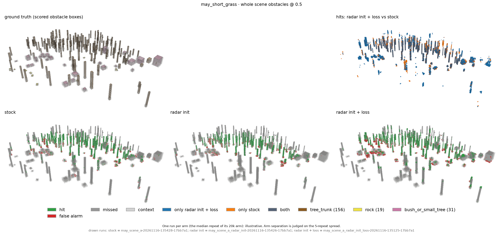
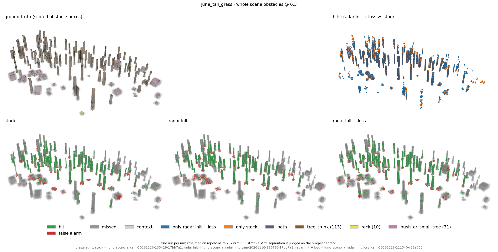
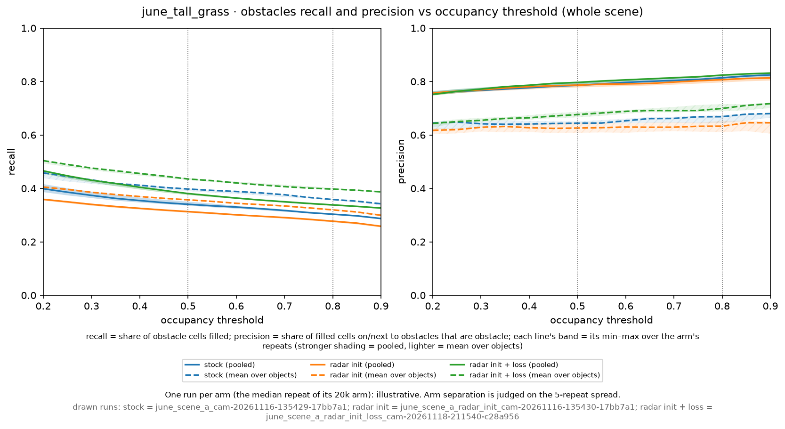

# Radar arms across sessions: may_short_grass vs june_tall_grass

Descriptive only: repeats share one seed and are not paired. Gap = radar variant - baseline (gain positive for higher-is-better metrics). `sep` = the two arms' [min, max] do not overlap; `n/a` = an arm has fewer than 2 repeats (no spread). Δ = gap in june_tall_grass - gap in may_short_grass. P1cuboid = scripts/13 ungated cuboid detection rate (T45) and point precision (T46); P1/P2 = scripts/19 whole-scene voxel metrics on the rendered lidar (P1) and the Gaussians (P2), pooled over cells; P2@t = Gaussians occupied at probability >= t.

*The definitions below are rendered once, with the values of session may_short_grass; the per-session values table and sections give the other sessions' values.*

## Definitions

Plain words first, the formula last. Every number is read from the run reports, never typed in.

1. **Cells.** The scene is cut into small cubes ("cells") of edge 0.521933 m. The edge is half the median trunk width of the session's boxes (width = mean of a box's two horizontal sizes), so a typical trunk box is about two cells across, and the trunk margin below equals the cell edge. Everything below is about cells.
2. **Ground truth, "on an obstacle" and "next to an obstacle".** People drew a box around every tree trunk, rock and bush ("obstacles"). The boxes are used only for scoring, never for training.
   - **On an obstacle (G):** a cell whose **centre** lies inside an obstacle box.
   - **The scored area around a class (N_c):** for each class (trunk, rock, bush) separately:
     1. **Margin:** m_c = half of the class's typical footprint width, i.e. the median over all of the session's boxes of that class of (length + width) / 4. Values for session may_short_grass: trunk 0.522 m, rock 0.665 m, bush 1.069 m.
     2. **Grow:** widen every box of the class by m_c on each of its four sides, along the box's own axes, leaving its height unchanged. A typical object's grown box is therefore about twice its own width.
     3. **Collect:** N_c = the cells whose centre lies inside a grown box.
   - **Only space the lidar could have covered is scored:** a box counts only when its centre is within 56.18 m (the distance within which 99.99% of the session's lidar returns lie) and the vertical field of view (±44.8°) of at least one recorded sweep. The same range and field-of-view test is applied to every cell of N_c.
   - **Obstacles as one group:** N = N_trunk ∪ N_rock ∪ N_bush, minus any cell whose centre lies in a box of a different, non-obstacle annotated class. Those cells count neither for nor against.
   - **Next to an obstacle:** N ∖ G, the cells in the grown area that are not inside any obstacle box.
   - **Scored:** only cells in N; everything else in the scene is ignored.
   - **Caveat:** the boxes are rectangular and a cell counts by its centre only. So a trunk narrower than the typical one can get one cell across or none, depending on where the grid lines fall.
3. **What the model contains.** A trained SplatAD model is millions of small fuzzy blobs (3D Gaussians). Each blob has an opacity from 0 (see-through) to 1 (solid).
4. **Occupancy of a cell** is how solid the model says the cell is, from 0 (empty) to 1 (solid).
   - Each blob adds its opacity to the cell its centre lies in, and a fading share to nearby cells.
   - Blobs combine like stacked tinted glass: light passes through a blob of opacity α with probability (1 − α). So occupancy = 1 − ∏_k(1 − α_k), which grows with every blob but never passes 1.
   - **Why opacities are combined this way (the source of the definition).** The rule is not new. It reads, at a cell, the same accumulation SplatAD uses to render a lidar ray. The design choice is recorded in PLAN §5 (P2) and `docs/research/evaluation_caveats.md`, "Blocking probability". Quotes are verbatim from the sources below.
     1. **How SplatAD blends Gaussians along a ray.** SplatAD (Hess et al., *SplatAD: Real-Time Lidar and Camera Rendering with 3D Gaussian Splatting for Autonomous Driving*, arXiv:2411.16816, https://arxiv.org/abs/2411.16816, Eqs. 4-5 (section 3.2), median-range rule (section 3.3); passages checked 2026-11-25) models the scene as "translucent 3D Gaussians with learnable occupancy o∈(0,1)" (§3.1).
        - **Eq. 4 (§3.2):** [F_p^rgb, F_p] = Σ_i [f_i^rgb, f_i] α_i ∏_{j=1}^{i−1}(1 − α_j). Each Gaussian's own opacity α_i is multiplied by ∏_{j<i}(1 − α_j), the light still left in front of it (the transmittance).
        - **Eq. 5 (§3.2):** α_i = sqrt(|Σ_i^I| / |Σ_i^I + s·I|) · o_i · exp(−½ Δ_iᵀ (Σ_i^I + s·I)⁻¹ Δ_i). The Gaussian's α_i is its learned opacity o_i times its falloff at the ray, projected onto the sensor plane.
        - **§3.3:** "For each lidar point, we α-blend the Gaussians' features 𝐟_i using Eqs. 4, 5 and 6." So the lidar uses exactly these weights.
     2. **SplatAD's own 0.5 rule, whose value we reuse.** SplatAD places a rendered lidar point at the median range, "the rolling shutter corrected range of the first Gaussian that satisfies ∏_{j=1}^{i}(1−α_j) < 0.5 during the α-blending in Eq. 4" (§3.3). It is used at inference: "While we use the expected range for training, the median range is used during inference as it, in contrast to the expected range, does not yield depths between Gaussians." (§3.3). In words: SplatAD says a ray has hit something once **1 − ∏(1 − α) passes 0.5**. Our occupancy combines opacities with the same formula, but over the Gaussians of a cell instead of along one ray. Our binding cut-off reuses that value, 0.5. The cut-off is the same, but "the cell is filled" does not mean "SplatAD's renderer would consider a ray stopped": the occupancy of a cell is a more generous call than a single ray's accumulation (see "How ours differs" below).
     3. **The lineage.** 3D Gaussian Splatting (Kerbl et al., *3D Gaussian Splatting for Real-Time Radiance Field Rendering*, arXiv:2308.04079, https://arxiv.org/abs/2308.04079, section 2.3, Eqs. 1-3 (ACM TOG 42(4), 2023); passages checked 2026-11-25) gives the same blending, Eq. 3: C = Σ_{i∈N} c_i α_i ∏_{j=1}^{i−1}(1 − α_j). It states: "Point-based α-blending and NeRF-style volumetric rendering share essentially the same image formation model." (§2.3). So ∏(1 − α_j) is the transmittance T_i of volume rendering (its Eqs. 1–2).
     4. **Why 1 − ∏(1 − α), as one number per cell.** The blending weights along a ray always add up to Σ_i α_i ∏_{j<i}(1 − α_j) = 1 − ∏_i(1 − α_i). Proof by telescoping: with T_k = ∏_{i≤k}(1 − α_i) and T_0 = 1, each weight equals T_{k−1} − T_k, so the sum is T_0 − T_n = 1 − T_n. A unit test checks this identity. The product does not depend on the order of the Gaussians, so no particular ray direction is needed. The result is the total opacity a ray collects from these Gaussians, between 0 and 1.
   - **How ours differs from SplatAD's α (stated openly):**
     - SplatAD evaluates each Gaussian **projected** onto the image or lidar plane, with a small blur term s·I that matches the pixel size or beam divergence (Eq. 5). We evaluate the **3D** Gaussian at a point: α_k(x) = σ(o_k) · exp(−½ (x − μ_k)ᵀ Σ_k⁻¹ (x − μ_k)), at the cell centre, or at its own peak for the cell holding its mean (T81).
     - We combine every Gaussian touching the cell, rather than those along one beam.
     - In a Gaussian's own cell, its peak opacity counts (T81), and the peaks of several Gaussians sit at different points of the cell. No single ray through the cell meets all of them at their peaks, so these Gaussians count for more than one ray through the cell would collect from them. "The cell is filled" is therefore a more generous call than "SplatAD's renderer would consider a ray stopped". The same rule is applied to every arm, so arm comparisons are unaffected.
     - Occupancy is not the fraction of the cell that is filled. Like the renderer, it assumes each Gaussian blocks light independently.
   - **General reference, not the source of our rule.** Using 3D Gaussians to predict 3D occupancy has been done before (Huang et al., *GaussianFormer: Scene as Gaussians for Vision-Based 3D Semantic Occupancy Prediction*, arXiv:2405.17429, https://arxiv.org/abs/2405.17429, section 3.3, Gaussian-to-Voxel Splatting (general reference only); passages checked 2026-11-25). It adds up the Gaussians' contributions at voxel positions. Ours combines opacities with the renderer's rule above instead, so that the result stays in [0, 1] and reuses SplatAD's cut-off value.
   - It is read from the blobs directly, not from a rendered image, so something behind grass that no sensor saw still counts.
5. **Filled, recall and precision.** Pick a cut-off t; a cell with occupancy ≥ t counts as *filled*. Let O_t be the set of filled cells.
   - **(a) What is scored and what is not.** Only the cells in N are scored: the cells **on** an obstacle (G) and the cells **next to** an obstacle (N ∖ G, the ring, 16407 cells). "Not ground truth" here means only that ring, not the whole scene. Every other cell is ignored, even if the model fills it, so the ring is what makes false alarms countable: a filled cell far from every obstacle is never counted. Cells on another labelled class are excluded from both metrics.
   - **(b) The 2 × 2 table.** Each scored cell is either filled or empty, and either on an obstacle or next to one:

     | | on an obstacle (G) | next to an obstacle (N ∖ G) |
     |---|---|---|
     | **model filled** | hit | false alarm |
     | **model left empty** | missed | correct empty |

     "Correct empty" enters neither metric.
   - **(c) Recall** = hit / (hit + missed) = |O_t ∩ G| / |G|. *Did it rebuild the obstacles?* The denominator is every obstacle cell (19600); it depends only on the ground truth. So recall cannot be gamed by leaving things out, but it ignores false alarms.
   - **(d) Precision** = hit / (hit + false alarm) = |O_t ∩ G| / |O_t ∩ N|. *When it fills something, is it real?* The denominator is every filled scored cell; it depends on the model. Filling everything near obstacles raises recall and lowers precision. This is why both are read together, and why the reading rule asks for higher recall *without lower precision*.
   - **IoU** (intersection over union) = hit / (hit + missed + false alarm) = |O_t ∩ G| / |(O_t ∪ G) ∩ N|. In words: the overlap between what the model filled and the obstacles, divided by everything either of them covers in the scored area. It puts both kinds of error in one number: a miss and a false alarm each lower it. Correct-empty cells do not enter it. It is always ≤ min(recall, precision). It is a summary only: the reading rule uses recall and precision.
   - **(e) Worked example.** The stock arm's drawn run in may_short_grass at t = 0.5, with its real counts: 5420 hits, 14180 missed, 1011 false alarms → recall 0.277, precision 0.843, IoU 0.263. These are one run; the tables give mean ± std over the repeats.
   - **(f) Pooled vs mean over objects.** Recall, precision and IoU are each reported in two ways. They differ only in how the objects are combined.
     - **Pooled** (T94): add up the cells of all objects first, then divide once. Pooled recall = Σ_k |O_t ∩ G_k| / Σ_k |G_k| = all hits / all obstacle cells; pooled precision = all hits / all filled scored cells. Every *cell* weighs the same, so objects with many cells (tall trunks, big bushes) dominate.
     - **Mean over objects** (T95): score each object k on its own, inside its own grown box N_k with its own obstacle cells G_k, then take the plain average: mean recall = (1/K) Σ_k recall_k, and likewise precision and IoU. Every *object* weighs the same, however small. K counts only the objects where the ratio is defined (a non-zero denominator): an object with no filled cell in its box has no precision and is left out of the precision mean. A filled cell inside several objects' grown boxes counts as a false alarm of each of them. Likewise, inside object k's grown box, a filled cell on a different obstacle (for example a bush beside the trunk) counts as a false alarm of k, because k's own cells are only those inside k's box.
     - **Example (made-up numbers, for illustration only):** a large trunk with 90 obstacle cells, 30 of them filled and a small rock with 10 obstacle cells, 8 of them filled. The per-object recalls are 0.333 and 0.800. Pooled recall = 0.380, dominated by the large trunk; mean recall = 0.567, where the small rock counts as much as the trunk.
     - **Reading the two together:** for recall, when objects share no cells, the pooled value is the average of the per-object recalls weighted by each object's cell count. So a mean above the pooled value means objects with few cells are recovered better, relative to their size, than objects with many cells; a mean below means the large objects carry the score.
   - **(g) Why precision stays below 1.** "Next to an obstacle" is not "empty space". The ring also holds things nobody labelled: grass (tall in June), ground and small plants, which really are solid. It also catches the Gaussians of an obstacle that spill past its box into the neighbouring cells (cells count by their centre). So precision stays below 1 even for a correct model. This is a likely cause, not a tested finding.
   - **(h) How the threshold changes both.** Raising t moves cells from filled to empty, so recall can only fall; precision usually rises.
6. **Statistics.** Each arm is trained 5 times. A table cell shows mean ± std over the repeats. Gap = difference of means. "sep" means the two arms' [min, max] ranges do not overlap. A variant gap counts only when it exceeds the spread between repeats without losing precision.

## Whole scene: may_short_grass

### obstacles, P2 occupied at >= 0.5

| metric | stock (`may_scene_a`) | radar init (`may_scene_a_radar_init`) | radar init + loss (`may_scene_a_radar_init_loss`) |
|---|---|---|---|
| recall | 0.278 ± 0.003 [0.275, 0.283] (n=5) | 0.221 ± 0.003 [0.218, 0.225] (n=5) | 0.370 ± 0.003 [0.366, 0.374] (n=5) |
| precision | 0.838 ± 0.004 [0.834, 0.843] (n=5) | 0.810 ± 0.005 [0.805, 0.817] (n=5) | 0.758 ± 0.006 [0.749, 0.762] (n=5) |
| IoU | 0.264 ± 0.003 [0.261, 0.268] (n=5) | 0.210 ± 0.003 [0.208, 0.215] (n=5) | 0.331 ± 0.002 [0.328, 0.333] (n=5) |

### obstacles, P2 occupied at >= 0.8

| metric | stock (`may_scene_a`) | radar init (`may_scene_a_radar_init`) | radar init + loss (`may_scene_a_radar_init_loss`) |
|---|---|---|---|
| recall | 0.244 ± 0.002 [0.241, 0.247] (n=5) | 0.190 ± 0.002 [0.187, 0.193] (n=5) | 0.326 ± 0.001 [0.324, 0.327] (n=5) |
| precision | 0.863 ± 0.003 [0.859, 0.866] (n=5) | 0.831 ± 0.002 [0.827, 0.834] (n=5) | 0.772 ± 0.003 [0.768, 0.774] (n=5) |
| IoU | 0.234 ± 0.002 [0.232, 0.237] (n=5) | 0.183 ± 0.002 [0.180, 0.186] (n=5) | 0.297 ± 0.001 [0.296, 0.298] (n=5) |

### tree_trunk, P2 occupied at >= 0.5

| metric | stock (`may_scene_a`) | radar init (`may_scene_a_radar_init`) | radar init + loss (`may_scene_a_radar_init_loss`) |
|---|---|---|---|
| recall | 0.375 ± 0.002 [0.372, 0.376] (n=5) | 0.302 ± 0.001 [0.300, 0.303] (n=5) | 0.433 ± 0.004 [0.426, 0.438] (n=5) |
| precision | 0.849 ± 0.005 [0.845, 0.856] (n=5) | 0.828 ± 0.002 [0.826, 0.830] (n=5) | 0.811 ± 0.009 [0.795, 0.817] (n=5) |
| IoU | 0.351 ± 0.001 [0.349, 0.352] (n=5) | 0.284 ± 0.001 [0.283, 0.286] (n=5) | 0.393 ± 0.004 [0.389, 0.398] (n=5) |

### tree_trunk, P2 occupied at >= 0.8

| metric | stock (`may_scene_a`) | radar init (`may_scene_a_radar_init`) | radar init + loss (`may_scene_a_radar_init_loss`) |
|---|---|---|---|
| recall | 0.331 ± 0.001 [0.329, 0.332] (n=5) | 0.263 ± 0.003 [0.258, 0.266] (n=5) | 0.379 ± 0.002 [0.377, 0.383] (n=5) |
| precision | 0.872 ± 0.005 [0.868, 0.878] (n=5) | 0.848 ± 0.003 [0.846, 0.852] (n=5) | 0.825 ± 0.003 [0.821, 0.828] (n=5) |
| IoU | 0.316 ± 0.001 [0.314, 0.317] (n=5) | 0.251 ± 0.003 [0.247, 0.253] (n=5) | 0.351 ± 0.002 [0.349, 0.354] (n=5) |

### rock, P2 occupied at >= 0.5

| metric | stock (`may_scene_a`) | radar init (`may_scene_a_radar_init`) | radar init + loss (`may_scene_a_radar_init_loss`) |
|---|---|---|---|
| recall | 0.253 ± 0.018 [0.230, 0.281] (n=5) | 0.206 ± 0.021 [0.180, 0.225] (n=5) | 0.284 ± 0.010 [0.270, 0.298] (n=5) |
| precision | 0.456 ± 0.011 [0.441, 0.472] (n=5) | 0.406 ± 0.034 [0.367, 0.455] (n=5) | 0.429 ± 0.020 [0.395, 0.445] (n=5) |
| IoU | 0.194 ± 0.012 [0.180, 0.214] (n=5) | 0.158 ± 0.017 [0.140, 0.177] (n=5) | 0.206 ± 0.008 [0.198, 0.217] (n=5) |

### rock, P2 occupied at >= 0.8

| metric | stock (`may_scene_a`) | radar init (`may_scene_a_radar_init`) | radar init + loss (`may_scene_a_radar_init_loss`) |
|---|---|---|---|
| recall | 0.228 ± 0.015 [0.202, 0.236] (n=5) | 0.165 ± 0.011 [0.157, 0.180] (n=5) | 0.267 ± 0.010 [0.258, 0.281] (n=5) |
| precision | 0.478 ± 0.022 [0.444, 0.500] (n=5) | 0.408 ± 0.025 [0.373, 0.438] (n=5) | 0.458 ± 0.011 [0.447, 0.475] (n=5) |
| IoU | 0.183 ± 0.012 [0.161, 0.191] (n=5) | 0.133 ± 0.010 [0.124, 0.146] (n=5) | 0.203 ± 0.007 [0.196, 0.212] (n=5) |

### bush_or_small_tree, P2 occupied at >= 0.5

| metric | stock (`may_scene_a`) | radar init (`may_scene_a_radar_init`) | radar init + loss (`may_scene_a_radar_init_loss`) |
|---|---|---|---|
| recall | 0.127 ± 0.007 [0.122, 0.138] (n=5) | 0.093 ± 0.006 [0.088, 0.104] (n=5) | 0.274 ± 0.005 [0.269, 0.280] (n=5) |
| precision | 0.819 ± 0.012 [0.807, 0.835] (n=5) | 0.763 ± 0.020 [0.739, 0.791] (n=5) | 0.663 ± 0.007 [0.655, 0.672] (n=5) |
| IoU | 0.124 ± 0.007 [0.119, 0.134] (n=5) | 0.091 ± 0.006 [0.086, 0.101] (n=5) | 0.241 ± 0.004 [0.236, 0.246] (n=5) |

### bush_or_small_tree, P2 occupied at >= 0.8

| metric | stock (`may_scene_a`) | radar init (`may_scene_a_radar_init`) | radar init + loss (`may_scene_a_radar_init_loss`) |
|---|---|---|---|
| recall | 0.106 ± 0.005 [0.102, 0.113] (n=5) | 0.076 ± 0.003 [0.073, 0.081] (n=5) | 0.244 ± 0.003 [0.241, 0.247] (n=5) |
| precision | 0.853 ± 0.011 [0.839, 0.864] (n=5) | 0.779 ± 0.020 [0.758, 0.803] (n=5) | 0.677 ± 0.004 [0.673, 0.684] (n=5) |
| IoU | 0.104 ± 0.005 [0.100, 0.111] (n=5) | 0.075 ± 0.003 [0.071, 0.079] (n=5) | 0.218 ± 0.002 [0.216, 0.222] (n=5) |

### Gap radar init (`may_scene_a_radar_init`) - stock (`may_scene_a`) (sep = the arms' [min, max] do not overlap, ovl = they overlap)

| metric | gap | sep / ovl |
|---|---|---|
| obstacles/P2@0.5/recall/pooled | -0.058 | sep |
| obstacles/P2@0.5/precision/pooled | -0.027 | sep |
| obstacles/P2@0.5/iou/pooled | -0.054 | sep |
| obstacles/P2@0.8/recall/pooled | -0.053 | sep |
| obstacles/P2@0.8/precision/pooled | -0.032 | sep |
| obstacles/P2@0.8/iou/pooled | -0.051 | sep |
| tree_trunk/P2@0.5/recall/pooled | -0.073 | sep |
| tree_trunk/P2@0.5/precision/pooled | -0.021 | sep |
| tree_trunk/P2@0.5/iou/pooled | -0.067 | sep |
| tree_trunk/P2@0.8/recall/pooled | -0.068 | sep |
| tree_trunk/P2@0.8/precision/pooled | -0.024 | sep |
| tree_trunk/P2@0.8/iou/pooled | -0.064 | sep |
| rock/P2@0.5/recall/pooled | -0.047 | sep |
| rock/P2@0.5/precision/pooled | -0.050 | ovl |
| rock/P2@0.5/iou/pooled | -0.036 | sep |
| rock/P2@0.8/recall/pooled | -0.063 | sep |
| rock/P2@0.8/precision/pooled | -0.070 | sep |
| rock/P2@0.8/iou/pooled | -0.049 | sep |
| bush_or_small_tree/P2@0.5/recall/pooled | -0.034 | sep |
| bush_or_small_tree/P2@0.5/precision/pooled | -0.056 | sep |
| bush_or_small_tree/P2@0.5/iou/pooled | -0.033 | sep |
| bush_or_small_tree/P2@0.8/recall/pooled | -0.030 | sep |
| bush_or_small_tree/P2@0.8/precision/pooled | -0.074 | sep |
| bush_or_small_tree/P2@0.8/iou/pooled | -0.030 | sep |

### Gap radar init + loss (`may_scene_a_radar_init_loss`) - stock (`may_scene_a`) (sep = the arms' [min, max] do not overlap, ovl = they overlap)

| metric | gap | sep / ovl |
|---|---|---|
| obstacles/P2@0.5/recall/pooled | 0.092 | sep |
| obstacles/P2@0.5/precision/pooled | -0.079 | sep |
| obstacles/P2@0.5/iou/pooled | 0.067 | sep |
| obstacles/P2@0.8/recall/pooled | 0.082 | sep |
| obstacles/P2@0.8/precision/pooled | -0.091 | sep |
| obstacles/P2@0.8/iou/pooled | 0.063 | sep |
| tree_trunk/P2@0.5/recall/pooled | 0.058 | sep |
| tree_trunk/P2@0.5/precision/pooled | -0.038 | sep |
| tree_trunk/P2@0.5/iou/pooled | 0.042 | sep |
| tree_trunk/P2@0.8/recall/pooled | 0.048 | sep |
| tree_trunk/P2@0.8/precision/pooled | -0.047 | sep |
| tree_trunk/P2@0.8/iou/pooled | 0.035 | sep |
| rock/P2@0.5/recall/pooled | 0.031 | ovl |
| rock/P2@0.5/precision/pooled | -0.027 | ovl |
| rock/P2@0.5/iou/pooled | 0.012 | ovl |
| rock/P2@0.8/recall/pooled | 0.039 | sep |
| rock/P2@0.8/precision/pooled | -0.021 | ovl |
| rock/P2@0.8/iou/pooled | 0.020 | sep |
| bush_or_small_tree/P2@0.5/recall/pooled | 0.147 | sep |
| bush_or_small_tree/P2@0.5/precision/pooled | -0.156 | sep |
| bush_or_small_tree/P2@0.5/iou/pooled | 0.117 | sep |
| bush_or_small_tree/P2@0.8/recall/pooled | 0.138 | sep |
| bush_or_small_tree/P2@0.8/precision/pooled | -0.176 | sep |
| bush_or_small_tree/P2@0.8/iou/pooled | 0.114 | sep |

### Gap radar init + loss (`may_scene_a_radar_init_loss`) - radar init (`may_scene_a_radar_init`) (sep = the arms' [min, max] do not overlap, ovl = they overlap)

| metric | gap | sep / ovl |
|---|---|---|
| obstacles/P2@0.5/recall/pooled | 0.150 | sep |
| obstacles/P2@0.5/precision/pooled | -0.052 | sep |
| obstacles/P2@0.5/iou/pooled | 0.121 | sep |
| obstacles/P2@0.8/recall/pooled | 0.136 | sep |
| obstacles/P2@0.8/precision/pooled | -0.058 | sep |
| obstacles/P2@0.8/iou/pooled | 0.114 | sep |
| tree_trunk/P2@0.5/recall/pooled | 0.131 | sep |
| tree_trunk/P2@0.5/precision/pooled | -0.017 | sep |
| tree_trunk/P2@0.5/iou/pooled | 0.109 | sep |
| tree_trunk/P2@0.8/recall/pooled | 0.116 | sep |
| tree_trunk/P2@0.8/precision/pooled | -0.023 | sep |
| tree_trunk/P2@0.8/iou/pooled | 0.100 | sep |
| rock/P2@0.5/recall/pooled | 0.079 | sep |
| rock/P2@0.5/precision/pooled | 0.023 | ovl |
| rock/P2@0.5/iou/pooled | 0.048 | sep |
| rock/P2@0.8/recall/pooled | 0.102 | sep |
| rock/P2@0.8/precision/pooled | 0.049 | sep |
| rock/P2@0.8/iou/pooled | 0.070 | sep |
| bush_or_small_tree/P2@0.5/recall/pooled | 0.181 | sep |
| bush_or_small_tree/P2@0.5/precision/pooled | -0.100 | sep |
| bush_or_small_tree/P2@0.5/iou/pooled | 0.150 | sep |
| bush_or_small_tree/P2@0.8/recall/pooled | 0.167 | sep |
| bush_or_small_tree/P2@0.8/precision/pooled | -0.102 | sep |
| bush_or_small_tree/P2@0.8/iou/pooled | 0.144 | sep |

**How to read this figure**
- **GT panel:** the obstacle boxes, coloured by class, for orientation.
- **Arm panels:** green = hit (filled, on an obstacle); red = false alarm (filled, next to an obstacle); grey = missed (empty, on an obstacle); faint grey = the scored area, the ring included. Correct-empty cells are not drawn. Cut-off t = 0.5. The terms are defined in point 5.
- **Difference panel:** hits only radar init + loss has, hits only stock has, and hits both have.
- One run per arm: the median repeat of whole-scene pooled recall at the binding cut-off t = 0.5 (metric `obstacles/P2@0.5/recall/pooled`), so it illustrates and does not decide anything.

**How to read this figure**
- **What is plotted:** recall (left) and precision (right) recomputed at each cut-off t from 0.2 to 0.9 (15 evenly spaced values). Solid lines are pooled and dashed lines are the mean over objects. The line is the median repeat. Each line has its own shaded band: at each t, the lowest and highest value of that same curve (pooled or mean over objects) over the 5 repeats of the arm. The pooled band is shaded more strongly than the mean band. Dotted lines mark the table cut-offs 0.5, 0.8.
- **Solid vs dashed:** solid = *pooled* (all objects' cells counted together, so large objects dominate); dashed = *mean over objects* (each object scored on its own, then averaged, so every object counts once). Full definitions and an example: point 5(f).
- **Definitions:** see point 5. Only recall and precision are plotted; IoU is in the tables. Recall = hit / (hit + missed) has all 19600 obstacle cells as its denominator; precision = hit / (hit + false alarm) has every filled scored cell as its denominator.
- **How the curves move:** raising t fills fewer cells, so recall can only fall and precision usually rises.
- **When one arm beats another:** its line is higher and its band does not overlap the other arm's band of the same kind (pooled with pooled, mean with mean).
- **Why t runs from 0.2 to 0.9:** the extremes are left out because they say nothing about the model. At t = 0 every cell counts as filled (recall 1, precision = the share of obstacle cells). At t ≈ 1 precision rests on a handful of cells and jumps.

## Whole scene: june_tall_grass

### obstacles, P2 occupied at >= 0.5

| metric | stock (`june_scene_a_cam`) | radar init (`june_scene_a_radar_init_cam`) | radar init + loss (`june_scene_a_radar_init_loss_cam`) |
|---|---|---|---|
| recall | 0.342 ± 0.006 [0.336, 0.351] (n=5) | 0.312 ± 0.002 [0.310, 0.314] (n=5) | 0.380 ± 0.003 [0.376, 0.383] (n=5) |
| precision | 0.789 ± 0.005 [0.783, 0.796] (n=5) | 0.784 ± 0.004 [0.778, 0.788] (n=5) | 0.796 ± 0.004 [0.790, 0.801] (n=5) |
| IoU | 0.313 ± 0.005 [0.309, 0.320] (n=5) | 0.287 ± 0.002 [0.285, 0.290] (n=5) | 0.346 ± 0.003 [0.342, 0.349] (n=5) |

### obstacles, P2 occupied at >= 0.8

| metric | stock (`june_scene_a_cam`) | radar init (`june_scene_a_radar_init_cam`) | radar init + loss (`june_scene_a_radar_init_loss_cam`) |
|---|---|---|---|
| recall | 0.304 ± 0.002 [0.302, 0.307] (n=5) | 0.276 ± 0.002 [0.274, 0.279] (n=5) | 0.338 ± 0.002 [0.335, 0.341] (n=5) |
| precision | 0.813 ± 0.005 [0.806, 0.821] (n=5) | 0.803 ± 0.005 [0.798, 0.807] (n=5) | 0.823 ± 0.003 [0.820, 0.826] (n=5) |
| IoU | 0.284 ± 0.002 [0.282, 0.286] (n=5) | 0.259 ± 0.002 [0.256, 0.261] (n=5) | 0.315 ± 0.002 [0.312, 0.318] (n=5) |

### tree_trunk, P2 occupied at >= 0.5

| metric | stock (`june_scene_a_cam`) | radar init (`june_scene_a_radar_init_cam`) | radar init + loss (`june_scene_a_radar_init_loss_cam`) |
|---|---|---|---|
| recall | 0.435 ± 0.004 [0.431, 0.440] (n=5) | 0.417 ± 0.002 [0.415, 0.419] (n=5) | 0.467 ± 0.004 [0.461, 0.471] (n=5) |
| precision | 0.828 ± 0.003 [0.825, 0.833] (n=5) | 0.823 ± 0.004 [0.817, 0.828] (n=5) | 0.834 ± 0.004 [0.829, 0.839] (n=5) |
| IoU | 0.399 ± 0.003 [0.397, 0.403] (n=5) | 0.382 ± 0.002 [0.380, 0.384] (n=5) | 0.427 ± 0.004 [0.421, 0.430] (n=5) |

### tree_trunk, P2 occupied at >= 0.8

| metric | stock (`june_scene_a_cam`) | radar init (`june_scene_a_radar_init_cam`) | radar init + loss (`june_scene_a_radar_init_loss_cam`) |
|---|---|---|---|
| recall | 0.397 ± 0.003 [0.394, 0.401] (n=5) | 0.376 ± 0.002 [0.373, 0.379] (n=5) | 0.429 ± 0.002 [0.426, 0.431] (n=5) |
| precision | 0.845 ± 0.003 [0.843, 0.850] (n=5) | 0.838 ± 0.004 [0.832, 0.842] (n=5) | 0.847 ± 0.002 [0.845, 0.851] (n=5) |
| IoU | 0.370 ± 0.002 [0.367, 0.374] (n=5) | 0.350 ± 0.003 [0.347, 0.353] (n=5) | 0.398 ± 0.002 [0.395, 0.401] (n=5) |

### rock, P2 occupied at >= 0.5

| metric | stock (`june_scene_a_cam`) | radar init (`june_scene_a_radar_init_cam`) | radar init + loss (`june_scene_a_radar_init_loss_cam`) |
|---|---|---|---|
| recall | 0.198 ± 0.015 [0.176, 0.212] (n=5) | 0.167 ± 0.017 [0.141, 0.188] (n=5) | 0.266 ± 0.006 [0.259, 0.271] (n=5) |
| precision | 0.210 ± 0.024 [0.179, 0.234] (n=5) | 0.209 ± 0.017 [0.185, 0.232] (n=5) | 0.219 ± 0.005 [0.214, 0.228] (n=5) |
| IoU | 0.113 ± 0.012 [0.097, 0.125] (n=5) | 0.102 ± 0.011 [0.087, 0.116] (n=5) | 0.136 ± 0.003 [0.133, 0.141] (n=5) |

### rock, P2 occupied at >= 0.8

| metric | stock (`june_scene_a_cam`) | radar init (`june_scene_a_radar_init_cam`) | radar init + loss (`june_scene_a_radar_init_loss_cam`) |
|---|---|---|---|
| recall | 0.186 ± 0.013 [0.176, 0.200] (n=5) | 0.153 ± 0.019 [0.129, 0.176] (n=5) | 0.240 ± 0.011 [0.224, 0.247] (n=5) |
| precision | 0.224 ± 0.017 [0.203, 0.239] (n=5) | 0.227 ± 0.023 [0.200, 0.263] (n=5) | 0.216 ± 0.006 [0.207, 0.221] (n=5) |
| IoU | 0.113 ± 0.009 [0.104, 0.122] (n=5) | 0.101 ± 0.012 [0.085, 0.118] (n=5) | 0.128 ± 0.005 [0.120, 0.132] (n=5) |

### bush_or_small_tree, P2 occupied at >= 0.5

| metric | stock (`june_scene_a_cam`) | radar init (`june_scene_a_radar_init_cam`) | radar init + loss (`june_scene_a_radar_init_loss_cam`) |
|---|---|---|---|
| recall | 0.144 ± 0.020 [0.132, 0.180] (n=5) | 0.090 ± 0.007 [0.084, 0.099] (n=5) | 0.196 ± 0.008 [0.187, 0.207] (n=5) |
| precision | 0.640 ± 0.015 [0.624, 0.657] (n=5) | 0.575 ± 0.020 [0.550, 0.596] (n=5) | 0.688 ± 0.022 [0.661, 0.719] (n=5) |
| IoU | 0.133 ± 0.017 [0.122, 0.163] (n=5) | 0.084 ± 0.006 [0.078, 0.092] (n=5) | 0.180 ± 0.008 [0.170, 0.192] (n=5) |

### bush_or_small_tree, P2 occupied at >= 0.8

| metric | stock (`june_scene_a_cam`) | radar init (`june_scene_a_radar_init_cam`) | radar init + loss (`june_scene_a_radar_init_loss_cam`) |
|---|---|---|---|
| recall | 0.106 ± 0.008 [0.101, 0.121] (n=5) | 0.065 ± 0.003 [0.062, 0.071] (n=5) | 0.145 ± 0.005 [0.140, 0.152] (n=5) |
| precision | 0.671 ± 0.016 [0.652, 0.694] (n=5) | 0.579 ± 0.011 [0.567, 0.597] (n=5) | 0.760 ± 0.015 [0.740, 0.782] (n=5) |
| IoU | 0.101 ± 0.007 [0.096, 0.113] (n=5) | 0.062 ± 0.003 [0.060, 0.067] (n=5) | 0.139 ± 0.005 [0.134, 0.146] (n=5) |

### Gap radar init (`june_scene_a_radar_init_cam`) - stock (`june_scene_a_cam`) (sep = the arms' [min, max] do not overlap, ovl = they overlap)

| metric | gap | sep / ovl |
|---|---|---|
| obstacles/P2@0.5/recall/pooled | -0.030 | sep |
| obstacles/P2@0.5/precision/pooled | -0.005 | ovl |
| obstacles/P2@0.5/iou/pooled | -0.026 | sep |
| obstacles/P2@0.8/recall/pooled | -0.028 | sep |
| obstacles/P2@0.8/precision/pooled | -0.010 | ovl |
| obstacles/P2@0.8/iou/pooled | -0.025 | sep |
| tree_trunk/P2@0.5/recall/pooled | -0.019 | sep |
| tree_trunk/P2@0.5/precision/pooled | -0.006 | ovl |
| tree_trunk/P2@0.5/iou/pooled | -0.017 | sep |
| tree_trunk/P2@0.8/recall/pooled | -0.022 | sep |
| tree_trunk/P2@0.8/precision/pooled | -0.008 | sep |
| tree_trunk/P2@0.8/iou/pooled | -0.020 | sep |
| rock/P2@0.5/recall/pooled | -0.031 | ovl |
| rock/P2@0.5/precision/pooled | -0.001 | ovl |
| rock/P2@0.5/iou/pooled | -0.011 | ovl |
| rock/P2@0.8/recall/pooled | -0.033 | ovl |
| rock/P2@0.8/precision/pooled | 0.003 | ovl |
| rock/P2@0.8/iou/pooled | -0.012 | ovl |
| bush_or_small_tree/P2@0.5/recall/pooled | -0.054 | sep |
| bush_or_small_tree/P2@0.5/precision/pooled | -0.064 | sep |
| bush_or_small_tree/P2@0.5/iou/pooled | -0.048 | sep |
| bush_or_small_tree/P2@0.8/recall/pooled | -0.041 | sep |
| bush_or_small_tree/P2@0.8/precision/pooled | -0.092 | sep |
| bush_or_small_tree/P2@0.8/iou/pooled | -0.039 | sep |

### Gap radar init + loss (`june_scene_a_radar_init_loss_cam`) - stock (`june_scene_a_cam`) (sep = the arms' [min, max] do not overlap, ovl = they overlap)

| metric | gap | sep / ovl |
|---|---|---|
| obstacles/P2@0.5/recall/pooled | 0.038 | sep |
| obstacles/P2@0.5/precision/pooled | 0.007 | ovl |
| obstacles/P2@0.5/iou/pooled | 0.033 | sep |
| obstacles/P2@0.8/recall/pooled | 0.034 | sep |
| obstacles/P2@0.8/precision/pooled | 0.010 | ovl |
| obstacles/P2@0.8/iou/pooled | 0.031 | sep |
| tree_trunk/P2@0.5/recall/pooled | 0.031 | sep |
| tree_trunk/P2@0.5/precision/pooled | 0.005 | ovl |
| tree_trunk/P2@0.5/iou/pooled | 0.028 | sep |
| tree_trunk/P2@0.8/recall/pooled | 0.032 | sep |
| tree_trunk/P2@0.8/precision/pooled | 0.002 | ovl |
| tree_trunk/P2@0.8/iou/pooled | 0.028 | sep |
| rock/P2@0.5/recall/pooled | 0.068 | sep |
| rock/P2@0.5/precision/pooled | 0.009 | ovl |
| rock/P2@0.5/iou/pooled | 0.023 | sep |
| rock/P2@0.8/recall/pooled | 0.054 | sep |
| rock/P2@0.8/precision/pooled | -0.008 | ovl |
| rock/P2@0.8/iou/pooled | 0.015 | ovl |
| bush_or_small_tree/P2@0.5/recall/pooled | 0.052 | sep |
| bush_or_small_tree/P2@0.5/precision/pooled | 0.048 | sep |
| bush_or_small_tree/P2@0.5/iou/pooled | 0.047 | sep |
| bush_or_small_tree/P2@0.8/recall/pooled | 0.039 | sep |
| bush_or_small_tree/P2@0.8/precision/pooled | 0.088 | sep |
| bush_or_small_tree/P2@0.8/iou/pooled | 0.038 | sep |

### Gap radar init + loss (`june_scene_a_radar_init_loss_cam`) - radar init (`june_scene_a_radar_init_cam`) (sep = the arms' [min, max] do not overlap, ovl = they overlap)

| metric | gap | sep / ovl |
|---|---|---|
| obstacles/P2@0.5/recall/pooled | 0.068 | sep |
| obstacles/P2@0.5/precision/pooled | 0.012 | sep |
| obstacles/P2@0.5/iou/pooled | 0.059 | sep |
| obstacles/P2@0.8/recall/pooled | 0.062 | sep |
| obstacles/P2@0.8/precision/pooled | 0.020 | sep |
| obstacles/P2@0.8/iou/pooled | 0.057 | sep |
| tree_trunk/P2@0.5/recall/pooled | 0.050 | sep |
| tree_trunk/P2@0.5/precision/pooled | 0.011 | sep |
| tree_trunk/P2@0.5/iou/pooled | 0.045 | sep |
| tree_trunk/P2@0.8/recall/pooled | 0.053 | sep |
| tree_trunk/P2@0.8/precision/pooled | 0.010 | sep |
| tree_trunk/P2@0.8/iou/pooled | 0.048 | sep |
| rock/P2@0.5/recall/pooled | 0.099 | sep |
| rock/P2@0.5/precision/pooled | 0.010 | ovl |
| rock/P2@0.5/iou/pooled | 0.034 | sep |
| rock/P2@0.8/recall/pooled | 0.087 | sep |
| rock/P2@0.8/precision/pooled | -0.011 | ovl |
| rock/P2@0.8/iou/pooled | 0.028 | sep |
| bush_or_small_tree/P2@0.5/recall/pooled | 0.106 | sep |
| bush_or_small_tree/P2@0.5/precision/pooled | 0.113 | sep |
| bush_or_small_tree/P2@0.5/iou/pooled | 0.095 | sep |
| bush_or_small_tree/P2@0.8/recall/pooled | 0.080 | sep |
| bush_or_small_tree/P2@0.8/precision/pooled | 0.181 | sep |
| bush_or_small_tree/P2@0.8/iou/pooled | 0.077 | sep |

**How to read this figure**
- **GT panel:** the obstacle boxes, coloured by class, for orientation.
- **Arm panels:** green = hit (filled, on an obstacle); red = false alarm (filled, next to an obstacle); grey = missed (empty, on an obstacle); faint grey = the scored area, the ring included. Correct-empty cells are not drawn. Cut-off t = 0.5. The terms are defined in point 5.
- **Difference panel:** hits only radar init + loss has, hits only stock has, and hits both have.
- One run per arm: the median repeat of whole-scene pooled recall at the binding cut-off t = 0.5 (metric `obstacles/P2@0.5/recall/pooled`), so it illustrates and does not decide anything.

**How to read this figure**
- **What is plotted:** recall (left) and precision (right) recomputed at each cut-off t from 0.2 to 0.9 (15 evenly spaced values). Solid lines are pooled and dashed lines are the mean over objects. The line is the median repeat. Each line has its own shaded band: at each t, the lowest and highest value of that same curve (pooled or mean over objects) over the 5 repeats of the arm. The pooled band is shaded more strongly than the mean band. Dotted lines mark the table cut-offs 0.5, 0.8.
- **Solid vs dashed:** solid = *pooled* (all objects' cells counted together, so large objects dominate); dashed = *mean over objects* (each object scored on its own, then averaged, so every object counts once). Full definitions and an example: point 5(f).
- **Definitions:** see point 5. Only recall and precision are plotted; IoU is in the tables. Recall = hit / (hit + missed) has all 12687 obstacle cells as its denominator; precision = hit / (hit + false alarm) has every filled scored cell as its denominator.
- **How the curves move:** raising t fills fewer cells, so recall can only fall and precision usually rises.
- **When one arm beats another:** its line is higher and its band does not overlap the other arm's band of the same kind (pooled with pooled, mean with mean).
- **Why t runs from 0.2 to 0.9:** the extremes are left out because they say nothing about the model. At t = 0 every cell counts as filled (recall 1, precision = the share of obstacle cells). At t ≈ 1 precision rests on a handful of cells and jumps.

## may_short_grass: arms

- **stock** (`may_scene_a`, n=5): may_short_grass-may_scene_a-20261116-133928-17bb7a1, may_short_grass-may_scene_a-20261116-135425-17bb7a1, may_short_grass-may_scene_a-20261116-135428-17bb7a1, may_short_grass-may_scene_a-20261116-135432-17bb7a1, may_short_grass-may_scene_a-20261116-135435-17bb7a1
- **radar init** (`may_scene_a_radar_init`, n=5): may_short_grass-may_scene_a_radar_init-20261116-134527-17bb7a1, may_short_grass-may_scene_a_radar_init-20261116-135426-17bb7a1, may_short_grass-may_scene_a_radar_init-20261116-135429-17bb7a1, may_short_grass-may_scene_a_radar_init-20261116-135433-17bb7a1, may_short_grass-may_scene_a_radar_init-20261116-135436-17bb7a1
- **radar init + loss** (`may_scene_a_radar_init_loss`, n=5): may_short_grass-may_scene_a_radar_init_loss-20261116-135125-17bb7a1, may_short_grass-may_scene_a_radar_init_loss-20261116-135427-17bb7a1, may_short_grass-may_scene_a_radar_init_loss-20261116-135431-17bb7a1, may_short_grass-may_scene_a_radar_init_loss-20261116-135434-17bb7a1, may_short_grass-may_scene_a_radar_init_loss-20261116-135437-17bb7a1

## june_tall_grass: arms

- **stock** (`june_scene_a_cam`, n=5): june_tall_grass-june_scene_a_cam-20261116-134222-17bb7a1, june_tall_grass-june_scene_a_cam-20261116-135429-17bb7a1, june_tall_grass-june_scene_a_cam-20261116-135432-17bb7a1, june_tall_grass-june_scene_a_cam-20261116-135435-17bb7a1, june_tall_grass-june_scene_a_cam-20261118-032048-c28a956
- **radar init** (`june_scene_a_radar_init_cam`, n=5): june_tall_grass-june_scene_a_radar_init_cam-20261116-134824-17bb7a1, june_tall_grass-june_scene_a_radar_init_cam-20261116-135427-17bb7a1, june_tall_grass-june_scene_a_radar_init_cam-20261116-135430-17bb7a1, june_tall_grass-june_scene_a_radar_init_cam-20261116-135433-17bb7a1, june_tall_grass-june_scene_a_radar_init_cam-20261116-135436-17bb7a1
- **radar init + loss** (`june_scene_a_radar_init_loss_cam`, n=5): june_tall_grass-june_scene_a_radar_init_loss_cam-20261116-135425-17bb7a1, june_tall_grass-june_scene_a_radar_init_loss_cam-20261116-135428-17bb7a1, june_tall_grass-june_scene_a_radar_init_loss_cam-20261116-135431-17bb7a1, june_tall_grass-june_scene_a_radar_init_loss_cam-20261116-135437-17bb7a1, june_tall_grass-june_scene_a_radar_init_loss_cam-20261118-211540-c28a956

## obstacles: arm values

| metric | session | stock | radar init | radar init + loss |
|---|---|---|---|---|
| P2@0.5/recall/pooled | may_short_grass | 0.278 ± 0.003 [0.275, 0.283] (n=5) | 0.221 ± 0.003 [0.218, 0.225] (n=5) | 0.370 ± 0.003 [0.366, 0.374] (n=5) |
| P2@0.5/recall/pooled | june_tall_grass | 0.342 ± 0.006 [0.336, 0.351] (n=5) | 0.312 ± 0.002 [0.310, 0.314] (n=5) | 0.380 ± 0.003 [0.376, 0.383] (n=5) |
| P2@0.5/precision/pooled | may_short_grass | 0.838 ± 0.004 [0.834, 0.843] (n=5) | 0.810 ± 0.005 [0.805, 0.817] (n=5) | 0.758 ± 0.006 [0.749, 0.762] (n=5) |
| P2@0.5/precision/pooled | june_tall_grass | 0.789 ± 0.005 [0.783, 0.796] (n=5) | 0.784 ± 0.004 [0.778, 0.788] (n=5) | 0.796 ± 0.004 [0.790, 0.801] (n=5) |
| P2@0.5/iou/pooled | may_short_grass | 0.264 ± 0.003 [0.261, 0.268] (n=5) | 0.210 ± 0.003 [0.208, 0.215] (n=5) | 0.331 ± 0.002 [0.328, 0.333] (n=5) |
| P2@0.5/iou/pooled | june_tall_grass | 0.313 ± 0.005 [0.309, 0.320] (n=5) | 0.287 ± 0.002 [0.285, 0.290] (n=5) | 0.346 ± 0.003 [0.342, 0.349] (n=5) |
| P2@0.8/recall/pooled | may_short_grass | 0.244 ± 0.002 [0.241, 0.247] (n=5) | 0.190 ± 0.002 [0.187, 0.193] (n=5) | 0.326 ± 0.001 [0.324, 0.327] (n=5) |
| P2@0.8/recall/pooled | june_tall_grass | 0.304 ± 0.002 [0.302, 0.307] (n=5) | 0.276 ± 0.002 [0.274, 0.279] (n=5) | 0.338 ± 0.002 [0.335, 0.341] (n=5) |
| P2@0.8/precision/pooled | may_short_grass | 0.863 ± 0.003 [0.859, 0.866] (n=5) | 0.831 ± 0.002 [0.827, 0.834] (n=5) | 0.772 ± 0.003 [0.768, 0.774] (n=5) |
| P2@0.8/precision/pooled | june_tall_grass | 0.813 ± 0.005 [0.806, 0.821] (n=5) | 0.803 ± 0.005 [0.798, 0.807] (n=5) | 0.823 ± 0.003 [0.820, 0.826] (n=5) |
| P2@0.8/iou/pooled | may_short_grass | 0.234 ± 0.002 [0.232, 0.237] (n=5) | 0.183 ± 0.002 [0.180, 0.186] (n=5) | 0.297 ± 0.001 [0.296, 0.298] (n=5) |
| P2@0.8/iou/pooled | june_tall_grass | 0.284 ± 0.002 [0.282, 0.286] (n=5) | 0.259 ± 0.002 [0.256, 0.261] (n=5) | 0.315 ± 0.002 [0.312, 0.318] (n=5) |
| P1/recall/pooled | may_short_grass | 0.299 ± 0.001 [0.298, 0.301] (n=5) | 0.273 ± 0.002 [0.270, 0.275] (n=5) | 0.298 ± 0.002 [0.295, 0.300] (n=5) |
| P1/recall/pooled | june_tall_grass | 0.322 ± 0.003 [0.319, 0.327] (n=5) | 0.311 ± 0.003 [0.308, 0.314] (n=5) | 0.329 ± 0.003 [0.326, 0.333] (n=5) |
| P1/precision/pooled | may_short_grass | 0.680 ± 0.004 [0.677, 0.685] (n=5) | 0.660 ± 0.004 [0.654, 0.663] (n=5) | 0.673 ± 0.003 [0.670, 0.677] (n=5) |
| P1/precision/pooled | june_tall_grass | 0.644 ± 0.003 [0.639, 0.647] (n=5) | 0.640 ± 0.003 [0.638, 0.646] (n=5) | 0.644 ± 0.002 [0.641, 0.646] (n=5) |
| P1cuboid/detection_rate | may_short_grass | n/a | n/a | n/a |
| P1cuboid/detection_rate | june_tall_grass | n/a | n/a | n/a |
| P1cuboid/point_precision | may_short_grass | n/a | n/a | n/a |
| P1cuboid/point_precision | june_tall_grass | n/a | n/a | n/a |

## tree_trunk: arm values

| metric | session | stock | radar init | radar init + loss |
|---|---|---|---|---|
| P2@0.5/recall/pooled | may_short_grass | 0.375 ± 0.002 [0.372, 0.376] (n=5) | 0.302 ± 0.001 [0.300, 0.303] (n=5) | 0.433 ± 0.004 [0.426, 0.438] (n=5) |
| P2@0.5/recall/pooled | june_tall_grass | 0.435 ± 0.004 [0.431, 0.440] (n=5) | 0.417 ± 0.002 [0.415, 0.419] (n=5) | 0.467 ± 0.004 [0.461, 0.471] (n=5) |
| P2@0.5/precision/pooled | may_short_grass | 0.849 ± 0.005 [0.845, 0.856] (n=5) | 0.828 ± 0.002 [0.826, 0.830] (n=5) | 0.811 ± 0.009 [0.795, 0.817] (n=5) |
| P2@0.5/precision/pooled | june_tall_grass | 0.828 ± 0.003 [0.825, 0.833] (n=5) | 0.823 ± 0.004 [0.817, 0.828] (n=5) | 0.834 ± 0.004 [0.829, 0.839] (n=5) |
| P2@0.5/iou/pooled | may_short_grass | 0.351 ± 0.001 [0.349, 0.352] (n=5) | 0.284 ± 0.001 [0.283, 0.286] (n=5) | 0.393 ± 0.004 [0.389, 0.398] (n=5) |
| P2@0.5/iou/pooled | june_tall_grass | 0.399 ± 0.003 [0.397, 0.403] (n=5) | 0.382 ± 0.002 [0.380, 0.384] (n=5) | 0.427 ± 0.004 [0.421, 0.430] (n=5) |
| P2@0.8/recall/pooled | may_short_grass | 0.331 ± 0.001 [0.329, 0.332] (n=5) | 0.263 ± 0.003 [0.258, 0.266] (n=5) | 0.379 ± 0.002 [0.377, 0.383] (n=5) |
| P2@0.8/recall/pooled | june_tall_grass | 0.397 ± 0.003 [0.394, 0.401] (n=5) | 0.376 ± 0.002 [0.373, 0.379] (n=5) | 0.429 ± 0.002 [0.426, 0.431] (n=5) |
| P2@0.8/precision/pooled | may_short_grass | 0.872 ± 0.005 [0.868, 0.878] (n=5) | 0.848 ± 0.003 [0.846, 0.852] (n=5) | 0.825 ± 0.003 [0.821, 0.828] (n=5) |
| P2@0.8/precision/pooled | june_tall_grass | 0.845 ± 0.003 [0.843, 0.850] (n=5) | 0.838 ± 0.004 [0.832, 0.842] (n=5) | 0.847 ± 0.002 [0.845, 0.851] (n=5) |
| P2@0.8/iou/pooled | may_short_grass | 0.316 ± 0.001 [0.314, 0.317] (n=5) | 0.251 ± 0.003 [0.247, 0.253] (n=5) | 0.351 ± 0.002 [0.349, 0.354] (n=5) |
| P2@0.8/iou/pooled | june_tall_grass | 0.370 ± 0.002 [0.367, 0.374] (n=5) | 0.350 ± 0.003 [0.347, 0.353] (n=5) | 0.398 ± 0.002 [0.395, 0.401] (n=5) |
| P1/recall/pooled | may_short_grass | 0.379 ± 0.002 [0.377, 0.382] (n=5) | 0.343 ± 0.002 [0.340, 0.345] (n=5) | 0.376 ± 0.003 [0.372, 0.380] (n=5) |
| P1/recall/pooled | june_tall_grass | 0.408 ± 0.004 [0.403, 0.412] (n=5) | 0.399 ± 0.003 [0.396, 0.403] (n=5) | 0.416 ± 0.002 [0.413, 0.419] (n=5) |
| P1/precision/pooled | may_short_grass | 0.711 ± 0.004 [0.706, 0.716] (n=5) | 0.687 ± 0.006 [0.679, 0.694] (n=5) | 0.712 ± 0.004 [0.708, 0.716] (n=5) |
| P1/precision/pooled | june_tall_grass | 0.680 ± 0.003 [0.676, 0.684] (n=5) | 0.678 ± 0.004 [0.674, 0.685] (n=5) | 0.680 ± 0.002 [0.678, 0.682] (n=5) |
| P1cuboid/detection_rate | may_short_grass | 0.556 ± 0.007 [0.545, 0.561] (n=5) | 0.491 ± 0.004 [0.487, 0.497] (n=5) | 0.544 ± 0.011 [0.534, 0.561] (n=5) |
| P1cuboid/detection_rate | june_tall_grass | 0.424 ± 0.007 [0.417, 0.434] (n=5) | 0.406 ± 0.004 [0.400, 0.411] (n=5) | 0.447 ± 0.007 [0.434, 0.451] (n=5) |
| P1cuboid/point_precision | may_short_grass | 0.606 ± 0.001 [0.604, 0.608] (n=5) | 0.587 ± 0.002 [0.584, 0.588] (n=5) | 0.595 ± 0.001 [0.595, 0.596] (n=5) |
| P1cuboid/point_precision | june_tall_grass | 0.564 ± 0.002 [0.561, 0.567] (n=5) | 0.560 ± 0.005 [0.552, 0.565] (n=5) | 0.562 ± 0.001 [0.560, 0.564] (n=5) |

## rock: arm values

| metric | session | stock | radar init | radar init + loss |
|---|---|---|---|---|
| P2@0.5/recall/pooled | may_short_grass | 0.253 ± 0.018 [0.230, 0.281] (n=5) | 0.206 ± 0.021 [0.180, 0.225] (n=5) | 0.284 ± 0.010 [0.270, 0.298] (n=5) |
| P2@0.5/recall/pooled | june_tall_grass | 0.198 ± 0.015 [0.176, 0.212] (n=5) | 0.167 ± 0.017 [0.141, 0.188] (n=5) | 0.266 ± 0.006 [0.259, 0.271] (n=5) |
| P2@0.5/precision/pooled | may_short_grass | 0.456 ± 0.011 [0.441, 0.472] (n=5) | 0.406 ± 0.034 [0.367, 0.455] (n=5) | 0.429 ± 0.020 [0.395, 0.445] (n=5) |
| P2@0.5/precision/pooled | june_tall_grass | 0.210 ± 0.024 [0.179, 0.234] (n=5) | 0.209 ± 0.017 [0.185, 0.232] (n=5) | 0.219 ± 0.005 [0.214, 0.228] (n=5) |
| P2@0.5/iou/pooled | may_short_grass | 0.194 ± 0.012 [0.180, 0.214] (n=5) | 0.158 ± 0.017 [0.140, 0.177] (n=5) | 0.206 ± 0.008 [0.198, 0.217] (n=5) |
| P2@0.5/iou/pooled | june_tall_grass | 0.113 ± 0.012 [0.097, 0.125] (n=5) | 0.102 ± 0.011 [0.087, 0.116] (n=5) | 0.136 ± 0.003 [0.133, 0.141] (n=5) |
| P2@0.8/recall/pooled | may_short_grass | 0.228 ± 0.015 [0.202, 0.236] (n=5) | 0.165 ± 0.011 [0.157, 0.180] (n=5) | 0.267 ± 0.010 [0.258, 0.281] (n=5) |
| P2@0.8/recall/pooled | june_tall_grass | 0.186 ± 0.013 [0.176, 0.200] (n=5) | 0.153 ± 0.019 [0.129, 0.176] (n=5) | 0.240 ± 0.011 [0.224, 0.247] (n=5) |
| P2@0.8/precision/pooled | may_short_grass | 0.478 ± 0.022 [0.444, 0.500] (n=5) | 0.408 ± 0.025 [0.373, 0.438] (n=5) | 0.458 ± 0.011 [0.447, 0.475] (n=5) |
| P2@0.8/precision/pooled | june_tall_grass | 0.224 ± 0.017 [0.203, 0.239] (n=5) | 0.227 ± 0.023 [0.200, 0.263] (n=5) | 0.216 ± 0.006 [0.207, 0.221] (n=5) |
| P2@0.8/iou/pooled | may_short_grass | 0.183 ± 0.012 [0.161, 0.191] (n=5) | 0.133 ± 0.010 [0.124, 0.146] (n=5) | 0.203 ± 0.007 [0.196, 0.212] (n=5) |
| P2@0.8/iou/pooled | june_tall_grass | 0.113 ± 0.009 [0.104, 0.122] (n=5) | 0.101 ± 0.012 [0.085, 0.118] (n=5) | 0.128 ± 0.005 [0.120, 0.132] (n=5) |
| P1/recall/pooled | may_short_grass | 0.263 ± 0.023 [0.236, 0.287] (n=5) | 0.262 ± 0.005 [0.258, 0.270] (n=5) | 0.270 ± 0.016 [0.253, 0.292] (n=5) |
| P1/recall/pooled | june_tall_grass | 0.242 ± 0.018 [0.224, 0.271] (n=5) | 0.221 ± 0.017 [0.200, 0.247] (n=5) | 0.256 ± 0.019 [0.235, 0.282] (n=5) |
| P1/precision/pooled | may_short_grass | 0.304 ± 0.013 [0.286, 0.320] (n=5) | 0.299 ± 0.014 [0.280, 0.311] (n=5) | 0.308 ± 0.016 [0.281, 0.321] (n=5) |
| P1/precision/pooled | june_tall_grass | 0.206 ± 0.013 [0.192, 0.219] (n=5) | 0.186 ± 0.013 [0.176, 0.206] (n=5) | 0.201 ± 0.015 [0.186, 0.222] (n=5) |
| P1cuboid/detection_rate | may_short_grass | 0.333 ± 0.000 [0.333, 0.333] (n=5) | 0.333 ± 0.000 [0.333, 0.333] (n=5) | 0.276 ± 0.021 [0.238, 0.286] (n=5) |
| P1cuboid/detection_rate | june_tall_grass | 0.133 ± 0.021 [0.095, 0.143] (n=5) | 0.133 ± 0.021 [0.095, 0.143] (n=5) | 0.143 ± 0.000 [0.143, 0.143] (n=5) |
| P1cuboid/point_precision | may_short_grass | 0.323 ± 0.005 [0.318, 0.328] (n=5) | 0.321 ± 0.010 [0.305, 0.329] (n=5) | 0.320 ± 0.009 [0.311, 0.335] (n=5) |
| P1cuboid/point_precision | june_tall_grass | 0.353 ± 0.010 [0.343, 0.370] (n=5) | 0.351 ± 0.005 [0.345, 0.356] (n=5) | 0.348 ± 0.006 [0.338, 0.354] (n=5) |

## bush_or_small_tree: arm values

| metric | session | stock | radar init | radar init + loss |
|---|---|---|---|---|
| P2@0.5/recall/pooled | may_short_grass | 0.127 ± 0.007 [0.122, 0.138] (n=5) | 0.093 ± 0.006 [0.088, 0.104] (n=5) | 0.274 ± 0.005 [0.269, 0.280] (n=5) |
| P2@0.5/recall/pooled | june_tall_grass | 0.144 ± 0.020 [0.132, 0.180] (n=5) | 0.090 ± 0.007 [0.084, 0.099] (n=5) | 0.196 ± 0.008 [0.187, 0.207] (n=5) |
| P2@0.5/precision/pooled | may_short_grass | 0.819 ± 0.012 [0.807, 0.835] (n=5) | 0.763 ± 0.020 [0.739, 0.791] (n=5) | 0.663 ± 0.007 [0.655, 0.672] (n=5) |
| P2@0.5/precision/pooled | june_tall_grass | 0.640 ± 0.015 [0.624, 0.657] (n=5) | 0.575 ± 0.020 [0.550, 0.596] (n=5) | 0.688 ± 0.022 [0.661, 0.719] (n=5) |
| P2@0.5/iou/pooled | may_short_grass | 0.124 ± 0.007 [0.119, 0.134] (n=5) | 0.091 ± 0.006 [0.086, 0.101] (n=5) | 0.241 ± 0.004 [0.236, 0.246] (n=5) |
| P2@0.5/iou/pooled | june_tall_grass | 0.133 ± 0.017 [0.122, 0.163] (n=5) | 0.084 ± 0.006 [0.078, 0.092] (n=5) | 0.180 ± 0.008 [0.170, 0.192] (n=5) |
| P2@0.8/recall/pooled | may_short_grass | 0.106 ± 0.005 [0.102, 0.113] (n=5) | 0.076 ± 0.003 [0.073, 0.081] (n=5) | 0.244 ± 0.003 [0.241, 0.247] (n=5) |
| P2@0.8/recall/pooled | june_tall_grass | 0.106 ± 0.008 [0.101, 0.121] (n=5) | 0.065 ± 0.003 [0.062, 0.071] (n=5) | 0.145 ± 0.005 [0.140, 0.152] (n=5) |
| P2@0.8/precision/pooled | may_short_grass | 0.853 ± 0.011 [0.839, 0.864] (n=5) | 0.779 ± 0.020 [0.758, 0.803] (n=5) | 0.677 ± 0.004 [0.673, 0.684] (n=5) |
| P2@0.8/precision/pooled | june_tall_grass | 0.671 ± 0.016 [0.652, 0.694] (n=5) | 0.579 ± 0.011 [0.567, 0.597] (n=5) | 0.760 ± 0.015 [0.740, 0.782] (n=5) |
| P2@0.8/iou/pooled | may_short_grass | 0.104 ± 0.005 [0.100, 0.111] (n=5) | 0.075 ± 0.003 [0.071, 0.079] (n=5) | 0.218 ± 0.002 [0.216, 0.222] (n=5) |
| P2@0.8/iou/pooled | june_tall_grass | 0.101 ± 0.007 [0.096, 0.113] (n=5) | 0.062 ± 0.003 [0.060, 0.067] (n=5) | 0.139 ± 0.005 [0.134, 0.146] (n=5) |
| P1/recall/pooled | may_short_grass | 0.174 ± 0.002 [0.172, 0.176] (n=5) | 0.165 ± 0.003 [0.161, 0.168] (n=5) | 0.175 ± 0.001 [0.174, 0.177] (n=5) |
| P1/recall/pooled | june_tall_grass | 0.136 ± 0.006 [0.130, 0.145] (n=5) | 0.122 ± 0.004 [0.116, 0.126] (n=5) | 0.143 ± 0.004 [0.137, 0.148] (n=5) |
| P1/precision/pooled | may_short_grass | 0.615 ± 0.007 [0.607, 0.625] (n=5) | 0.607 ± 0.011 [0.590, 0.619] (n=5) | 0.589 ± 0.007 [0.582, 0.598] (n=5) |
| P1/precision/pooled | june_tall_grass | 0.508 ± 0.010 [0.494, 0.517] (n=5) | 0.491 ± 0.012 [0.477, 0.507] (n=5) | 0.516 ± 0.013 [0.501, 0.532] (n=5) |
| P1cuboid/detection_rate | may_short_grass | 0.458 ± 0.021 [0.438, 0.479] (n=5) | 0.362 ± 0.024 [0.333, 0.396] (n=5) | 0.392 ± 0.017 [0.375, 0.417] (n=5) |
| P1cuboid/detection_rate | june_tall_grass | 0.197 ± 0.017 [0.174, 0.217] (n=5) | 0.188 ± 0.010 [0.174, 0.203] (n=5) | 0.217 ± 0.000 [0.217, 0.217] (n=5) |
| P1cuboid/point_precision | may_short_grass | 0.724 ± 0.009 [0.713, 0.734] (n=5) | 0.696 ± 0.018 [0.680, 0.723] (n=5) | 0.702 ± 0.009 [0.690, 0.715] (n=5) |
| P1cuboid/point_precision | june_tall_grass | 0.636 ± 0.006 [0.626, 0.643] (n=5) | 0.593 ± 0.015 [0.569, 0.606] (n=5) | 0.653 ± 0.011 [0.635, 0.660] (n=5) |

## Gap: radar init - stock

| metric | may_short_grass gap (sep) | june_tall_grass gap (sep) | Δ |
|---|---|---|---|
| obstacles/P2@0.5/recall/pooled | -0.058 (sep) | -0.030 (sep) | 0.028 |
| obstacles/P2@0.5/precision/pooled | -0.027 (sep) | -0.005 (ovl) | 0.023 |
| obstacles/P2@0.5/iou/pooled | -0.054 (sep) | -0.026 (sep) | 0.028 |
| obstacles/P2@0.8/recall/pooled | -0.053 (sep) | -0.028 (sep) | 0.025 |
| obstacles/P2@0.8/precision/pooled | -0.032 (sep) | -0.010 (ovl) | 0.023 |
| obstacles/P2@0.8/iou/pooled | -0.051 (sep) | -0.025 (sep) | 0.026 |
| obstacles/P1/recall/pooled | -0.026 (sep) | -0.011 (sep) | 0.015 |
| obstacles/P1/precision/pooled | -0.020 (sep) | -0.003 (ovl) | 0.017 |
| tree_trunk/P2@0.5/recall/pooled | -0.073 (sep) | -0.019 (sep) | 0.054 |
| tree_trunk/P2@0.5/precision/pooled | -0.021 (sep) | -0.006 (ovl) | 0.015 |
| tree_trunk/P2@0.5/iou/pooled | -0.067 (sep) | -0.017 (sep) | 0.050 |
| tree_trunk/P2@0.8/recall/pooled | -0.068 (sep) | -0.022 (sep) | 0.046 |
| tree_trunk/P2@0.8/precision/pooled | -0.024 (sep) | -0.008 (sep) | 0.016 |
| tree_trunk/P2@0.8/iou/pooled | -0.064 (sep) | -0.020 (sep) | 0.044 |
| tree_trunk/P1/recall/pooled | -0.037 (sep) | -0.009 (ovl) | 0.028 |
| tree_trunk/P1/precision/pooled | -0.024 (sep) | -0.002 (ovl) | 0.022 |
| tree_trunk/P1cuboid/detection_rate | -0.065 (sep) | -0.018 (sep) | 0.046 |
| tree_trunk/P1cuboid/point_precision | -0.019 (sep) | -0.004 (ovl) | 0.015 |
| rock/P2@0.5/recall/pooled | -0.047 (sep) | -0.031 (ovl) | 0.017 |
| rock/P2@0.5/precision/pooled | -0.050 (ovl) | -0.001 (ovl) | 0.049 |
| rock/P2@0.5/iou/pooled | -0.036 (sep) | -0.011 (ovl) | 0.025 |
| rock/P2@0.8/recall/pooled | -0.063 (sep) | -0.033 (ovl) | 0.030 |
| rock/P2@0.8/precision/pooled | -0.070 (sep) | 0.003 (ovl) | 0.073 |
| rock/P2@0.8/iou/pooled | -0.049 (sep) | -0.012 (ovl) | 0.037 |
| rock/P1/recall/pooled | -0.001 (ovl) | -0.021 (ovl) | -0.020 |
| rock/P1/precision/pooled | -0.005 (ovl) | -0.019 (ovl) | -0.014 |
| rock/P1cuboid/detection_rate | 0.000 (ovl) | 0.000 (ovl) | 0.000 |
| rock/P1cuboid/point_precision | -0.002 (ovl) | -0.002 (ovl) | -0.000 |
| bush_or_small_tree/P2@0.5/recall/pooled | -0.034 (sep) | -0.054 (sep) | -0.020 |
| bush_or_small_tree/P2@0.5/precision/pooled | -0.056 (sep) | -0.064 (sep) | -0.008 |
| bush_or_small_tree/P2@0.5/iou/pooled | -0.033 (sep) | -0.048 (sep) | -0.015 |
| bush_or_small_tree/P2@0.8/recall/pooled | -0.030 (sep) | -0.041 (sep) | -0.011 |
| bush_or_small_tree/P2@0.8/precision/pooled | -0.074 (sep) | -0.092 (sep) | -0.018 |
| bush_or_small_tree/P2@0.8/iou/pooled | -0.030 (sep) | -0.039 (sep) | -0.009 |
| bush_or_small_tree/P1/recall/pooled | -0.009 (sep) | -0.015 (sep) | -0.005 |
| bush_or_small_tree/P1/precision/pooled | -0.008 (ovl) | -0.016 (ovl) | -0.008 |
| bush_or_small_tree/P1cuboid/detection_rate | -0.096 (sep) | -0.009 (ovl) | 0.087 |
| bush_or_small_tree/P1cuboid/point_precision | -0.028 (ovl) | -0.043 (sep) | -0.015 |

## Gap: radar init + loss - stock

| metric | may_short_grass gap (sep) | june_tall_grass gap (sep) | Δ |
|---|---|---|---|
| obstacles/P2@0.5/recall/pooled | 0.092 (sep) | 0.038 (sep) | -0.054 |
| obstacles/P2@0.5/precision/pooled | -0.079 (sep) | 0.007 (ovl) | 0.087 |
| obstacles/P2@0.5/iou/pooled | 0.067 (sep) | 0.033 (sep) | -0.034 |
| obstacles/P2@0.8/recall/pooled | 0.082 (sep) | 0.034 (sep) | -0.048 |
| obstacles/P2@0.8/precision/pooled | -0.091 (sep) | 0.010 (ovl) | 0.101 |
| obstacles/P2@0.8/iou/pooled | 0.063 (sep) | 0.031 (sep) | -0.032 |
| obstacles/P1/recall/pooled | -0.001 (ovl) | 0.007 (ovl) | 0.008 |
| obstacles/P1/precision/pooled | -0.007 (ovl) | 0.000 (ovl) | 0.007 |
| tree_trunk/P2@0.5/recall/pooled | 0.058 (sep) | 0.031 (sep) | -0.027 |
| tree_trunk/P2@0.5/precision/pooled | -0.038 (sep) | 0.005 (ovl) | 0.043 |
| tree_trunk/P2@0.5/iou/pooled | 0.042 (sep) | 0.028 (sep) | -0.014 |
| tree_trunk/P2@0.8/recall/pooled | 0.048 (sep) | 0.032 (sep) | -0.016 |
| tree_trunk/P2@0.8/precision/pooled | -0.047 (sep) | 0.002 (ovl) | 0.048 |
| tree_trunk/P2@0.8/iou/pooled | 0.035 (sep) | 0.028 (sep) | -0.007 |
| tree_trunk/P1/recall/pooled | -0.003 (ovl) | 0.007 (sep) | 0.010 |
| tree_trunk/P1/precision/pooled | 0.001 (ovl) | -0.001 (ovl) | -0.001 |
| tree_trunk/P1cuboid/detection_rate | -0.012 (ovl) | 0.023 (ovl) | 0.034 |
| tree_trunk/P1cuboid/point_precision | -0.011 (sep) | -0.001 (ovl) | 0.009 |
| rock/P2@0.5/recall/pooled | 0.031 (ovl) | 0.068 (sep) | 0.037 |
| rock/P2@0.5/precision/pooled | -0.027 (ovl) | 0.009 (ovl) | 0.036 |
| rock/P2@0.5/iou/pooled | 0.012 (ovl) | 0.023 (sep) | 0.011 |
| rock/P2@0.8/recall/pooled | 0.039 (sep) | 0.054 (sep) | 0.015 |
| rock/P2@0.8/precision/pooled | -0.021 (ovl) | -0.008 (ovl) | 0.013 |
| rock/P2@0.8/iou/pooled | 0.020 (sep) | 0.015 (ovl) | -0.005 |
| rock/P1/recall/pooled | 0.007 (ovl) | 0.014 (ovl) | 0.007 |
| rock/P1/precision/pooled | 0.004 (ovl) | -0.004 (ovl) | -0.008 |
| rock/P1cuboid/detection_rate | -0.057 (sep) | 0.010 (ovl) | 0.067 |
| rock/P1cuboid/point_precision | -0.003 (ovl) | -0.005 (ovl) | -0.002 |
| bush_or_small_tree/P2@0.5/recall/pooled | 0.147 (sep) | 0.052 (sep) | -0.095 |
| bush_or_small_tree/P2@0.5/precision/pooled | -0.156 (sep) | 0.048 (sep) | 0.204 |
| bush_or_small_tree/P2@0.5/iou/pooled | 0.117 (sep) | 0.047 (sep) | -0.070 |
| bush_or_small_tree/P2@0.8/recall/pooled | 0.138 (sep) | 0.039 (sep) | -0.098 |
| bush_or_small_tree/P2@0.8/precision/pooled | -0.176 (sep) | 0.088 (sep) | 0.264 |
| bush_or_small_tree/P2@0.8/iou/pooled | 0.114 (sep) | 0.038 (sep) | -0.076 |
| bush_or_small_tree/P1/recall/pooled | 0.001 (ovl) | 0.007 (ovl) | 0.005 |
| bush_or_small_tree/P1/precision/pooled | -0.026 (sep) | 0.008 (ovl) | 0.034 |
| bush_or_small_tree/P1cuboid/detection_rate | -0.067 (sep) | 0.020 (ovl) | 0.087 |
| bush_or_small_tree/P1cuboid/point_precision | -0.021 (ovl) | 0.017 (ovl) | 0.038 |

## Gap: radar init + loss - radar init

| metric | may_short_grass gap (sep) | june_tall_grass gap (sep) | Δ |
|---|---|---|---|
| obstacles/P2@0.5/recall/pooled | 0.150 (sep) | 0.068 (sep) | -0.082 |
| obstacles/P2@0.5/precision/pooled | -0.052 (sep) | 0.012 (sep) | 0.064 |
| obstacles/P2@0.5/iou/pooled | 0.121 (sep) | 0.059 (sep) | -0.062 |
| obstacles/P2@0.8/recall/pooled | 0.136 (sep) | 0.062 (sep) | -0.074 |
| obstacles/P2@0.8/precision/pooled | -0.058 (sep) | 0.020 (sep) | 0.078 |
| obstacles/P2@0.8/iou/pooled | 0.114 (sep) | 0.057 (sep) | -0.058 |
| obstacles/P1/recall/pooled | 0.024 (sep) | 0.018 (sep) | -0.007 |
| obstacles/P1/precision/pooled | 0.013 (sep) | 0.004 (ovl) | -0.009 |
| tree_trunk/P2@0.5/recall/pooled | 0.131 (sep) | 0.050 (sep) | -0.081 |
| tree_trunk/P2@0.5/precision/pooled | -0.017 (sep) | 0.011 (sep) | 0.028 |
| tree_trunk/P2@0.5/iou/pooled | 0.109 (sep) | 0.045 (sep) | -0.064 |
| tree_trunk/P2@0.8/recall/pooled | 0.116 (sep) | 0.053 (sep) | -0.063 |
| tree_trunk/P2@0.8/precision/pooled | -0.023 (sep) | 0.010 (sep) | 0.033 |
| tree_trunk/P2@0.8/iou/pooled | 0.100 (sep) | 0.048 (sep) | -0.052 |
| tree_trunk/P1/recall/pooled | 0.034 (sep) | 0.016 (sep) | -0.018 |
| tree_trunk/P1/precision/pooled | 0.024 (sep) | 0.002 (ovl) | -0.023 |
| tree_trunk/P1cuboid/detection_rate | 0.053 (sep) | 0.041 (sep) | -0.012 |
| tree_trunk/P1cuboid/point_precision | 0.009 (sep) | 0.002 (ovl) | -0.006 |
| rock/P2@0.5/recall/pooled | 0.079 (sep) | 0.099 (sep) | 0.020 |
| rock/P2@0.5/precision/pooled | 0.023 (ovl) | 0.010 (ovl) | -0.013 |
| rock/P2@0.5/iou/pooled | 0.048 (sep) | 0.034 (sep) | -0.014 |
| rock/P2@0.8/recall/pooled | 0.102 (sep) | 0.087 (sep) | -0.015 |
| rock/P2@0.8/precision/pooled | 0.049 (sep) | -0.011 (ovl) | -0.060 |
| rock/P2@0.8/iou/pooled | 0.070 (sep) | 0.028 (sep) | -0.042 |
| rock/P1/recall/pooled | 0.008 (ovl) | 0.035 (ovl) | 0.027 |
| rock/P1/precision/pooled | 0.009 (ovl) | 0.015 (ovl) | 0.006 |
| rock/P1cuboid/detection_rate | -0.057 (sep) | 0.010 (ovl) | 0.067 |
| rock/P1cuboid/point_precision | -0.001 (ovl) | -0.003 (ovl) | -0.001 |
| bush_or_small_tree/P2@0.5/recall/pooled | 0.181 (sep) | 0.106 (sep) | -0.075 |
| bush_or_small_tree/P2@0.5/precision/pooled | -0.100 (sep) | 0.113 (sep) | 0.213 |
| bush_or_small_tree/P2@0.5/iou/pooled | 0.150 (sep) | 0.095 (sep) | -0.054 |
| bush_or_small_tree/P2@0.8/recall/pooled | 0.167 (sep) | 0.080 (sep) | -0.087 |
| bush_or_small_tree/P2@0.8/precision/pooled | -0.102 (sep) | 0.181 (sep) | 0.282 |
| bush_or_small_tree/P2@0.8/iou/pooled | 0.144 (sep) | 0.077 (sep) | -0.067 |
| bush_or_small_tree/P1/recall/pooled | 0.010 (sep) | 0.021 (sep) | 0.011 |
| bush_or_small_tree/P1/precision/pooled | -0.018 (ovl) | 0.024 (ovl) | 0.042 |
| bush_or_small_tree/P1cuboid/detection_rate | 0.029 (ovl) | 0.029 (sep) | -0.000 |
| bush_or_small_tree/P1cuboid/point_precision | 0.006 (ovl) | 0.060 (sep) | 0.053 |

